# Changelog

Release notes for Global Intelligence Atlas (GIA), newest first. Versions before 2.0 were released as Terra Atlas, an educational fork of [World Monitor](https://github.com/koala73/worldmonitor) by Elie Habib. The [README](README.md) describes the project as it is now; the roadmap and progress tracker are in [README → Progress](README.md#-progress) and [`HANDOFF.md`](HANDOFF.md) section 9.

---

## 🪨 v2.22: the small worlds

- **Six more worlds:** Mars's moons Phobos and Deimos, Pluto's moon Charon, the dwarf planet Ceres, the asteroid Vesta and the near-Earth asteroid Bennu, each with its map, its facts (NASA fact sheets and mission pages), a label, its orbit (with Orbits on) and a card. Mars's card lists its two moons and Pluto's lists Charon; the solar system card has a Small worlds table with each one's distance from the Sun and from the Earth. Their names show once you zoom in on the inner solar system.
- **Real shapes:** Phobos, Deimos, Vesta and Bennu are drawn in their real shapes instead of as balls. The new `tools/build-smallworlds.py` turns a shape model into a radius for every vertex of a 128 × 64 sphere (2.8° steps), saved as a 17 kB file in `site/app/data/shapes/`. The app moves each vertex out to that radius and works out the lighting from the new surface. The models are Stellarium's (Phobos, Deimos and Vesta; their texture coordinates are longitude and latitude, so each shape lines up with its map) and NASA 3D Resources' Bennu (OSIRIS-REx). The closest you may fly allows for each world's longest reach, so you cannot fly into Deimos's long end.
- **Real positions:** the new `smallworlds.js` places Phobos and Deimos with Lainey's ephemerides of the Martian moons (Royal Observatory of Belgium and IMCCE, fitted to observations from 1877 to 2005), translated from Johannes Gajdosik's MIT-licensed C compilation in Stellarium. Charon sits 19,596 km out over Pluto's prime meridian, which the International Astronomical Union defines as the meridian facing Charon. Ceres, Vesta and Bennu follow two-body orbits from Minor Planet Center elements, turned by their rotation elements. Bennu's place is approximate, because each close pass by the Earth changes its orbit a little. The file (about 8 kB compressed) loads the first time you open space or Mars or Pluto comes close; each shape (12–14 kB compressed) loads when you fly near it.
- **Maps:** Phobos and Charon from NASA 3D Resources; Deimos from Stellarium; Ceres and Vesta from USGS mosaics of NASA Dawn images and Bennu from NASA's OSIRIS-REx mosaic, as prepared for Stellarium. On Vesta the north, which was in winter darkness when Dawn was there, is plain grey, and a credit line printed on the map was painted over; the credit is in `textures/space/CREDITS.md` and on the card.
- **Fix:** the map credit on the cards of the moons of Saturn, Uranus and Neptune named Voyager and Galileo; it now names Cassini or Voyager 2.
- **Under the hood:** new `tests/e2e/test_v222.py` (21 checks: the shape files, the offline pack, loading on demand, Phobos's and Deimos's distances, orbit planes and periods, the asteroids' distances and Vesta's period, Mars's card, all six drawn and mapped with the four shapes, the closest approach to Deimos, Charon over Pluto's prime meridian, the cards' credits, the solar system table and labels, the orbits, the new sources). Six new references (Lainey et al. 2007, Gajdosik 2006, Minor Planet Center, Stellarium, USGS Dawn mosaics, the Bennu global mosaic). The first visit grows by about 4.8 kB compressed (gzip), mostly the new bodies' facts in `bodies.js` and their handling in `cosmos.js`.

---

## 🌗 v2.21: moons of Saturn, Uranus and Neptune

- **Thirteen more moons:** Mimas, Enceladus, Tethys, Dione, Rhea, Titan and Iapetus (Saturn), Miranda, Ariel, Umbriel, Titania and Oberon (Uranus) and Triton (Neptune), each drawn at its real size with a map from NASA 3D Resources, its facts from NASA's fact sheets, a label, its orbit (with Orbits on) and a card. A planet's card lists its big moons to fly to; a moon's card offers its planet and its sisters.
- **Real positions:** new `outermoons.js` computes Saturn's moons with TASS 1.7 (Vienne and Duriez, 1995) and Uranus's with GUST86 (Laskar and Jacobson, 1987), translated from Johannes Gajdosik's MIT-licensed C compilation in Stellarium by the new `tools/build-outermoons.py`, then turned from the ecliptic into the J2000 equator frame the rest of the space view uses. Triton follows fixed JPL osculating elements for June 2008; its orbit plane slowly turns, so its place is approximate and its card says so. The file (about 35 kB compressed) loads only when Saturn, Uranus or Neptune is close enough for its moons to show.
- **Honest maps:** where Voyager 2 never photographed a moon (the northern halves of Uranus's moons, most of Triton) the NASA maps were black, which looked like night; those parts are now plain grey, and the cards say what the grey means. Titan's map, a rendering of its haze, is toned down towards its real colour and lit like a world with air.
- **Planets on busy devices:** the space view started only when the browser had an idle moment, which a slow or busy device might never have, so the planets could stay missing; it now starts within 5 seconds regardless.
- **Repository fixes:** the desktop app build failed on Windows because one flight-route file was named `CON.json`, a name Windows reserves; Windows-reserved airline codes now get a leading underscore (`_CON.json`; `build-flightdb.py` and `flightdb.js` agree). The Tests workflow failed since early November because the News tab test had grown to 28 checks while the workflow still expected 25; it now requires all checks to pass, whatever their number. The offline pack (`offline-pack.json`) was rebuilt: it was missing the files added since v2.14, such as the close-up and tilt code.
- **Under the hood:** new `tests/e2e/test_v221.py` (21 checks: no Windows-reserved names, the offline pack, the start without an idle moment, each moon's distance, the planes of the orbits, Triton going backwards, Titan's period, loading on demand, cards and chips, every moon drawn and mapped, orbits). The first visit grows by about 3.9 kB compressed (the moons' facts and names in `bodies.js` and `cosmos.js`, and the new references); the moons' positions code (35 kB) and maps load only when needed.

---

## 🪐 v2.20: the whole solar system

- **Space opens on the solar system:** the planet button (and Explore → The solar system, and links with `&sp=system`) now open a view from about 100 astronomical units (AU) out, 55° above the plane of the planets with the Earth towards you, instead of flying straight to the Moon. Every planet and Pluto sits where Astronomy Engine puts it for the atlas clock, on its orbit, as a dot with its name (the Earth too). Drag to turn, right-drag or two fingers to slide, scroll to zoom (out to 400 AU); click a planet or its name to fly there. The card lists each planet's distance from the Sun and how long its sunlight takes.
- **The asteroid and Kuiper belts:** 6,000 rocks between 2.1 and 3.3 AU, with the Kirkwood gaps at 2.50, 2.82 and 2.96 AU left empty, and 5,000 between about 39 and 48 AU (a quarter of them plutinos at 39.4 AU). Each one follows its own Kepler orbit in the vertex shader, so the time machine sets them turning at their real speeds. The rocks are illustrative, not individual known asteroids. They show in the solar system view and whenever you are more than 0.3 AU from what you are looking at.
- **The farthest spacecraft:** Voyager 1, Voyager 2 and New Horizons, placed from their direction from the Sun and their published distance on 1 January 2025 carried forward at cruise speed (good to about 1 AU). Zoom out to find them; each has a card with its distance, speed and how long a radio signal takes (Voyager 1 passes one light-day in November 2026).
- **Fly much closer:** the closest you may fly to a body is now set by its best map: until one map pixel covers about a quarter of a screen pixel (about 16 km up on the Moon, 60 km on Mars) instead of a fixed height. On the Moon, Mars and Mercury a 6 × 6 patch of NASA Solar System Treks tiles at the level that matches your height (up to level 8 on the Moon, 7 on Mars, 6 on Mercury) is drawn over the global map under you, and swapped as you move; turning slows as you get closer. A faint fine grain in the planet shader stops the closest views looking smeared where the map runs out of detail.
- **Fix:** the orbit switch also set the belts' visibility, so they showed close to planets; orbits and belts are now separate.
- **README:** a New in v2.20 section with three views; the space paragraph describes the solar system view.
- **Under the hood:** new `tests/e2e/test_v220.py` (22 checks: the solar system view and its link, panning and zoom range, the planet table and its distances, the belts and the Kirkwood gaps, the spacecraft and their cards, flying to a planet by its name, the closest height on the Moon, the tile patch's levels and grid on the Moon and Mars, dropping it on the way out). `test_space.py` now expects the space button to open the solar system and counts the belts apart from the planet dots. Two new references (NASA JPL Voyager status, Johns Hopkins APL New Horizons). The first visit grows by about 7.2 kB compressed (gzip), almost all of it `cosmos.js`, which is loaded at start-up.

---

## 🏙️ v2.19: a whole city up close

- **Tilt:** a tilt button (and the <kbd>V</kbd> key, or <kbd>Shift</kbd> + drag) swings the camera down so you look across a city instead of straight down. `tilt.js` lays the tilt on top of globe.gl's OrbitControls: each frame the camera goes back to where the controls left it, the controls move it, and it is swung about the point in the middle of the screen by the tilt angle, so zoom and drag feel the same. The address bar, scale bar and close-ups still get the straight-down position; clicks use the tilted camera. The tilt fades out above about 320 km and is gone by 1,600 km, never takes the camera below 250 m, and links keep it (`&t=60`). A sky dome (blue by day, a warm band towards the Sun at dusk, dark at night) fills the view above the horizon, the air seen from space steps aside, and country borders, drawn 25 km up, are hidden while tilted. Loaded the first time it is used.
- **Buildings with windows** (`world.js`): every OpenStreetMap building gets a facade drawn in its shader: windows one storey apart (from `building:levels`, or 3.2 m), glass curtain walls on towers and tall offices, shop windows at street level on shops and offices, few windows on sheds and factories; brick, stone, plaster, concrete or glass colours and slate, tar or terracotta roofs. Walls are lit by the real Sun (its direction now), and from far away the windows blend into an even tone instead of flickering. After dark about a third of the windows light up, each its own warm or cool colour, more between 5 and 11 p.m. and fewer between 1 and 5 a.m.
- **Parks, woods, rivers and lakes:** the close-up query now also asks OpenStreetMap for parks, gardens, pitches, grass, woods, beaches, rivers, canals, lakes and ponds (including multipolygon lakes and woods, joined into whole outlines) within 1.4 km, and mapped trees within 900 m. Water ripples, reflects the sky and glints where the Sun catches it. Trees are drawn where they are mapped and scattered through parks and woods (up to 7,000).
- **Streets:** pavements beside every road, asphalt, dashed lane lines (yellow centre lines in the Americas, white elsewhere), edge lines on main roads, zebra crossings where town roads meet and a street lamp every 32 m. After dark the lamps glow and pool warm light on the road, and cars and ships are no longer lit as if by day.
- **Air:** distant parts of the scene fade into haze, pale by day and dark blue at night.
- **Fixes:** links made at close zoom kept only three decimals of height, so they reopened at 0; they now keep two significant figures and five decimals of latitude and longitude. The street and building close-ups no longer fail as a whole if the ground or buildings cannot be built (the traffic keeps running).
- **README:** a New in v2.19 section with an afternoon and a midnight view.
- **Under the hood:** new `tests/e2e/test_v219.py` (22 checks: what the map's pieces are, joined outlines, facade styles, windows lit by the hour, the tilt's limits, every layer built from a test town, the tilt button, links and the V key, lights after dark). `test_sky.py` now leaves the shader keeper's one-vertex specks out of its draw-call count (that check failed now and then on v2.17 as well). The first visit grows by about 1.5 kB (the tilt button and its wiring, and the What's new text); `world.js` and `tilt.js` load only when you zoom in or tilt.

---

## 🚦 v2.18: close-ups that behave like the real thing

- **Traffic that drives like traffic:** `followTraffic()` in `closeup.js` replaces constant-speed vehicles with a simple car-following model: each vehicle keeps about 1.2 s and 2 m to the one ahead in its lane, accelerates at up to 2.5 m/s² and brakes at up to 6 m/s², slows to about a third of its speed for the junction at the end of its road, and on town roads (primary to residential) stops at a traffic light that changes every 30 seconds, half the roads at a time; a driver too close to stop comfortably goes on through, as on amber. Still simulated on the real roads, and the map still says so.
- **Ships with wakes:** `wakeGeometry()` draws two foam arms at the Kelvin angle (19.5°) and a churned centre line from the stern of every moving ship, from 0.6 to 6 ship lengths long and brighter with speed; it is rebuilt only when the speed changes by a knot.
- **Lights after dark:** when the Sun is more than 3° below the horizon at the view (`solarElevation`, checked every 10 seconds), ships carry their navigation lights (white masthead and stern, red to port, green to starboard) and vehicles their headlights and red tail lights, brighter while braking; all vehicle lights are one point cloud.
- **README:** an animated close-ups panel (cars queueing at a light, a ship's wake at 19.5°) drawn by `tools/readme-art.mjs`, and a New in v2.18 section.
- **Under the hood:** new `tests/e2e/test_v218.py` (10 checks: no collisions, a queue at red, stopping at the line, acceleration within 6 m/s², wakes that grow with speed, lights only after dark, traffic waiting in town). The first visit grows by only 0.4 kB (the What’s new text): the close-up code still loads only when you zoom in that far.

---

## ⚡ v2.17: the Earth sooner, never a black globe

- **The whole Earth sooner:** the relief map (`earth-topology.png`) and ocean-glint mask (`earth-water.png`) start as one-pixel stand-ins and load once the page is idle, so the first view no longer waits for them; the water mask is now stored in one grey channel (430 kB → 200 kB, the same pixels). The 4K day and night pair (2.2 MB) loads six seconds after that, so it does not compete with the live layers, and not at all when the browser asks to save data or reports a 2G or 3G connection. Measured with the new first-visit timer (median of five runs, software WebGL): the finished Earth on a phone-like connection 4.01 s → 3.45 s, on broadband 1.91 s → 1.58 s, and 2.38 MB → 1.59 MB downloaded before it.
- **Never a black globe:** globe.gl hides its sphere while map tiles are on, so the close-up satellite imagery left a black globe until its tiles arrived, or for good when they could not (offline or blocked). A Sun-lit Earth (the same day/night material) now sits just under the tiles and steps aside when they switch off.
- **Planes that look like planes:** below about 41 km (the height at which ships become 3D models) `flights.js` paints planes white instead of by height, shrinks them from their map size toward their true length (reached at about 6 km, never under a quarter of the map size so they stay findable) and adds their lights as one gliding point cloud: red left and green right wingtip lights, white strobes that double-flash on the wingtips and tail, and a red beacon on top, each plane on its own beat. `gia.lightCount()` reports how many planes carry them.
- **README:** designed Launch and Download buttons (Windows, macOS, Linux) at the top and in a new Get the app section with how to install the web app, an animated How the world reaches your screen diagram, an animated first-visit chart and a before/after picture; all drawn by `tools/readme-art.mjs` in dark and light versions.
- **A calmer whole-globe view:** `fatlines.js` takes a `farOpacity`; undersea cables fade to 40 % at the whole-globe view and are fully drawn again from about 4,000 km up.
- **Speed you can check:** `tests/perf/startup.py` with `tests/perf/h2-server.mjs` serves the site over HTTP/2 with gzip (as GitHub Pages does), throttles the network and processor, mocks every live feed and prints medians for first paint, globe ready, Earth texture in and bytes before it. Tried and dropped after measuring: minifying the app scripts (29 % smaller, no measurable gain once gzipped) and a slimmer three.js bundle (6 % smaller).
- **Under the hood:** new `tests/e2e/test_v217.py` (14 checks, in the test workflow); the air-quality and Baltic-ships tests wait for their data instead of a fixed time, which made them flaky on busy machines.

---

## ✨ v2.16: closer, faster, truer to life

- **Lifelike close-ups (new `closeup.js`, loaded the first time you zoom in that far):** below about 41 km every live ship in view becomes its 3D model from the ship cards, at its broadcast length and beam, turned to its heading and gliding at its reported speed from its icon for up to two minutes until the next report. Below about 6 km one Overpass query fetches the roads (1.8 km round) and buildings (900 m round) from OpenStreetMap; cars, vans, lorries and buses (instanced meshes, four draw calls) drive the real roads on the correct side for the country, at speeds and spacing by road class, fewer at night by the local hour, on half see-through asphalt strips; buildings are raised to their mapped height below about 2.5 km. Icons and pins stay on top. The attribution line says the traffic is simulated, a one-time note explains it, and Map has a switch to turn close-ups off. Planes already became true-size 3D models up close. Idea from God's Eye View (Bilawal Sidhu, MIT); no code copied.
- **Faster first view:** `tools/build-preload.mjs` writes a `modulepreload` link for all 83 start-up modules into `app/index.html` (checked in the tests), so the browser asks for them at once instead of one level of imports at a time. The traffic-camera list (5.5 MB), the airline, aircraft-type and airport tables (600 kB) and the star map (900 kB) now load when the browser is idle after the first frames. On a local server the page downloads 4.5 MB instead of 11 MB before it has loaded.
- **Animals in pictures:** an animal's page asks iNaturalist for the taxon in depth and shows up to 12 photos people took in the wild, only those with a Creative Commons licence or public-domain mark, each credited with its photographer and licence link; pressing one shows it large. Below: its family tree (class, order, family, genus), the Wikipedia summary as plain text (markup and scripts removed), its iNaturalist sighting count and conservation status.
- **Print look:** a sixth sensor look (key 6, or Map → Print) draws the live globe as an ordered 4 × 4 halftone (Bayer, 1973) in navy ink on warm paper, with a faint paper grain and vignette. It is an SVG filter on the globe canvas (luminance, a tone curve, a tiled threshold screen from a `data:` image, an arithmetic compare and a two-colour lookup), so it needs no extra script and runs within the Content Security Policy. Idea from codeptor's ascii-dither-shader; that repository has no licence, so nothing was copied.
- **About 1,700 more public cameras:** `tools/cameras/eagle-eye.mjs` merges the Open Eagle Eye registry (stuchapin909, MIT) into Public webcams worldwide during the daily data job. A camera is added only if the registry marks it verified and free of sign-in, its address is HTTPS on a named host with no credentials, its host passes the same reviewed-publisher rules as WorldCam (eleven hosts were reviewed and added: Wyoming, Kentucky (TRIMARC) and Missouri road agencies, CET São Paulo, BC Ferries, GeoNet, the Finnish Meteorological Institute, the Swedish Institute of Space Physics, Sodankylä Geophysical Observatory and AuroraMAX), and no camera already in the atlas or the agency camera layer is within 60 m. Only metadata is stored; images load from each publisher.
- **Steadier webcam job:** the WorldCam list currently answers "not found". Instead of stopping, `tools/fetch-worldcams.mjs` now rebuilds from the last published snapshot (dropping the previous Open Eagle Eye rows first, so removals carry through) and still refreshes the Osiris and Open Eagle Eye additions; `index.json` records whether WorldCam was fresh.
- **README:** a New in v2.16 showcase with a split Normal / Print picture, the v2.15 and v2.16 milestones, and credits for Open Eagle Eye and ascii-dither-shader.
- **Under the hood:** new tests `tests/cameras/eagle-eye.test.mjs` (15 checks), `tests/e2e/test_print.py` (8), `tests/e2e/test_closeup.py` (16) and six more wildlife checks (37 in all); the v2.15 and v2.16 browser tests now run in the Tests workflow; three new references in `docs/REFERENCES.md`.

---

## 🫁 v2.15: the air you breathe, storm warnings, and a voice

- **Air quality, everywhere:** a new layer colours about 400 places (every capital, then the biggest cities at least 160 km apart) by the US Air Quality Index now, from one batched request to the Open-Meteo air-quality API (Copernicus Atmosphere Monitoring Service (CAMS) models). A place's page gives a gauge with the index in words, who should take care and what to do (US Environmental Protection Agency (EPA) bands), the main pollutant and why, the fine-particle dose as cigarettes a day (Muller and Muller, 2015), the ultraviolet (UV) index, desert dust, the change since this time yesterday, five days hour by hour with the cleanest hours today and tomorrow, and, folded, each pollutant against the World Health Organization (WHO) 2021 guideline and pollen in Europe. Any clicked spot gets its air in Here now, with a button to a full page. An hourly `air.json` in the live-data branch keeps the layer working when the service is unreachable.
- **US weather warnings:** every live National Weather Service (NWS) warning, watch and advisory drawn as its exact area in the NWS map colours; zone-based alerts get their outlines from their forecast zones. The page explains the Common Alerting Protocol (CAP) severity, urgency and certainty in plain words, counts down the time left, counts the cities and people inside, puts what to do first and folds the full text. A filter picks warnings, warnings and watches, or every alert; `nws.json` in the live-data branch is the fallback.
- **Listen and sound:** a headphones button in every page header reads the page aloud with the system voice; a speaker button in the top bar switches on soft cues made with the Web Audio API (page opened, something big in Just in, a tornado or extreme warning). Off by default.
- **README:** an animated strip of all 71 layers in day and night versions, a New in v2.15 showcase, three new Click anything tiles, new feature sections and idea credits (Argus, free-sfx, ElevenLabs MCP, Emil Kowalski's design skills; ideas only, nothing copied).
- **Under the hood:** `aqi.js` holds the index arithmetic for both the app and `tools/fetch-live.mjs`; the desktop app may fetch from `air-quality-api.open-meteo.com` and `api.weather.gov`; `tools/probe-sources.mjs` checks both; seven new references in `docs/REFERENCES.md`; new test `tests/e2e/test_sense.py` (35 checks).

---

## 🔒 Security hardening

A defensive review of the website, the desktop app, the proxy and the GitHub automation, with fixes. What is protected and what is still open is written down in [SECURITY.md](SECURITY.md).

- **Website:** every page now carries a Content Security Policy (CSP) that runs only the site's own script files: no inline scripts, inline event handlers, `eval` or plug-ins, and frames only from YouTube. A new page guard (`app/js/guard.js`) takes inline handlers off any HTML that reaches the page, disarms `javascript:` links and sandboxes stray frames; live TV frames are sandboxed. The address in the edition links is escaped. A new test feeds the whole app hostile data (an HTML and script payload in every name, title and place of every feed and data file) and fails if any of it becomes a real element or runs.
- **Desktop app:** the same CSP through Tauri; native fetches only over `https://` on the standard port with no credentials in the address, every redirect must stay on the data-host list (no bouncing to your local network), answers over 48 MB are refused; the window may open web, mail and phone links only (no files or folders); WebView2 SmartScreen is back on.
- **Proxy:** browsers on other websites are turned away, redirects may not leave the host list, other ports and credentials are refused, and every answer is marked as inert data.
- **GitHub automation:** every action is pinned to a full commit SHA, read-only workflows no longer keep the token in their checkout, form input no longer reaches a shell command directly, the promo-video workflow got least permissions, the desktop build tool is pinned with a lock file (`npm ci --ignore-scripts`), and the Playwright test tool is pinned. New `security.yml` runs GitHub CodeQL, RustSec (`cargo audit`) and `npm audit` weekly and on every push, plus `tools/check-workflows.py`, which fails a workflow that is unpinned, has no permissions block, pastes event text into a shell or uses `pull_request_target`.

---

## 🚢 v2.14: ships you can see, alerts and power plants in depth

- **Every ship in 3D, with its cargo:** a ship's card now shows its kind built at its real length, beam and draught on a see-through sea, slowly turning, with a 1.8 m person on the quay for scale: container stacks in a line's mix of colours, hatch covers over ore and grain, a tanker's pipe deck, the domes of a gas carrier, a car carrier's tall box, a cruise ship's decks and lifeboats, a fishing boat's gantry, a tug's fenders, a sailing boat's sails. Ships do not broadcast what they carry, so the kind is read from their Automatic Identification System (AIS) type, their size and their name, and the card says which, with what it holds when full (containers, tonnes, barrels, cubic metres of gas, cars or passengers). Port pages show the reference ship you pick in 3D, and a side-on picture of each of the nine reference ships and of the biggest ships in port.
- **Every disaster alert in depth:** a Global Disaster Alert and Coordination System (GDACS) alert's page shows its level on the green, orange and red scale with what each means (whether help from abroad is likely needed), what GDACS weighs for that kind of hazard, the people living within the distances that matter for it as Isotype figures, a link to the same earthquake's own page or the same storm, volcano, fire or flood tracked by NASA, the weather there now and the other alerts within 1,000 km. On the globe: its rings in the alert's colour.
- **Every power plant in depth:** its capacity factor (how much of the year it effectively runs flat out) against the typical figure for its fuel from the U.S. Energy Information Administration, the people its output could supply, its life-cycle carbon against every other kind of power (Intergovernmental Panel on Climate Change medians) and in cars, its country's plants by fuel as one bar with its rank, and for wind and solar farms how hard it is likely running right now from the wind at turbine height or the sunshine there. On the globe: a 50 km ring and a line to each neighbouring plant in its fuel's colour.

---

## 🔎 v2.13: click anything for the whole story

This release carries everything built since v2.12: the six items just below, then the Counted world redesign, weather you can see, and an in-depth page for every plane, ship, airport, earthquake, natural event, country, city, satellite and rocket launch.

- **Every port in depth:** click a port and its page gives the sea at the harbour now (wave height with the sea state in words from the World Meteorological Organization (WMO) scale and a wave drawn as high and as quick as the real one, wind with its Beaufort force, water temperature, swell and current, and a warning in gale-force wind), the tide over yesterday, today and tomorrow with the next high and low water (from a global ocean model, not for navigation), and **Can it take your ship?**: a cut-away of its channel, anchorage, cargo pier, oil and gas terminal depths with the tide on top and the hull of the ship you pick, and a verdict for nine typical ships from a fishing boat to a very large crude carrier: fits at any tide, only near high tide, anchors off and works cargo by barge, or cannot (too deep, too long or too wide). **Ships here now** draws the live ships within 20 km as figures coloured moored, at anchor or moving, by kind, with the biggest as buttons that open their own card and the deepest against the channel. **Getting in** lists what limits entry (tide, swell, ice, bridges), pilots, tugs, traffic services and shelter; **What it handles** the cargo it takes (containers, bulk, oil, gas, roll-on/roll-off), its heaviest crane lift, repairs, dry dock, supplies and services; then the nearest city, airports and harbours, and its Sailing Directions volume, chart and navigational warning area. A World Monitor port borrows the World Port Index record of the harbour nearest it. On the globe: the 20 km and 100 km circles. Sea and tide from Open-Meteo's marine models.
- **Every undersea cable in depth:** click a cable for its length against journeys you know and how long light takes to cross it (against a satellite hop), its age and owners, its landing stations by country, **If it were cut** (how many cables land in each of its countries, with those that have three or fewer marked), **Ships over it now** (vessels stopped or at anchor within 2 km of its route away from port, the most common way cables are damaged) and the cables that share its landings. On the globe light flows along it and its landing stations are ringed.
- **Every nuclear plant in depth:** its power and a year's output in the electricity of how many people, the people living within its 16, 30 and 80 km planning zones as Isotype figures, which way the wind would carry anything released now (an arrow on the globe with the rings), and the other plants within 300 km.
- **Fixed: ports had no cargo-pier or oil-terminal depths.** The World Port Index import read the wrong field names, so every port showed a dash; the monthly open-data job now reads them, along with the rest of the index (tide range, shelter, entry limits, pilots, tugs, cargo facilities, cranes, repairs, supplies, services and charts).
- **Fixed: a shared link lost its live flights, ships and cameras** when the person opening it had not seen the new version yet; it put the default layers in their place.
- **Fixed: some Wikidata operators showed as a code** such as "Q274591" when they had no English name; they are now left out.

- **New look for the app and the website**, after Otto Neurath and Gerd Arntz's Isotype picture statistics: a flat red, ultramarine, ochre and green palette where each colour names a category, Jost for headings and numbers, Atkinson Hyperlegible for reading, nearly square corners, no gradients, glow or frosted glass. The README's new Design section explains the principles.
- **Day and night themes** for the app and the website, in their own colours rather than plain white and black: day is warm map paper with ultramarine ink, night is deep navy with pale blue and amber. They follow the system setting until you press Night at the top right; the choice is shared between the two, and the new theme spreads out from the button as a circle. The globe sits on paper by day and among stars at night.
- **The world right now, counted:** the top of the Live section draws earthquakes, disaster alerts, thunderstorms, fires, aircraft and news as rows of identical figures, each row saying what one figure stands for. Click a row to switch the layer on or fly to it.
- **Weather you can see:** a new Clouds, rain, storms and fire smoke layer draws real clouds from the Open-Meteo forecast, rain and snow where they are falling, lightning inside thunderstorms and the glow and smoke of large fires from NASA's Fire Information for Resource Management System (FIRMS), lit by the real Sun. It also has its own **Weather map style**: pick Weather under Map and the Earth turns a muted slate with the clouds, rain, lightning and smoke over it; pick any other style and the weather switches off again (unless you had switched the layer on yourself).
- **Home page rebuilt** around live counts from the US Geological Survey (USGS) and NASA's Earth Observatory Natural Event Tracker (EONET), tied to a globe that shows where they are. The feature card wall became a plain index; the auto-scrolling marquee, the travelling button border, the split-text hero and card tilt are gone, along with the GreenSock Animation Platform (GSAP) files they needed.
- **Motion like a finished product, kept quiet:** on the website the hero settles in line by line while the globe opens behind it, sections rise into place as you scroll, numbers count up, the nav underline slides, buttons lift with a light sweep, index rows grow a coloured edge, a thin bar under the nav shows how far down the page you are, and pages cross-fade into each other. In the app, drawer and notes contents rise in, the search box pops open and messages slide up. Everything moves only position and opacity, plays once and stops.
- **The home page tells a story around one live globe**, after Apple's product pages: the globe stays pinned while five chapters scroll past (earthquakes on the Ring of Fire, fires seen from orbit, storms, volcanoes, then everything at once). Each chapter turns the globe to its place, lights only its own points with slow rings around the biggest, and counts its live number up. The headline rises word by word, the globe leans toward your pointer, a faint orbit wireframe turns behind it as you scroll, section titles fill with ink as they cross the screen, and the main buttons are magnetic. Phones get the globe pinned under the navigation; reduced motion shows everything at once and still.
- **Fewer words, more on click:** the home page keeps one line per item (a number and a label, or a title and a tag) and opens each one for the detail and a button into the globe; the Learn page folds every lesson to its subject, title and key equation; long explanations in the app's sections fold to one line you can click open. The home page's still screenshot is gone; the live globe beside the counts does that job.
- **News headlines with their pictures:** each headline in the News tab shows the image the publisher attached to the story in its own feed, loaded from the publisher's server. A story without one, or whose picture will not load, shows a tile with the publisher's initials so the list stays aligned.
- **Calmer motion elsewhere:** buttons press in when tapped, figures count in only when a number changes, the Live ticker holds still (scroll it sideways), and the pulsing dots and spinning reticle are still. With reduced motion on, nothing travels.
- **Pins stay visible down to the closest zoom.** Zoom onto a ship in the Atlantic, an earthquake or a power plant and its symbol stays on it all the way to about 570 m up; before, symbols right under the camera faded out below about 3 km. Planes are drawn below the camera however close you get, so a plane you zoom onto never vanishes behind you.
- **Landmarks to see everywhere:** a new Landmarks layer under Places, on by default, puts nearly 200 landmarks on every continent on the globe, each drawn as what it is: an ancient site, a temple, church or mosque, a castle or palace, a tower or monument, a bridge or work of engineering, or a natural wonder. The pins stay visible from orbit to street level. Click one for a slowly drifting photo from Wikimedia Commons credited to its author under its licence, the first sentence of its Wikipedia article, its key figures from Wikidata (built, height or elevation, area, visitors a year, United Nations Educational, Scientific and Cultural Organization (UNESCO) World Heritage status) and chips for the landmarks nearby. Nothing is copied into the site; each card asks Wikipedia and Wikidata when it opens.
- **A live view at landmarks:** when a public traffic camera is within 15 km of a landmark, its card shows the camera's latest picture with its distance; click it to open the camera.
- **Fixed: the weather stayed on after leaving the Weather map style** when the page had been reloaded or opened from a link in that style. Picking another style now always takes away the weather the style brought; a weather layer you switched on yourself before picking the style still stays.
- **Every plane in detail, like a flight-tracking app:** click a plane and its flight view now leads with the flight number and airline (BA 117, British Airways) rather than the raw callsign, says what the plane is doing (climbing out of, cruising at flight level 380, on final approach into), and lists the aircraft model with its typical seats, range, length and wingspan, its year of first flight, the country it is registered in (flagging military aircraft) and how many of the airline's planes are in the air now. The scheduled route, with stops, shows the local time at both ends and the weather at the destination. On the globe the route already flown is drawn in gold, the track in coral and the rest of the way dashed and moving to a ringed, labelled destination. Search a flight number (BA117, BAW117) or an airline name to find it in the air, and show only one airline's planes from its flight view or from search. Hovering a plane names the flight, model and route. The tables (5,900 airlines, 2,900 aircraft types, 620,000 scheduled routes, 3,800 airports and the address blocks of every country) come from Virtual Radar Server's public-domain standing data, rebuilt by `tools/build-flightdb.py`, and are kept in the site, so they work without any flight-tracking account.
- **A 3D model of the exact aircraft:** the flight view now opens with a 3D model of that plane's own type rather than a typical one of its class, built to its real length and wingspan with its real engines: two or four under the wings, two on the tail (CRJ900, Gulfstream G650), three on the MD-11 with one in the tail fin, propellers under a high wing on an ATR 72 or a Hercules, a T-tail where it has one, the 747's upper-deck hump and the A380's double deck, winglets where they are fitted, cockpit windows, and the tail in the airline's colours for about 50 airlines. It turns slowly next to a 1.8 m person for scale, and the line under it says what you are looking at (for example "Boeing 777-300ER, drawn to scale: 73.9 m long, 64.8 m wingspan, two jet engines under the wings"). Aircraft names were tidied too (ERJ 145 instead of C-99, CRJ900 instead of CL-600 Challenger 890), and 27 more types have their seats, range and size.
- **Airports in depth:** click an airport and its card counts the places you can fly to nonstop, the countries and the airlines, lists the busiest routes with their distance and airlines, names the main airlines and the longest nonstop flight, and draws every scheduled route out of it on the globe as gold arcs (all in one draw call). London Heathrow, for example: 302 destinations in 101 countries.
- **Ships in detail:** a ship's card now gives its flag (the country its Maritime Mobile Service Identity (MMSI) belongs to), its type in words (cargo ship, tanker, tug, pilot boat, with any dangerous-goods category), its length and width, whether it fits the original Panama Canal locks, only the 2016 ones or neither, a readable destination (NLRTM becomes RTM, Netherlands) and how many other ships under the same flag are on the map. One button shows only cargo ships, tankers, passenger ships or any other kind; hovering a ship names its type and flag.
- **Eclipses you can watch:** Explore → Eclipses lists the next four eclipses of the Sun and of the Moon (faint penumbral ones left out) and the last total one of each, worked out in your browser by Astronomy Engine; times agree with NASA's predictions to about a minute. Press Watch and the atlas switches to the Day/night map, runs the time machine at 10 minutes a second from two hours before the middle to two hours after, and pauses. For an eclipse of the Sun the Moon's real shadow sweeps across the globe: the ground darkens with the share of the Sun hidden, and under the dark centre (totality) the street lights come on. Its centre lands within 20 km of where NASA puts greatest eclipse (2 August 2027: Luxor, Egypt). For an eclipse of the Moon the camera flies out to the Moon, which slides into the Earth's shadow and turns copper red from the sunsets the Earth's air bends into it. Jupiter's moons darken in Jupiter's shadow the same way.
- **Landing sites on the Moon and Mars:** gold pins mark where 17 spacecraft landed on the Moon (Luna 9, the six Apollo landings, Lunokhod 1, the Chang'e landers including both far-side ones, Chandrayaan-3, SLIM, Odysseus and Blue Ghost) and 10 on Mars (Viking to Perseverance and Zhurong). They ride round with the body and hide when it turns away; names appear once it fills the view, and a click turns the site toward you and tells its story: who, when, the crew and what it found. The Landings button in the space bar hides them. Apollo positions from Davies and Colvin (2000); the others from the NASA Space Science Data Coordinated Archive (NSSDCA).
- **The Moon and the planets, where they really are:** behind the globe is now NASA's Tycho map of the real star sky with the Milky Way (it turns with the Earth), and the Sun, the Moon, the eight planets, Pluto and Jupiter's four big moons at their true positions, sizes and distances right now, worked out in your browser by Astronomy Engine. Click a name, the new planet button above the zoom buttons, or Explore → Fly to the Moon, and the camera flies out there. Turn it round, zoom in close, and fly on with the space bar along the top; Orbits draws their paths and Earth flies you back to exactly where you were. Each one is turned the way it really faces us, so the Moon shows its real phase and wobble (libration) and Saturn's rings their real tilt, with Saturn's shadow across them. Its card gives its distance now, how long its light takes to reach us, how bright it is in our sky, the constellation it is in front of, and its key figures from NASA's fact sheets. Maps from Solar System Scope (Creative Commons Attribution 4.0, made from NASA mission imagery) and NASA 3D Resources (public domain); fly close to the Moon, Mars or Mercury and the atlas loads NASA's own full global mosaic from Solar System Treks. Venus can be seen with or without its clouds. Links can open in space (`&sp=saturn`), the time machine moves everything, and the layer is called Moon and planets under Sky and space.
- **Every country in depth:** click a country and its page draws its people as Isotype figures (one figure is always a round number of people, blue for towns and cities, ochre for the countryside), gives its population, area, density and time zones with its rank among all countries, and sets it against the world on income per person, life expectancy, life in towns and cities, internet use, electricity, renewable energy and forest, each with the world marked on the bar, the change since 2000 and a trend line since 1990. The top line gives the official name, region, capital and the time there now, day or night. **Inside it right now** counts what your layers show within its borders (earthquakes this week with the largest, planes in its sky, open natural events, live cameras) and lists its landmarks as buttons; **Borders** lists its neighbours as buttons that fly you there and open their page; languages, money, what its people are called, driving side, phone code, web suffix and United Nations membership fold away underneath. On the globe the country is outlined in thick gold lines (one draw call), its neighbours are traced and its capital is pinned. Live from REST Countries, the World Bank and Wikipedia.
- **Every city in depth:** click a city and its page gives the weather there now (temperature, feels-like, today's range, wind and gusts, humidity, the Ultraviolet (UV) index) and a line for the next 24 hours with the hours rain is likely; a daylight ribbon with sunrise, sunset and now, how much longer or shorter tomorrow is, and its longest and shortest days; its people as Isotype figures with its rank in the world and in its country; the nearest airports with how many places the main one flies to nonstop and its farthest flight; what your layers show within 100 km, with nearby landmarks as buttons; and the exact other side of the Earth with the nearest city and a button to fly there. The top line names its country as a button that opens the country page, and the local time. On the globe a gold circle marks 100 km round it. Weather live from Open-Meteo.
- **Every rocket launch in depth:** click a launch pad and its page counts down live, says how sure the time is and how long the window lasts, gives the time at the pad and yours and whether it flies in daylight, at twilight (when the plume can glow like a jellyfish) or at night, and the weather forecast at the pad for the launch hour with what usually holds a launch (thunderstorms and thick cloud, strong gusts, the jet stream 10 km up). **Flight plan** lists every step from propellant loading to satellite deployment with T− and T+ times, ticked off live during the flight. **Where it goes** gives its target orbit, the heading it leaves on (worked out from the pad latitude and the orbit tilt), the seas and countries under its climb, the free speed Earth's spin gives it and where its booster lands. The crew with their agency, age and days already in space; the rocket drawn to scale beside the Statue of Liberty and the Saturn V with its payload, weight, thrust and every launch it has flown as a square; the booster's serial and flight count; the mission and the pad's own record. On the globe: its climb to orbit, its first orbit, the booster landing spot and a 300 km circle, and during the flight a ring where the rocket should be. From The Space Devs' Launch Library 2 and Open-Meteo.
- **Every satellite and space station in depth:** click one and its page says what it is for, who owns it and when and where it was launched (CelesTrak SATCAT), then ticks live with its speed, height, the country under it and whether it is in sunlight. Its orbit is drawn to scale with its height on a ladder from an airliner to the geostationary ring, how much of each orbit is sunlit and how many sunrises it sees a day, the countries and seas of its next orbit with the minutes until each, the people inside its horizon now, and the orbits and distance flown since launch. The globe shows its footprint, a line to the ground and its next orbit in one draw call.
- **Every storm, volcano and wildfire in depth:** click a natural event and its page says where it is (the country as a button, the nearest city), how long it has been going, the weather there now and the people living near it as Isotype figures. A storm gives its wind and its step on the Saffir-Simpson scale (hurricane, typhoon or cyclone, by ocean), its wind over its life, which way and how fast it is moving and how far it has come, with its track on the globe coloured by strength. A volcano gets its photo and story, the people within 10, 30 and 100 km and which way its ash would drift on the wind 5.5 km up, with rings and an arrow on the globe. A wildfire gives its size against places you know, the fire weather, which way it would spread and the satellite hotspots near it. Icebergs give their size.
- **Every earthquake in depth:** click a quake and its card becomes an event page. It leads with the magnitude, depth, strongest shaking (Modified Mercalli) and how many people said they felt it, the PAGER alert in words (estimated deaths) and the tsunami flag with what it really means. The energy is given in tonnes of TNT and Hiroshima bombs on a magnitude scale from "felt" to Japan 2011, and a cut-away shows the depth through the crust and mantle against Everest and the deepest borehole. **How the fault moved:** the moment tensor drawn as a beachball, named in words (thrust, normal, or left- or right-lateral strike-slip), with the nearest plate boundary. **Shaking:** the ShakeMap contours drawn on the globe in the USGS colours and labelled, the "Did You Feel It?" count, and the nearest cities with their distance, direction and shaking. **The waves:** when the P and S waves reached the nearest big city and London, New York, Tokyo, Sydney, São Paulo or Johannesburg (IASP91 travel times), while both wavefronts sweep across the globe 60 times faster than real in one shader, with the shadow the core casts from 103° to 143°. **Aftershocks:** the foreshocks and aftershocks inside the Gardner and Knopoff window, counted, plotted against time and ringed on the globe, with Båth's law for the largest. **How well it is measured:** reviewed or automatic, stations used, azimuthal gap and position uncertainty. Everything is live from the USGS ComCat detail feed and event query; nothing is copied into the site.
- **Drawn interface icons:** the buttons that used text characters as pictures (close, back, play and pause, rewind and fast forward, zoom in and out, auto-rotate, save a picture, the layers menu and the folding arrows) now use one set of line icons drawn on the same 24-point grid, so they line up, keep their weight in both themes and every font, and say what they do to screen readers.
- **Easier to hit:** every button, chip and switch in the app is at least 24 pixels in each direction, and on touch screens the small ones (layer chips, Learn, the folding arrows, map controls, the space bar and the plane view modes) reach 44 pixels with an invisible margin, as the Web Content Accessibility Guidelines (WCAG) 2.2 and Apple's Human Interface Guidelines ask. The home page's chapter dots grew to 24-pixel targets with the same small dot.
- **A plainer home page:** the small capitals line above the headline moved under the buttons as a quiet note (version, free, no account, no server), and the chapter numbers 01 to 05 are gone; the chapter titles carry the story. Small capital labels in landmark cards became ordinary sentence case.
- **A cinematic Earth, lit by the real Sun:** mountains are shaded from the Sun's direction (strongest near sunset, where shadows are long), daylight falls off toward the night side, the oceans glint where the Sun reflects toward you, the air glows blue along the day side's edge and red-orange along the line of sunset and almost vanishes on the night side, and city lights burn warm only where it is dark. All of it comes from real data: NASA's day and night imagery, elevation and the water mask.
- **Planes leave trails:** every plane in the air draws a short trail that fades out behind it, longer for faster planes, so the flow of traffic over the oceans and between cities shows at a glance. The trails glide with the planes on the graphics card and all of them are drawn together in one go, so 20,000 planes cost no more than one. Switch them off under Live flights → Trails.
- **Ships leave wakes:** every ship under way trails the V of a real wake, two arms opening at 19.5° either side of its course (the angle Lord Kelvin found in 1887, the same for every ship at every speed) with ripples running back from the stern and churned water behind it. Faster ships leave longer wakes; moored and anchored ships leave none. All wakes are drawn together in one go on the graphics card.
- **Storm tracks flow:** a storm, iceberg or other moving natural event draws its track with dashes flowing from its first sighting toward its latest position, which pulses slowly, so you can see where it is heading.
- **Just in:** when a strong earthquake (magnitude 4.5 or more), a red disaster alert, an emergency squawk or a rocket launch going live appears while the atlas is open, it jumps to the front of the Live strip with a Just in mark for 15 minutes, a light sweeps across it once, and a shockwave rolls out over the globe from where it happened. What was already there when the page opened, or when you switched a layer on, is not marked.
- **Fewer words from orbit:** from far away the cards on the globe carry only the name; the kind and the place come back as you zoom in, and in the tip when you point at a symbol.
- **Every card says less and shows more:** figures appear as tiles (the number large, its label small), the zoom, link and share buttons sit in one row, long text folds to three lines, and the weather, position and layer notes wait under More.
- **Accessibility:** consistent focus rings, sentence-case headings in the right order, and colours checked for contrast in both themes. The phone navigation on the website now scrolls instead of disappearing.

---

## 📰 v2.12: a News tab with world headlines and free live news channels

- **News in the rail** (between Tools and Intel), modelled on World Monitor's news feeds and live news panel.
- **Headlines:** the latest stories from 16 publishers' own RSS and Atom feeds: BBC News (world and six regions), The Guardian, Deutsche Welle (DW), France 24, NPR (National Public Radio), CBC News (Canadian Broadcasting Corporation), MercoPress, Al Jazeera, Africanews, The Hindu, CNA (Channel NewsAsia), The Japan Times, The Kyiv Independent, ABC News (Australian Broadcasting Corporation), RNZ (Radio New Zealand) and UN News. Filter by region or word; each story opens on the publisher's site. Only the title, time and link are kept.
- **Live TV:** 22 news channels from broadcasters' official free streams: their YouTube live stream through the embedded player, or their own HLS stream where browsers may play it (Al Jazeera, DW, NHK World-Japan, TRT World, CGTN, Arirang, CBS News, tagesschau24 and RTVE's Canal 24 Horas). Sound starts muted, one channel plays at a time and playback stops when you leave the tab. No relays, re-streams or sanctioned channels.
- **Ownership labels** on every headline and channel: public, state-controlled or state-funded, commercial or intergovernmental.
- **`news.yml`** reads the feeds and checks the channels every 30 minutes and writes the `news-data` branch; a branch push checks every source live and publishes nothing. Each publisher and channel is credited in `sources.js` and the APA references.

---

## 🌐 v2.11: cameras worldwide, the World Monitor baseline, property and industry

- **Traffic cameras from 22 more agencies:** Arizona, Florida, Georgia, North Carolina, Louisiana, Indiana, Michigan, Washington, Nevada, Utah, Oregon and Houston in the United States; Edmonton, Ottawa and Toronto in Canada; Singapore; Japan's river cameras; Italy's motorways, Sweden, Poland and city cameras in the Balkans and Switzerland. Ontario and Alberta no longer need a key. The last live check collected 34,537 traffic cameras.
- **900 public webcams in 74 countries from [Osiris](https://github.com/simplifaisoul/osiris)'s list**, including Japan, South Korea, Southeast Asia, Africa, Latin America and the two public mainland China webcams it lists. Mainland China publishes no open traffic camera feeds; Hong Kong and Taiwan are covered by their transport departments. Cameras whose publishers block embedding are page links only.
- **The rest of World Monitor's map datasets as layers:** military bases (all operators), gamma irradiators, technology headquarters, cloud regions, AI labs, startup ecosystems, financial centres, mining sites, commodity hubs and Gulf investments.
- **Markers that share a spot:** close up they fan out round it, each with its own symbol; further out a click on the "+N" badge or the spot lists every one. Satellites and other things in space are never spread or listed, and still show at their own height.
- **Economy, property and industry** (new group): house prices by area (U.S. Federal Housing Finance Agency (FHFA), UK House Price Index, Eurostat, Organisation for Economic Co-operation and Development (OECD)), U.S. county home values and rents (American Community Survey (ACS)), homes sold in England and Wales by postcode district (HM Land Registry Price Paid Data, no addresses kept), what each country exports (CEPII BACI), heavy industry with emissions (Climate TRACE) and factories mapped in OpenStreetMap. The monthly `economy.yml` job writes the `economy-data` branch.
- **Checks before merging:** `camera-check.yml` and `economy.yml` try every source live on a branch push and publish nothing; the live-data status now says whether OpenSky Network keys are missing or their login failed.

---

## 🚀 v2.10: the Global Intelligence Atlas (GIA) repository launch

- **A new README** with a feature gallery, a web app versus desktop app comparison, a progress tracker, architecture diagrams and the references; the version notes moved here.
- **Faster in the browser:** the page asks for the globe engine and the first modules in parallel (`modulepreload`), and on repeat visits the service worker answers the 1.4 MB engine, the Earth textures and images from its cache at once, refreshing them in the background.
- **Same app on the web and the desktop:** both run the same `site/` folder; the desktop release now says so and links the web app.
- **Real screenshots from the live site:** the manual **Refresh README screenshots** workflow retakes the README pictures and the spinning-globe GIF from GitHub Pages.

---

## 🗺️ v2.9: open data in place of World Monitor's lists

- **Open data for infrastructure:** Ports (every large, medium and small harbour in the U.S. National Geospatial-Intelligence Agency (NGA) World Port Index, with depths), Nuclear sites, Spaceports, Financial centres and Critical minerals (Wikidata), Undersea cables (TeleGeography's Submarine Cable Map) and Chokepoints (the U.S. Energy Information Administration (EIA) list) can draw independently sourced open data. The monthly **Open data** workflow (`tools/fetch-open-data.mjs`) writes it to the `open-data` branch.
- **About → Datasets:** open data where available (the default), open data only, or World Monitor's curated lists as before; `"datasets"` in `config.json` or `?datasets=` sets it. Pipelines, trade routes, AI data centres, conflict zones and watch regions still use World Monitor's lists. World Monitor and Elie Habib stay credited everywhere.

---

## 💧 v2.8: pesticides measured in rivers, lakes and wells

- **Pesticides in rivers and wells:** sample results from the Water Quality Portal (U.S. Geological Survey, U.S. Environmental Protection Agency (EPA), states and tribes) for 15 pesticides, including atrazine, simazine, metolachlor, glyphosate, 2,4-D, chlorpyrifos and imidacloprid, over the last three years. Pick one pesticide, wells, rivers or lakes, and detections only. Red sites were above an EPA drinking-water limit (maximum contaminant level); each site's card lists every pesticide with its highest value, how often it was found, the last sample date and a link to the raw results.

---

## 🏭 v2.7: pollution burden by neighbourhood and environmental violations

- **Pollution burden, California tracts:** CalEnviroScreen 4.0 from the Office of Environmental Health Hazard Assessment for every census tract. Pick the overall score or one indicator (pesticide use nearby, fine particles, diesel, drinking water, lead, traffic, cleanup sites, asthma, poverty and more) and see each neighbourhood's percentile; the card lists them all.
- **Environmental violations:** facilities the EPA or a state found in violation of a permit, took formal action against or fined, from ECHO (Enforcement and Compliance History Online), with inspections, penalties and a link to the EPA's report.

---

## ☁ v2.6: chemicals and environment, down to the square mile

- **Pesticide use, California:** every farm pesticide application reported to the California Department of Pesticide Regulation (Pesticide Use Reporting), added up for each one-mile survey section. Pick one chemical, tick **Aerial applications only** to see crop dusting, and read the month-by-month bars. A section's card lists its pounds, aerial share, main chemicals, crop, county and survey section.
- **Pesticide estimates, U.S. counties:** the U.S. Geological Survey's estimate of each pesticide used on farms in every county of the lower 48 states.
- **Toxic chemical releases:** every facility in the EPA Toxics Release Inventory, with its top chemicals and how much were known or suspected carcinogens.
- A monthly workflow (`regional.yml` + `tools/fetch-regional.mjs`) downloads the yearly files and boils them down onto a `regional-data` branch. Run it once after pushing.

---

## 🧩 v2.5: layers that describe themselves, editions and plug-ins

- **Layer manifest** (About → Layer manifest): every layer with its data sources, their licences, how often it refreshes and what it can do; download it as JSON.
- **Editions** from one codebase: `?edition=classroom` for schools (no surveillance cameras, plate readers, crime, conflict, news or Intel) and `?edition=lite` for slow devices. Site owners set `"edition"` in `site/app/config.json`.
- **Plug-in layers:** drop a module into `site/app/plugins/` and add `?plugins=name` (or `"plugins"` in `config.json`). Each plug-in is checked before it is added. Try `?plugins=daylength` for hours of daylight today at every latitude; the guide is [`site/app/plugins/README.md`](site/app/plugins/README.md).

---

## ⏪ v2.4: replay the last two weeks

- **Replay the last days** (Layers → Live): every aircraft (coloured by height), every ship and the disaster alerts in force, saved once an hour for 14 days, plus the magnitude 4+ earthquakes of the 24 hours before each hour from the USGS catalogue. Drag the slider under the layer, press Play or step an hour at a time; day and night follow the replayed hour, and turning the layer off returns to now.
- A new hourly workflow (`history.yml` + `tools/build-history.mjs`) keeps the frames on an orphan `history` branch, about 200 KB an hour, force-pushed as one commit so it never grows past 14 days.
- **20 reference projects** for visuals, presentation, frameworks and modelling theory are credited in About, on the credits page and in [`docs/REFERENCES.md`](docs/REFERENCES.md) (APA 7th edition). Atlas copies no code from them, and every licence is compatible with AGPL-3.0-only.

| # | Project | Licence | What Atlas takes from it |
|---|---|---|---|
| 1 | [CesiumJS (Cesium GS)](https://github.com/CesiumGS/cesium) | Apache-2.0 | Reference for virtual-globe design: terrain under a globe, time-dynamic scenes driven by one clock, and the timeline widget that inspired the Replay slider. |
| 2 | [deck.gl (vis.gl, OpenJS Foundation)](https://github.com/visgl/deck.gl) | MIT | Reference for batching very large point and trip layers on the graphics card in a few draw calls, as Atlas does for aircraft and ships. |
| 3 | [kepler.gl](https://github.com/keplergl/kepler.gl) | MIT | Reference for time-filtered playback of geospatial data with a play button and a time slider (the Replay layer). |
| 4 | [MapLibre GL JS](https://github.com/maplibre/maplibre-gl-js) | BSD-3-Clause | Reference for vector tiles, label placement and globe projection in an open map renderer. |
| 5 | [3DTilesRendererJS (NASA Jet Propulsion Laboratory, NASA-AMMOS)](https://github.com/NASA-AMMOS/3DTilesRendererJS) | Apache-2.0 | Reference for streaming 3D terrain and buildings into three.js by level of detail, for the street-level and 3D surroundings views. |
| 6 | [Apache ECharts](https://github.com/apache/echarts) | Apache-2.0 | Reference for clear, animated dashboard charts (feed health and counts). |
| 7 | [D3 (Data-Driven Documents)](https://github.com/d3/d3) | ISC | Reference for map projections, scales and colour ramps (Bostock et al., 2011). |
| 8 | [Observable Plot](https://github.com/observablehq/plot) | ISC | Reference for the grammar of graphics: small, honest charts with labelled axes for Learn cards. |
| 9 | [OpenLayers](https://github.com/openlayers/openlayers) | BSD-2-Clause | Reference for handling many tile sources and coordinate reference systems side by side. |
| 10 | [reveal.js (Hakim El Hattab)](https://github.com/hakimel/reveal.js) | MIT | Reference for presentation flow: step-by-step guided tours with keyboard control. |
| 11 | [H3: hexagonal hierarchical geospatial index (Uber)](https://github.com/uber/h3) | Apache-2.0 | Reference for equal-area hexagonal binning to summarise dense points such as fires and aircraft. |
| 12 | [Turf.js](https://github.com/Turfjs/turf) | MIT | Reference for geodesic measures (distance, bearing, point in polygon) used in watch areas and flight paths. |
| 13 | [Supercluster (Mapbox)](https://github.com/mapbox/supercluster) | ISC | Reference for fast hierarchical point clustering by zoom level (marker decluttering). |
| 14 | [PROJ (OSGeo)](https://github.com/OSGeo/PROJ) | MIT | Reference for coordinate transformations, such as the local east-north frame used to place terrain and buildings. |
| 15 | [FilterPy (Roger Labbe)](https://github.com/rlabbe/filterpy) | MIT | Modelling theory: Kalman filtering, the principled form of the dead-reckoning that glides aircraft between position reports (Kalman, 1960). |
| 16 | [traffic (Xavier Olive)](https://github.com/xoolive/traffic) | MIT | Modelling theory: aircraft trajectory processing and analysis from ADS-B data (Olive, 2019). |
| 17 | [MovingPandas (Anita Graser)](https://github.com/movingpandas/movingpandas) | BSD-3-Clause | Modelling theory: movement data as trajectories over time, the model behind the hourly Replay frames (Graser, 2019). |
| 18 | [Skyfield (Brandon Rhodes)](https://github.com/skyfielders/python-skyfield) | MIT | Modelling theory: accurate positions of the Sun, Moon and satellites, used to check the app’s own formulas. |
| 19 | [OSINT Framework (Justin Nordine)](https://github.com/lockfale/OSINT-Framework) | MIT | Reference for organising open-source intelligence tools as a browsable tree (the Intel directory). |
| 20 | [NetworkX](https://github.com/networkx/networkx) | BSD-3-Clause | Modelling theory: graph and network analysis for cables, pipelines, power and trade routes (Hagberg et al., 2008). |

---

## 🏔 v2.3: real terrain and buildings at street level

- **Street level** (flight panel): stand in the real landscape below a plane, at the spot where it is 30° above the horizon. Hills come from [Terrain Tiles](https://registry.opendata.aws/terrain-tiles/), buildings from OpenStreetMap through the Overpass API, raised to their mapped height or number of floors. The plane's height is measured from the real ground there.
- **3D surroundings** (camera cards): the hills and buildings around any camera, with a pin where it stands. Drag to turn, scroll to zoom.
- Built in local metres around one point and merged into one mesh for the ground and one for all buildings, so a whole town costs two draw calls. No key needed.

---

## ⚓ v2.2: ships worldwide

**Live ships** now covers the world. Ships broadcast the Automatic Identification System (AIS); AISStream relays what its receivers hear, but needs a free key and does not allow web pages to connect. So:

- **Website:** add the repository secret `AISSTREAM_KEY` (free at [aisstream.io](https://aisstream.io)). The live-data job listens for a minute every few minutes and publishes every vessel heard in the last 30 minutes.
- **Desktop app:** paste your own key under Live ships in Layers for ships in view, straight from AISStream.
- **Proxy (optional):** `npx wrangler secret put AISSTREAM_KEY` turns on `/ais`, ships in view for website visitors.
- **No key:** the layer shows the Baltic Sea from Fintraffic, as before.

---

## 🔥 v2.1: fires, radar, alerts and a health check

| | |
|---|---|
| **Fire hotspots** | Every active fire NASA’s VIIRS (Visible Infrared Imaging Radiometer Suite) instrument detected in the last 24 hours, from NASA FIRMS (Fire Information for Resource Management System), coloured by fire radiative power. The live-data job saves a copy every 30 minutes; the desktop app reads NASA’s file directly. Optional secret `FIRMS_MAP_KEY` (free) switches the job to the FIRMS area API. |
| **Weather radar** | RainViewer’s global radar mosaic for the past two hours in 10-minute frames, wrapped on a transparent shell, with a time slider and Play button under the layer in Layers. RainViewer’s free tier allows 100 tile requests a minute, so frames are built from a few large tiles and requests are rate-limited. |
| **Watch areas** | Tools → Watch areas: draw a circle, choose earthquakes above a magnitude, GDACS (Global Disaster Alert and Coordination System) alerts, emergency squawks, fire hotspots or a news surge, and get browser or desktop notifications. Stored only in the browser (localStorage). |
| **Data health** | Tools → Data health (also in About): every source’s status, last update, item count and error, from the live-data `status.json`, the aircraft table, the camera collector and this session’s requests. A weekly workflow ([`health.yml`](.github/workflows/health.yml), [`tools/probe-sources.mjs`](tools/probe-sources.mjs)) probes every source and opens a GitHub issue labelled `data-health` when one breaks. |
| **Aircraft types** | A weekly workflow ([`aircraft-db.yml`](.github/workflows/aircraft-db.yml)) turns the OpenSky Network aircraft database into 256 small files on the orphan branch `aircraft-db`. The live-data job fills in each aircraft’s ICAO (International Civil Aviation Organization) type code from it, and the app looks up planes it receives live, so shapes, the flights board and search by type are accurate. |
| **Cameras** | Checked the eight v1.12 sources against the live services: Québec (Web Mercator coordinates, images found on each camera’s Québec 511 page), New Zealand (nested names, relative image paths), DriveBC (relative image paths) and Iceland (field names) are fixed; Spain and New South Wales already matched; Germany’s Autobahn webcam lists are currently empty at the source. 511 Ontario and 511 Alberta now need free developer keys (`ONTARIO_511_KEY`, `ALBERTA_511_KEY`). |

---

## 🕵 Intelligence toolkit (adapted from Osiris)

Tools now has an **Intelligence toolkit**: open-source intelligence (OSINT) lookups anyone can run, each with a short “How this works” lesson. Type anything into one box and it picks the tool.

- **Domain lookup:** Domain Name System (DNS) records, registration through the Registration Data Access Protocol (RDAP), and Certificate Transparency (CT) certificates with the subdomains they reveal.
- **Address or network:** who runs an internet address or autonomous system (AS) number, its Border Gateway Protocol (BGP) announcements, and an approximate place you can fly to on the globe.
- **Software flaw:** a Common Vulnerabilities and Exposures (CVE) record with its Common Vulnerability Scoring System (CVSS) score, Exploit Prediction Scoring System (EPSS) chance, and whether the Cybersecurity and Infrastructure Security Agency (CISA) lists it as exploited.
- **Sanctions search:** the U.S. Treasury Office of Foreign Assets Control (OFAC) Specially Designated Nationals (SDN) list, refreshed daily by `.github/workflows/intel.yml`.
- **Crypto wallet:** Bitcoin and Ethereum balances and history, checked against sanctioned addresses.
- **Conflict monitor:** Osiris’s active conflict zones ranked by live GDELT conflict reports from the last 24 hours.

It is adapted from [Osiris](https://github.com/simplifaisoul/osiris) by simplifaisoul (MIT licence). Osiris runs these lookups on a server; here they go straight from the browser or desktop app to public registries, so the site stays static. Osiris’s port scanner and its searches for private people (usernames, phone numbers, leaked passwords) are deliberately not included.

---

## 🗂 Intel: declassified documents and investigation tools

A new **Intel** section on the left rail brings open-source intelligence (OSINT) to the globe, all running in the browser:

- **Declassified documents:** 52 records that governments once kept secret and have since released officially (Zimmermann Telegram, Venona, the Pentagon Papers, the Stasi files, the Mitrokhin Archive, the Chile and Argentina declassification projects and more), pinned where they happened, on a timeline you can filter by year and topic. Each card links to the archive that holds the original. A directory lists 18 archives in the United States, United Kingdom, Germany, Australia, Canada, India, Japan and Brazil, and a live search finds released documents on the Internet Archive.
- **Redaction inspector:** open a PDF and see whether its black boxes really removed the words, or whether the text is still in the file underneath. It also lists redactions marked but never applied, metadata, and earlier saved versions, and can save a picture-only copy that is safe to share. It reports only what is in the file and never guesses at removed text. A fictional training sample is included.
- **Photo location:** reads the Exchangeable Image File Format (EXIF) data of a photo (camera, time, Global Positioning System (GPS) position) and flies there.
- **Shadow clock:** from an object and its shadow, finds the times of day at a place, or draws on the globe every place the photo could have been taken at a known time.
- **Web archive lookup:** first, latest and nearest saved copies of a web page from the Wayback Machine.

---

## 🧱 v2.0: its own project

Global Intelligence Atlas is no longer a fork. The globe, website, desktop app, data jobs and documentation now live in this repository on their own, without World Monitor’s server code or CI. What remains from World Monitor is credited and kept under the same licence:

| | |
|---|---|
| **What still comes from World Monitor** | The curated static datasets in `site/app/data/worldmonitor-static.json` (undersea cables, pipelines, ports, trade routes, chokepoints, AI data centres, spaceports, nuclear sites, economic centres, critical minerals, conflict zones, hotspots), the country outlines, the original layer catalogue and 3D-globe concept. [`tools/extract-upstream-data.mjs`](tools/extract-upstream-data.mjs) rebuilds that file from any World Monitor checkout. |
| **Licence** | Because those datasets and ideas are AGPL-3.0-only, so is this project. See [`LICENSE`](LICENSE) and [`NOTICE.md`](NOTICE.md). |
| **References** | Every library, data source and paper is listed in APA 7th edition style in [`docs/REFERENCES.md`](docs/REFERENCES.md), starting with World Monitor itself. |
| **Continuing the work** | [`HANDOFF.md`](HANDOFF.md) is a briefing for the next developer or AI agent: the architecture, how data flows, how to test, what is unfinished and a prioritised feature list. |

The release history below keeps the Terra Atlas version notes, since that is how the features arrived.

---

## ✈ History — Terra Atlas v1.12: 3D planes, a view from the ground, and a sharper map

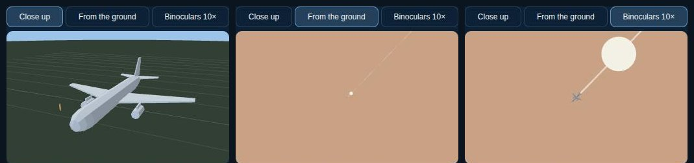

| | |
|---|---|
| **Planes by type** | Every aircraft is sorted into one of eight classes (wide-body, narrow-body, regional jet, turboprop, business jet, light aircraft, helicopter, fast jet) from its ICAO (International Civil Aviation Organization) type code, its ADS-B (Automatic Dependent Surveillance–Broadcast) emitter category or, when neither is known, its speed and height. Zoomed out, each class is a flat silhouette; below about 760 km the planes become low-poly 3D models (`planes3d.js`, about 300 triangles each, one instanced draw call per class), and close to the ground they are drawn at their real size. The live-data snapshot now records the emitter category (`?extended=1` on OpenSky). |
| **From the ground** | The flight panel has a small 3D viewer (`planeview.js`): **Close up** turns the model next to a 1.8 m person; **From the ground** puts you below, looking up at 60° to the plane's real height, with the Moon at its true size beside it; **Binoculars 10×** magnifies the same patch of sky. The caption works out the angle it spans (an A320 at 35,000 ft is about a third of the Moon's width). |
| **News that always loads** | GDELT (Global Database of Events, Language, and Tone) often refuses browsers or goes down. The live-data job now saves each news topic every 20 minutes, and when the GEO 2.0 API itself is down it builds the same map from GDELT's 15-minute event export. The site falls back to that copy automatically. |
| **Easier zooming** | The mouse wheel and trackpad pinch zoom **towards the cursor**, smoothly, from orbit to street level in about 30 notches (the old wheel needed about 60). Every card for something on the ground has **Zoom to street level** and **Show the area**; double-click dives in faster; the closest zoom is now about 570 m up. |
| **No grey haze** | Sharp satellite imagery now switches in from about 4,800 km up instead of 760 km, so the stretched 4K globe picture (a blue-grey blur at mid zoom) is gone. Pulsing rings for news and earthquakes had stopped shrinking as you zoomed in and washed over whole regions; they now keep their size on screen. Night shading follows you down to the ground instead of vanishing below 5 km. |
| **More cameras** | New daily sources: Autobahn GmbH (Germany), DGT (Spain), Vegagerðin (Iceland), the Freeway Bureau (Taiwan, live motion-JPEG streams), NZ Transport Agency (New Zealand), Live Traffic NSW (Australia), DriveBC (British Columbia) and Québec 511. Each source is optional: a failing one keeps its previous list. Mainland China's road agencies publish no open camera feeds, so Hong Kong and Taiwan cover the region. |

---

## 🧭 History — Terra Atlas v1.11: a layout where nothing overlaps

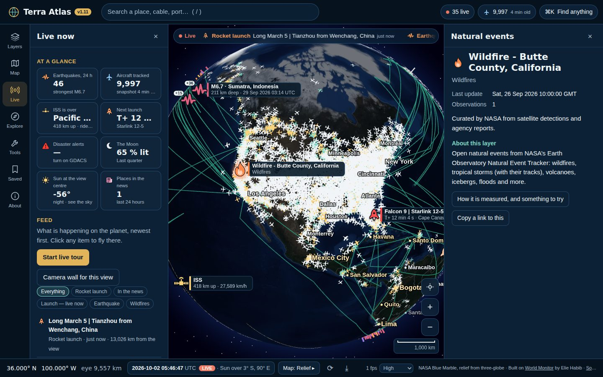

| | |
|---|---|
| **Fixed regions** | The window is now a fixed layout: a top bar (search, live count, flights count and snapshot age, Find anything), a **section rail** on the left, one section drawer, the globe, a **Details** drawer on the right and a one-line status bar. The globe is resized to the space between the drawers, so panels never cover each other, the zoom buttons or the time machine. An automated check of every chrome element at 1920, 1440, 1280, 1100, 900 and 390 px wide, with details, the time machine, a toast and the Map section open, finds no overlaps. |
| **Sections** | **Layers** (a filter box, an "On the map" strip where × hides a layer, groups that fold away, and options shown only for layers that are on) · **Map** (base map, sensor look, street-level detail, frame rate) · **Live** (an at-a-glance board, then the feed) · **Explore** (start-here cards, tours, quiz, lessons) · **Tools** (measure, trace, sky, area scan, flights board, ISS ride, flight finder, camera wall, time machine, replay, share, save, picture, spin) · **Saved** · **About**. |
| **At a glance** | Earthquakes in the last 24 hours (and the strongest), aircraft tracked, where the ISS is right now, a countdown to the next launch, red and orange disaster alerts, the Moon's phase, the Sun's height at the view centre and places in the news. Each tile opens the matching view. |
| **Easier to move around** | The Details drawer has a **Back** button. Esc closes the details first, then the section. `?` opens the keyboard list. On windows narrower than 1,280 px only one drawer is open at a time, and on phones the rail becomes a tab bar and the drawers become sheets. |
| **Faster** | Undersea cables and pipelines are drawn as one batch of GPU-widened lines (`fatlines.js`) instead of 90 separate thick-line objects, and earthquake pulses are one GPU-animated object (`pulses.js`) instead of dozens of lines rebuilt every frame. Draw calls with the default layers fell from 157 to 36. The drawing resolution also adapts to a pixel budget (about 4 million pixels on High), so big and high-DPI screens no longer render far more pixels than they need. Long tasks in the zoom-and-drag test fell to one (74 ms). |

---

## 🌌 History — Terra Atlas v1.10: smooth and steady, plus the sky above you

| | |
|---|---|
| **Fixed: blank flashes** | The idle renderer (v1.7) skipped drawing when the globe was still, but globe.gl's render pass cleared the screen first. On normal 60 fps screens that gave blank or black flicker. The whole render pass is now skipped, so the last frame simply stays on screen. |
| **Fixed: map stopped updating with real data** | Merging layers used `push(...array)`, which overflows JavaScript's call stack past ~100,000 items. The full plate-reader and camera sets hit that, so the map silently stopped refreshing. |
| **Fixed: stutter** | The hovered country was re-triangulated as a filled polygon on every change (and filled the whole screen up close); it is now a cached outline, and nothing hover-related runs while you drag. Plate-reader data is reused between camera moves, and the click index is cached per layer with numeric keys. Long tasks during a zoom-and-drag test with real data fell from 25 (2.2 s, worst 213 ms) to 4 (0.3 s, worst 104 ms). |
| **Steadier markers and names** | City names are placed so they never overlap each other or a symbol. Markers that were showing keep a head start, so they stop reshuffling every time the camera pauses, and labels fade out at the planet's edge instead of piling up there. Fewer name cards are open at once. |
| **Planes glide on the GPU** | Each plane carries its velocity into the vertex shader, so motion is perfectly smooth at any frame rate with no CPU cost (positions are re-based every 5 s). Moving 10,000 planes on the CPU now takes 3 ms instead of 18. Heights are exaggerated less from far away, so planes no longer make a fuzzy halo around the planet. Hover a plane for its callsign, height and speed. |
| **Sky above here** | Click any spot on the ground, then **Sky above here**, for a live polar chart of the Sun, the Moon, satellites and the planes in that sky, with heights and compass directions, redrawn every 2 seconds (`site/app/js/sky.js`). |
| **Fresher flights** | GitHub often delays or drops 10-minute schedules (the snapshot was found an hour old). Each workflow run now stays alive about 50 minutes and publishes every 4 minutes, and runs queue back to back. Browsers now cache the 250 KB (gzipped) snapshot properly instead of re-downloading it every minute. |
| **Smaller windows** | The side panels now make room when the bottom bar wraps onto two rows, and the top bar drops the Lessons and Home links on narrower screens. |

---

## 🛫 History — Terra Atlas v1.9: gliding planes, airport boards, flight search and shareable links

| | |
|---|---|
| **Planes glide** | Between data updates every airborne plane keeps moving along its heading at its ground speed, redrawn twice a second (once a second on the Fast setting). Planes no longer jump every few seconds, and a followed flight stays centred. |
| **Airport arrivals and departures** | Click any airport to see what is arriving (with a landing estimate), departing and on the ground right now. It is worked out from each nearby plane’s heading, height and climb rate relative to the runway. Click a flight to open its seatback view. |
| **Find any flight** | In the command palette (<kbd>Ctrl</kbd>+<kbd>K</kbd>), type a callsign (`BAW12`), an airline prefix (`UAL` lists every United flight in the air), a registration (`N123AB`) or a type (`A388`). |
| **Shareable links** | Every card has a **Copy a link to this** button. The link reopens the same camera, base map and layers with that earthquake, launch, ship, airport or flight already selected. |
| **Live data confirmed** | The `live-data` snapshot now uses an OpenSky API login and carries about 9,600 aircraft worldwide every 10 minutes, plus launches, disaster alerts and orbits. |

---

## 🔥 History — Terra Atlas v1.8: every marker is the shape of what it is

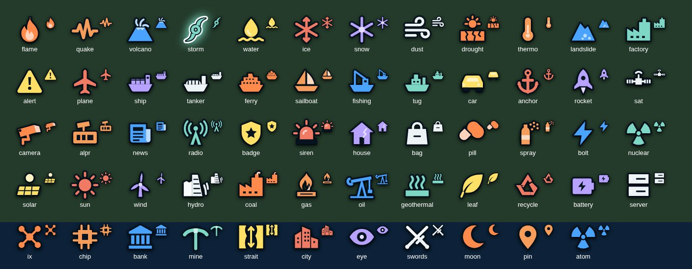

| | |
|---|---|
| **Symbols instead of bubbles** | Markers used to be identical teardrop pins with a small icon inside. Now each marker *is* its symbol, with no bubble around it: a flame for a wildfire, a seismogram for an earthquake, a hurricane spiral for a tropical storm, a cargo ship, tanker, ferry, sailing boat, fishing boat or tug for each AIS ship type, a pump jack, wind turbine, dam, solar panel, reactor trefoil or smokestack for each power-plant fuel, a car, house, bag, pill, spray can or siren for each kind of crime report, a CCTV camera, a plate reader, a rocket, a satellite for the ISS, and the Sun and Moon where they are overhead. 58 symbols in total, drawn as vector paths (`site/app/js/icons.js`) in the layer's colour with a dark halo, so they read on satellite imagery and on dark oceans alike. |
| **Size means something** | Bigger earthquakes, bigger power stations and busier internet buildings get bigger symbols (from 24 to 38 px). The one you clicked grows and gets a white halo. |
| **A key for every layer, and filters** | Each layer lists the kinds currently on the map (in the layer list and in Learn). Click a kind to hide or show it, for example only wildfires, or no thefts. |
| **Everywhere, at every zoom** | Symbols now show from the whole-globe view, where the most important items are shown first, down to street level. They also appear next to layer names, in hover cards, in field notes and in the Live feed and ticker. Click a “+N” badge to zoom into a cluster. |

<table>
<tr>
<td width="50%">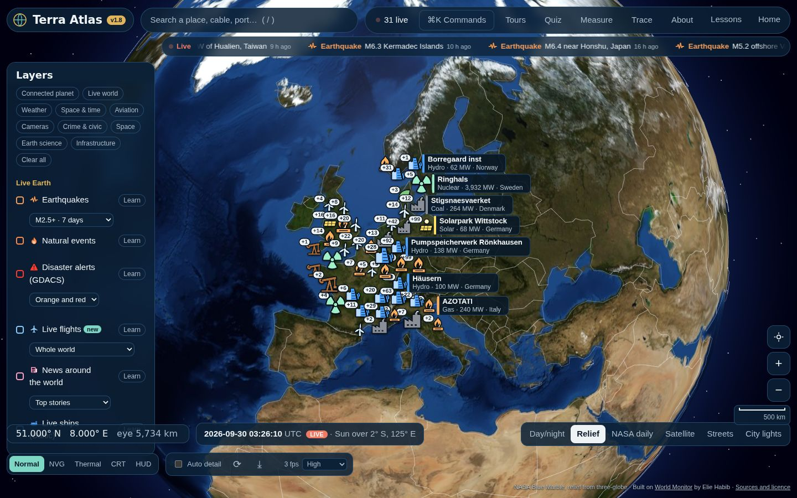 <b>Power plants by fuel</b>, sized by capacity.</td>
<td width="50%">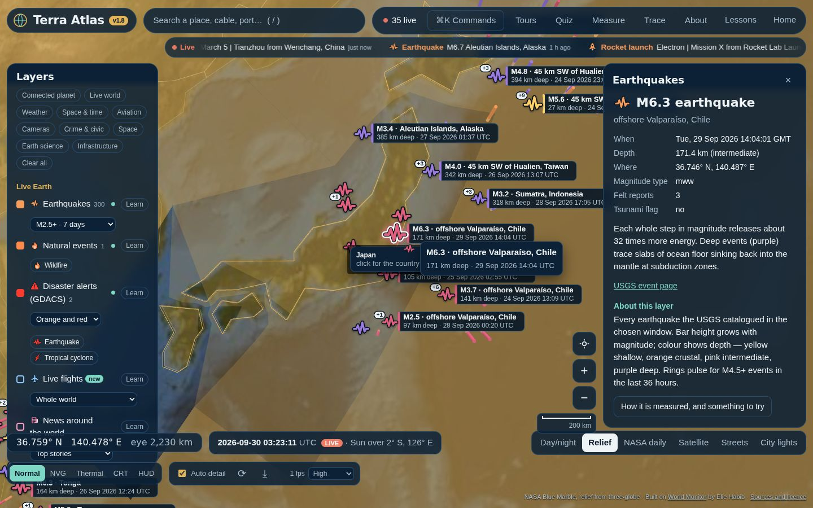 <b>Earthquakes</b> as seismograms, sized by magnitude and coloured by depth.</td>
</tr>
<tr>
<td>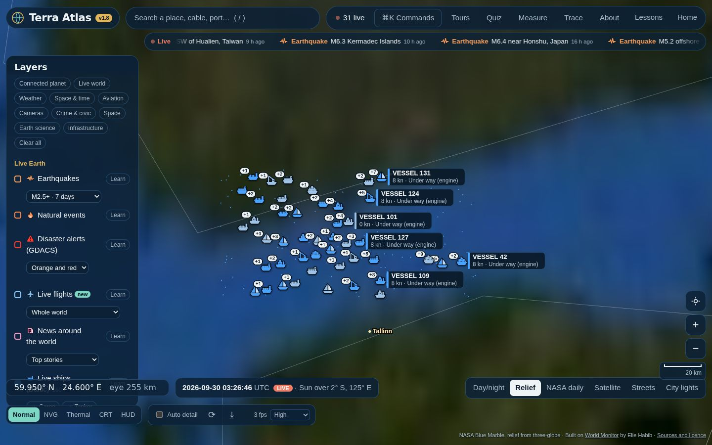 <b>Ships by type</b> from their AIS type code (test data).</td>
<td>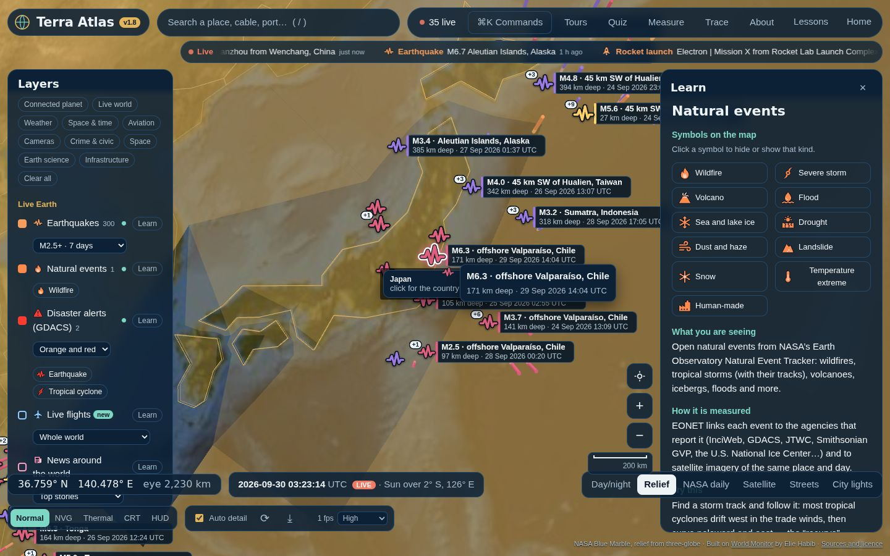 <b>Every layer has a key.</b> Click a symbol to filter.</td>
</tr>
</table>

---

## ✈ History — Terra Atlas v1.7 — live flights everywhere, a smoother globe, and the Moon

| | |
|---|---|
| **Live flights that actually load** | Flight trackers (OpenSky, airplanes.live, adsb.lol, adsb.fi) don’t send the Cross-Origin Resource Sharing (CORS) headers that browsers require, so a web page can’t read them and in v1.6 planes often never appeared. Now there are three routes. **(1) Website:** a GitHub Actions job (`.github/workflows/live.yml` + `tools/fetch-live.mjs`) fetches every aircraft worldwide every ~10 minutes and force-pushes it as one commit to an orphan `live-data` branch, which `raw.githubusercontent.com` serves with CORS headers. Your browser then moves each plane forward along its heading at its ground speed until the next snapshot (dead reckoning). **(2) Desktop app:** a native Rust command (`fetch_text`, allowlisted hosts only) reads OpenSky every 90 s and the regional exchanges every few seconds, fully live. **(3) Optional:** a 60-line Cloudflare Worker in `proxy/` gives the website real-time flights as well. |
| **Every layer says where its data came from** | Under each layer, in plain words: “4,000 aircraft from the live-data snapshot (7 min old, positions projected forward)”, or exactly what to do when a source is down. Launches, disaster alerts and satellite orbits now fall back to the same snapshot when their live source is blocked or rate-limited. |
| **Flights board** | How many aircraft are up and on the ground, height bands, the fastest (usually riding a jet stream), the highest, and any emergency squawks; click one for its seatback view. |
| **Ride along with the ISS** | The camera follows the space station, showing which country or ocean it is over, its height and speed, and whether it is day or night below. Zoom freely while riding; grab the globe to stop. |
| **Moon and tides** | Where the Moon is straight overhead right now, its phase and distance, the next new, quarter and full moons, the moonrise/moonset line, and the two tidal bulges (low-precision Astronomical Almanac formulas, about 0.3° accurate). |
| **Command palette (Ctrl+K / ⌘K)** | Type to find any of 45 layers, presets, tours, base maps, looks, 2,500 cities, actions, and your own **saved views** (camera + base map + layers, kept in your browser). |
| **Smoother and lighter** | An idle render governor draws at full speed while you interact, 30 fps when only something is animating, and 5 fps when the picture is still, so the GPU and fans rest and the main thread is free for data. Shader error checks no longer block start-up (13.5 s → 5.6 s of start-up long tasks on a software renderer), the drawing buffer is no longer preserved every frame, and the desktop app asks WebView2 for GPU rasterisation. |

<table>
<tr>
<td width="50%">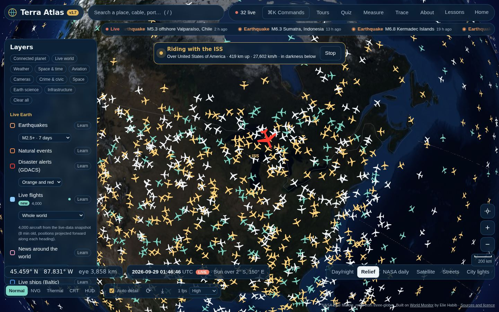 <b>Ride along with the ISS</b>, with live flights underneath.</td>
<td width="50%">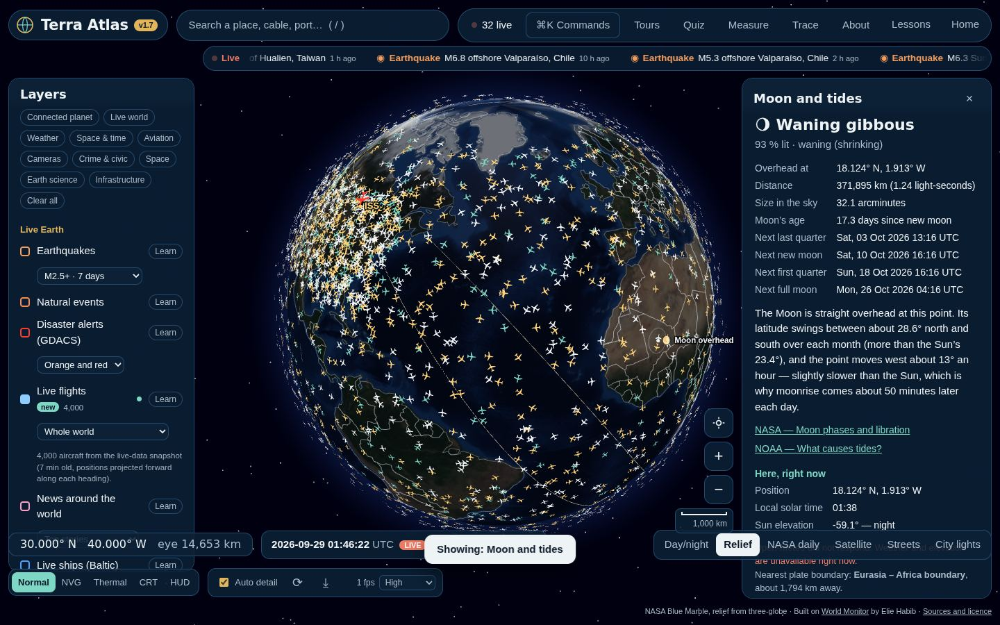 <b>Moon and tides</b> — phase, distance and the next full moon.</td>
</tr>
<tr>
<td>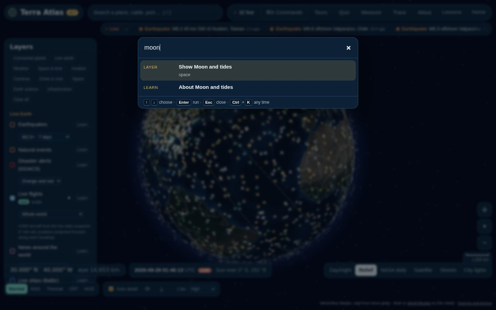 <b>Command palette</b> — Ctrl+K from anywhere.</td>
<td>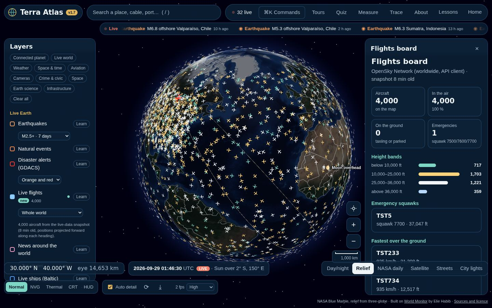 <b>Flights board</b> (screenshot uses test data).</td>
</tr>
</table>

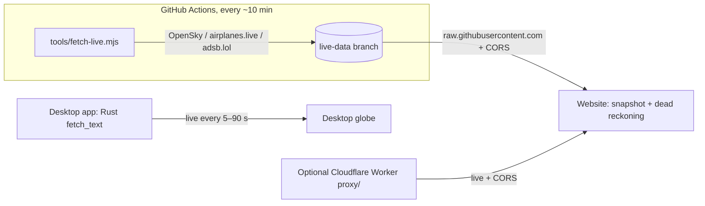

---

## ⏱ History — Terra Atlas v1.6 — time and connections

| | |
|---|---|
| **Time machine** | Click the clock (or press `[` `]`) to run the planet from −1 h/s to +6 h/s, pause it, or drag up to 7 days back. The Sun, the day/night line, satellites, space stations and the ISS ground track all follow the clock; **Replay quakes** plays the last week of earthquakes in order at one hour per second. `\` returns to live time. |
| **Trace (press C)** | Click any spot to draw how it is wired to the world: the nearest internet exchange buildings and the busiest regional hub, the undersea-cable landing and every coast those cables reach, power stations within 150 km by fuel, the nearest airport, public cameras and radio receivers, and a beam to every tracked satellite above the horizon — each with its light-speed delay. |
| **Rocket launches** | The next 25 orbital launches from The Space Devs’ Launch Library 2 at their pads, with live countdowns, mission and orbit, launch-weather odds, and webcast links; pads with a launch in the next 24 hours pulse and live webcasts show red. “Why launch from here?” works out the pad’s free speed from Earth’s spin. |
| **Wind and temperature now** | Thousands of streaks drifting with the current 10 m wind over a 2 m temperature map. The grid is fetched from Open-Meteo every 6 hours during the Pages deploy (never committed); the motion is computed in the browser every frame. |
| **Disaster alerts** | Orange and red GDACS alerts (UN OCHA and European Commission) for earthquakes, cyclones, floods, volcanoes, wildfires and droughts; red alerts pulse and join the Live ticker. |
| **Pins at every zoom** | Pins now stand on the ground and are re-seated as you zoom, so they stay under the cursor and clickable all the way down to street level (previously they floated ~30 km up and vanished behind the camera). Columns shrink with zoom, the item you clicked stays pinned, and cluster badges replace hidden columns up close. |

<table>
<tr>
<td width="50%">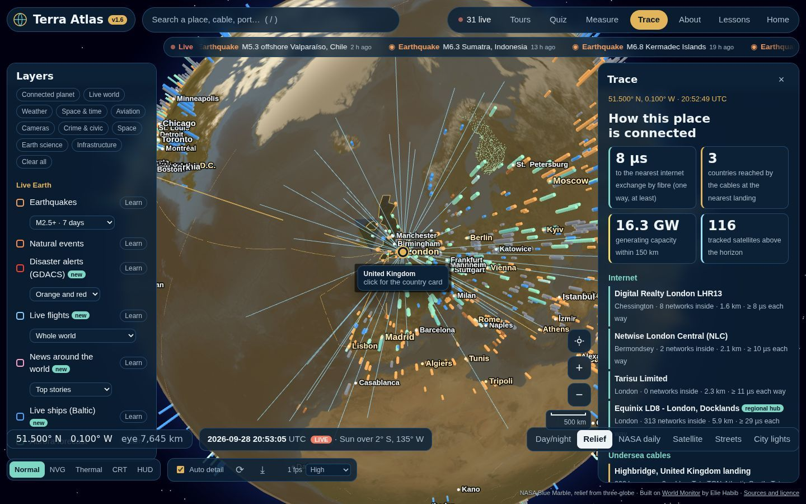 <b>Trace</b> — how London is wired to the world.</td>
<td width="50%">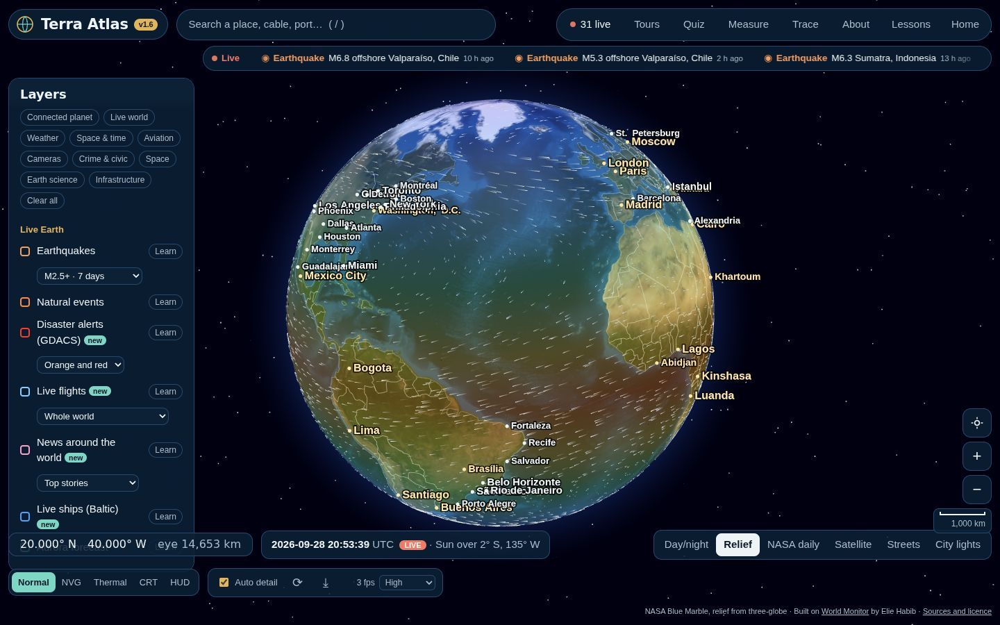 <b>Wind and temperature now</b>.</td>
</tr>
<tr>
<td>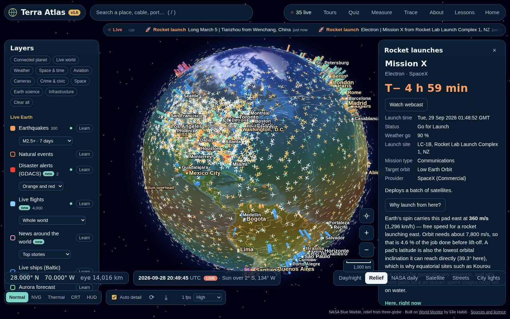 <b>Rocket launches</b> with live countdowns and webcasts.</td>
<td>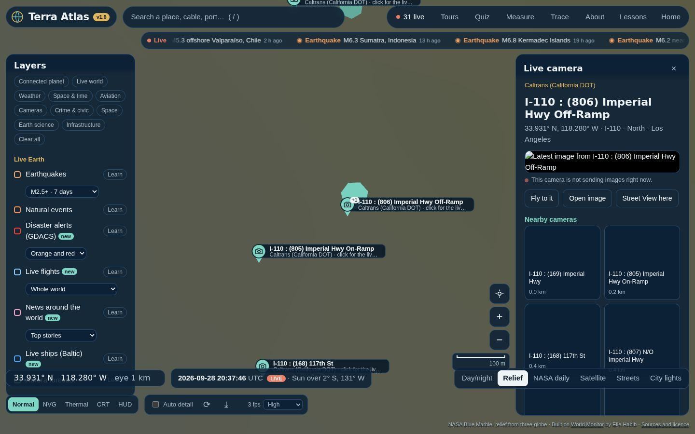 <b>Pins at maximum zoom</b> — still on the street and clickable.</td>
</tr>
</table>

---

## ⚡ History — Terra Atlas v1.5 — fast and detailed

| | |
|---|---|
| **New marker engine** | Every column from every layer is now one instanced mesh (one draw call), and pins and place names are cached canvas sprites instead of DOM elements and 3D text. In a test with 11 layers on over Los Angeles, draw calls fell from 778 to 164 and the freeze after the camera stopped fell from 11.4 s to none over 50 ms. |
| **Map-style pins** | The nearest markers become teardrop pins with icons; the closest get a label card (name and details), cards never overlap, and markers too close together fold into a “+N” cluster badge — like a web map. |
| **Hover cards everywhere** | Point at anything for its details. Hover and click use a latitude/longitude grid index, so finding the thing under the cursor takes microseconds instead of projecting every marker. |
| **No more freezing** | Work after a camera move is split into small slices that yield to the browser between layers, and a newer move cancels the older one. Marker shaders are compiled up front, particle sets are reused, and ray-casting is switched off for the big custom objects. |
| **Quality governor** | Bottom right: a live frame-rate meter and Auto / High / Balanced / Fast. Auto steps down on slow devices (fewer pins, cards and columns, lower pixel ratio, no atmosphere). |

---

## ◎ History — Terra Atlas v1.4 — the connected planet

| | |
|---|---|
| **Overwatch HUD** | Sensor look 5 (or the *HUD* button): a heads-up display over the globe with a rotating crosshair and live read-outs of what is within range — flights, cameras, power, networks, radio — and the nearest of each. |
| **Area scan (press S)** | Pulls every public layer together for the spot under the crosshair: aircraft in range, the tracked satellites that can see that spot *right now* (computed with SGP4 look angles), cameras, internet buildings, power plants, radio receivers, weather, local time and the nearest of each, one click away. |
| **NASA satellite overlays** | Wrap the globe in today’s clouds, rain and snow from the last 30 minutes (IMERG), active fires, last night’s lights, sea-surface temperature, smoke and dust, or snow cover — NASA GIBS images on a transparent shell. |
| **Power plants** | 10,700 plants ≥ 50 MW from the WRI Global Power Plant Database, coloured by fuel with a fuel filter, capacity, generation and owner. |
| **Internet exchanges & data centres** | PeeringDB colocation buildings sized by the number of networks inside — where the internet physically meets. |
| **Live radio receivers** | Public KiwiSDR shortwave receivers worldwide; click one to open it and listen live from that spot on Earth. |
| **Live ships** | Every AIS-broadcasting vessel in the Baltic from Fintraffic’s open feed, plus Finnish road weather cameras in the camera layer. |
| **Satellite footprints** | Any satellite card now shows *What can it see right now?* — the circle of Earth inside its horizon. |

---

## 🔴 History — Terra Atlas v1.3

| | |
|---|---|
| **Live ticker + Live feed** | A red ticker under the search bar streams what is happening now — earthquakes, storms and wildfires, news, and aircraft squawking emergency codes. The **Live** button opens the full feed with filters; **Start live tour** flies from event to event hands-free. |
| **News pins** | Places in the news in the last 24 hours (GDELT), by topic — top stories, disasters, conflict, protests, science, climate — each with its headlines and links to the original articles. |
| **Crime maps** | Official incident reports for Chicago, San Francisco, New York City, Los Angeles and all of England, Wales and Northern Ireland, as 3D hexagon density columns plus pins, with dates, categories and a lesson on reading the numbers fairly. |
| **Camera wall** | Twelve live cameras nearest the centre of your view in one grid, refreshing every 20 s. Plus London JamCams and Hong Kong cameras. |
| **Apply button and presets** | Tick and untick layers, then press **Apply** — nothing changes until you do. One-click presets: Live world, Aviation, Cameras, Crime & civic, Space, Earth science, Infrastructure. Every layer shows a live count. |
| **Flight emergencies** | Aircraft squawking 7500 / 7600 / 7700 are drawn large in red with a pulsing ring and pushed to the Live feed. |
| **Fixes** | Shared objects no longer vanish when layers are toggled (the cause of flights or pins disappearing), and the first visit after an update resets old layer lists saved in the address bar so new layers actually appear. A **What’s new** card and a version badge show which build you are on. |

---

## ✨ History — Terra Atlas v1.1

| | What you get |
|---|---|
| ✈️ **Every flight in the sky** | Live aircraft worldwide (OpenSky) or in detail around your view (adsb.lol), drawn as plane pointers turned to their real heading and coloured by altitude — tens of thousands in a single draw call. |
| 🪟 **Seatback flight view** | Click a plane for an airline-screen style panel: origin → destination with progress, altitude, ground speed, heading, climb rate, outside air temperature, distance and time to go, weather and local time at the destination, and a photo of the actual aircraft. *Follow* keeps the camera on it; *Window view* drops you to satellite imagery beneath it. |
| 📹 **Live traffic cameras** | About 6,000 public road cameras: Caltrans (all 12 California districts), NYC DOT, Transport for London JamCams and Hong Kong’s Transport Department (511 Ontario and Alberta when their feeds respond). Stills refresh every 15 s; Caltrans streams play live and London cameras play a recent video clip. Every camera shows the nearest others as a camera wall. |
| 🚨 **Licence-plate readers** | Flock Safety and other ALPR cameras mapped in OpenStreetMap (largely via DeFlock), with maker, operator and facing direction, a neutral Learn card on the privacy debate, and a live refresh from OpenStreetMap for the area you are viewing. |
| 🛰 **Clickable satellites and the ISS** | Click any satellite for its orbit class, perigee and apogee, inclination and period, draw its full orbit, and get the next times it passes over you. |
| 📍 **Map-style pins and names** | 2,500 city names and 3,300 airports appear as you zoom, like a web map. Close up, markers turn into icon pins with labels. Named places get a Wikipedia summary and photo. |
| 👀 **Look around** | Any point: Street View, Google Earth 3D, Mapillary, open Panoramax street photos and the nearest live cameras. |
| 🧭 **Navigation that behaves like Google Maps** | Dragging covers about one screen of ground at any zoom, each scroll notch changes height by about 15 %, double-click zooms in, arrows pan, `+`/`−` zoom, a locate-me button and a scale bar. Lines and markers keep the same on-screen size at every zoom. |
| ⚡ **Faster start** | 2K textures first and 4K when idle, a procedural star field instead of a 900 kB image, a 30 % smaller 3D engine bundle, and capped pixel ratio on high-density screens. |

> Camera lists and the licence-plate-reader snapshot are collected once a day by [`data.yml`](.github/workflows/data.yml) (run it once by hand after installing: `gh workflow run data.yml`). Flights, satellites and camera pictures are always live.
