# Changelog

Release notes for Global Intelligence Atlas (GIA), newest first. Versions before 2.0 were released as Terra Atlas, an educational fork of [World Monitor](https://github.com/koala73/worldmonitor) by Elie Habib. The [README](README.md) describes the project as it is now; the roadmap and progress tracker are in [README → Progress](README.md#-progress) and [`HANDOFF.md`](HANDOFF.md) section 9.

---

## 📰 v2.12: a News tab with world headlines and free live news channels

- **News in the rail** (between Tools and Intel), modelled on World Monitor's news feeds and live news panel.
- **Headlines:** the latest stories from 16 publishers' own RSS and Atom feeds: BBC News (world and six regions), The Guardian, Deutsche Welle (DW), France 24, NPR (National Public Radio), CBC News (Canadian Broadcasting Corporation), MercoPress, Al Jazeera, Africanews, The Hindu, CNA (Channel NewsAsia), The Japan Times, The Kyiv Independent, ABC News (Australian Broadcasting Corporation), RNZ (Radio New Zealand) and UN News. Filter by region or word; each story opens on the publisher's site. Only the title, time and link are kept.
- **Live TV:** 22 news channels from broadcasters' official free streams: their YouTube live stream through the embedded player, or their own HLS stream where browsers may play it (Al Jazeera, DW, NHK World-Japan, TRT World, CGTN, Arirang, CBS News, tagesschau24 and RTVE's Canal 24 Horas). Sound starts muted, one channel plays at a time and playback stops when you leave the tab. No relays, re-streams or sanctioned channels.
- **Ownership labels** on every headline and channel: public, state-controlled or state-funded, commercial or intergovernmental.
- **`news.yml`** reads the feeds and checks the channels every 30 minutes and writes the `news-data` branch; a branch push checks every source live and publishes nothing. Each publisher and channel is credited in `sources.js` and the APA references.

---

## 🌐 v2.11: cameras worldwide, the World Monitor baseline, property and industry

- **Traffic cameras from 22 more agencies:** Arizona, Florida, Georgia, North Carolina, Louisiana, Indiana, Michigan, Washington, Nevada, Utah, Oregon and Houston in the United States; Edmonton, Ottawa and Toronto in Canada; Singapore; Japan's river cameras; Italy's motorways, Sweden, Poland and city cameras in the Balkans and Switzerland. Ontario and Alberta no longer need a key. The last live check collected 34,537 traffic cameras.
- **900 public webcams in 74 countries from [Osiris](https://github.com/simplifaisoul/osiris)'s list**, including Japan, South Korea, Southeast Asia, Africa, Latin America and the two public mainland China webcams it lists. Mainland China publishes no open traffic camera feeds; Hong Kong and Taiwan are covered by their transport departments. Cameras whose publishers block embedding are page links only.
- **The rest of World Monitor's map datasets as layers:** military bases (all operators), gamma irradiators, technology headquarters, cloud regions, AI labs, startup ecosystems, financial centres, mining sites, commodity hubs and Gulf investments.
- **Markers that share a spot:** close up they fan out round it, each with its own symbol; further out a click on the "+N" badge or the spot lists every one. Satellites and other things in space are never spread or listed, and still show at their own height.
- **Economy, property and industry** (new group): house prices by area (U.S. Federal Housing Finance Agency (FHFA), UK House Price Index, Eurostat, Organisation for Economic Co-operation and Development (OECD)), U.S. county home values and rents (American Community Survey (ACS)), homes sold in England and Wales by postcode district (HM Land Registry Price Paid Data, no addresses kept), what each country exports (CEPII BACI), heavy industry with emissions (Climate TRACE) and factories mapped in OpenStreetMap. The monthly `economy.yml` job writes the `economy-data` branch.
- **Checks before merging:** `camera-check.yml` and `economy.yml` try every source live on a branch push and publish nothing; the live-data status now says whether OpenSky Network keys are missing or their login failed.

---

## 🚀 v2.10: the Global Intelligence Atlas (GIA) repository launch

- **A new README** with a feature gallery, a web app versus desktop app comparison, a progress tracker, architecture diagrams and the references; the version notes moved here.
- **Faster in the browser:** the page asks for the globe engine and the first modules in parallel (`modulepreload`), and on repeat visits the service worker answers the 1.4 MB engine, the Earth textures and images from its cache at once, refreshing them in the background.
- **Same app on the web and the desktop:** both run the same `site/` folder; the desktop release now says so and links the web app.
- **Real screenshots from the live site:** the manual **Refresh README screenshots** workflow retakes the README pictures and the spinning-globe GIF from GitHub Pages.

---

## 🗺️ v2.9: open data in place of World Monitor's lists

- **Open data for infrastructure:** Ports (every large, medium and small harbour in the U.S. National Geospatial-Intelligence Agency (NGA) World Port Index, with depths), Nuclear sites, Spaceports, Financial centres and Critical minerals (Wikidata), Undersea cables (TeleGeography's Submarine Cable Map) and Chokepoints (the U.S. Energy Information Administration (EIA) list) can draw independently sourced open data. The monthly **Open data** workflow (`tools/fetch-open-data.mjs`) writes it to the `open-data` branch.
- **About → Datasets:** open data where available (the default), open data only, or World Monitor's curated lists as before; `"datasets"` in `config.json` or `?datasets=` sets it. Pipelines, trade routes, AI data centres, conflict zones and watch regions still use World Monitor's lists. World Monitor and Elie Habib stay credited everywhere.

---

## 💧 v2.8: pesticides measured in rivers, lakes and wells

- **Pesticides in rivers and wells:** sample results from the Water Quality Portal (U.S. Geological Survey, U.S. Environmental Protection Agency (EPA), states and tribes) for 15 pesticides, including atrazine, simazine, metolachlor, glyphosate, 2,4-D, chlorpyrifos and imidacloprid, over the last three years. Pick one pesticide, wells, rivers or lakes, and detections only. Red sites were above an EPA drinking-water limit (maximum contaminant level); each site's card lists every pesticide with its highest value, how often it was found, the last sample date and a link to the raw results.

---

## 🏭 v2.7: pollution burden by neighbourhood and environmental violations

- **Pollution burden, California tracts:** CalEnviroScreen 4.0 from the Office of Environmental Health Hazard Assessment for every census tract. Pick the overall score or one indicator (pesticide use nearby, fine particles, diesel, drinking water, lead, traffic, cleanup sites, asthma, poverty and more) and see each neighbourhood's percentile; the card lists them all.
- **Environmental violations:** facilities the EPA or a state found in violation of a permit, took formal action against or fined, from ECHO (Enforcement and Compliance History Online), with inspections, penalties and a link to the EPA's report.

---

## ☁ v2.6: chemicals and environment, down to the square mile

- **Pesticide use, California:** every farm pesticide application reported to the California Department of Pesticide Regulation (Pesticide Use Reporting), added up for each one-mile survey section. Pick one chemical, tick **Aerial applications only** to see crop dusting, and read the month-by-month bars. A section's card lists its pounds, aerial share, main chemicals, crop, county and survey section.
- **Pesticide estimates, U.S. counties:** the U.S. Geological Survey's estimate of each pesticide used on farms in every county of the lower 48 states.
- **Toxic chemical releases:** every facility in the EPA Toxics Release Inventory, with its top chemicals and how much were known or suspected carcinogens.
- A monthly workflow (`regional.yml` + `tools/fetch-regional.mjs`) downloads the yearly files and boils them down onto a `regional-data` branch. Run it once after pushing.

---

## 🧩 v2.5: layers that describe themselves, editions and plug-ins

- **Layer manifest** (About → Layer manifest): every layer with its data sources, their licences, how often it refreshes and what it can do; download it as JSON.
- **Editions** from one codebase: `?edition=classroom` for schools (no surveillance cameras, plate readers, crime, conflict, news or Intel) and `?edition=lite` for slow devices. Site owners set `"edition"` in `site/app/config.json`.
- **Plug-in layers:** drop a module into `site/app/plugins/` and add `?plugins=name` (or `"plugins"` in `config.json`). Each plug-in is checked before it is added. Try `?plugins=daylength` for hours of daylight today at every latitude; the guide is [`site/app/plugins/README.md`](site/app/plugins/README.md).

---

## ⏪ v2.4: replay the last two weeks

- **Replay the last days** (Layers → Live): every aircraft (coloured by height), every ship and the disaster alerts in force, saved once an hour for 14 days, plus the magnitude 4+ earthquakes of the 24 hours before each hour from the USGS catalogue. Drag the slider under the layer, press Play or step an hour at a time; day and night follow the replayed hour, and turning the layer off returns to now.
- A new hourly workflow (`history.yml` + `tools/build-history.mjs`) keeps the frames on an orphan `history` branch, about 200 KB an hour, force-pushed as one commit so it never grows past 14 days.
- **20 reference projects** for visuals, presentation, frameworks and modelling theory are credited in About, on the credits page and in [`docs/REFERENCES.md`](docs/REFERENCES.md) (APA 7th edition). Atlas copies no code from them, and every licence is compatible with AGPL-3.0-only.

| # | Project | Licence | What Atlas takes from it |
|---|---|---|---|
| 1 | [CesiumJS (Cesium GS)](https://github.com/CesiumGS/cesium) | Apache-2.0 | Reference for virtual-globe design: terrain under a globe, time-dynamic scenes driven by one clock, and the timeline widget that inspired the Replay slider. |
| 2 | [deck.gl (vis.gl, OpenJS Foundation)](https://github.com/visgl/deck.gl) | MIT | Reference for batching very large point and trip layers on the graphics card in a few draw calls, as Atlas does for aircraft and ships. |
| 3 | [kepler.gl](https://github.com/keplergl/kepler.gl) | MIT | Reference for time-filtered playback of geospatial data with a play button and a time slider (the Replay layer). |
| 4 | [MapLibre GL JS](https://github.com/maplibre/maplibre-gl-js) | BSD-3-Clause | Reference for vector tiles, label placement and globe projection in an open map renderer. |
| 5 | [3DTilesRendererJS (NASA Jet Propulsion Laboratory, NASA-AMMOS)](https://github.com/NASA-AMMOS/3DTilesRendererJS) | Apache-2.0 | Reference for streaming 3D terrain and buildings into three.js by level of detail, for the street-level and 3D surroundings views. |
| 6 | [Apache ECharts](https://github.com/apache/echarts) | Apache-2.0 | Reference for clear, animated dashboard charts (feed health and counts). |
| 7 | [D3 (Data-Driven Documents)](https://github.com/d3/d3) | ISC | Reference for map projections, scales and colour ramps (Bostock et al., 2011). |
| 8 | [Observable Plot](https://github.com/observablehq/plot) | ISC | Reference for the grammar of graphics: small, honest charts with labelled axes for Learn cards. |
| 9 | [OpenLayers](https://github.com/openlayers/openlayers) | BSD-2-Clause | Reference for handling many tile sources and coordinate reference systems side by side. |
| 10 | [reveal.js (Hakim El Hattab)](https://github.com/hakimel/reveal.js) | MIT | Reference for presentation flow: step-by-step guided tours with keyboard control. |
| 11 | [H3: hexagonal hierarchical geospatial index (Uber)](https://github.com/uber/h3) | Apache-2.0 | Reference for equal-area hexagonal binning to summarise dense points such as fires and aircraft. |
| 12 | [Turf.js](https://github.com/Turfjs/turf) | MIT | Reference for geodesic measures (distance, bearing, point in polygon) used in watch areas and flight paths. |
| 13 | [Supercluster (Mapbox)](https://github.com/mapbox/supercluster) | ISC | Reference for fast hierarchical point clustering by zoom level (marker decluttering). |
| 14 | [PROJ (OSGeo)](https://github.com/OSGeo/PROJ) | MIT | Reference for coordinate transformations, such as the local east-north frame used to place terrain and buildings. |
| 15 | [FilterPy (Roger Labbe)](https://github.com/rlabbe/filterpy) | MIT | Modelling theory: Kalman filtering, the principled form of the dead-reckoning that glides aircraft between position reports (Kalman, 1960). |
| 16 | [traffic (Xavier Olive)](https://github.com/xoolive/traffic) | MIT | Modelling theory: aircraft trajectory processing and analysis from ADS-B data (Olive, 2019). |
| 17 | [MovingPandas (Anita Graser)](https://github.com/movingpandas/movingpandas) | BSD-3-Clause | Modelling theory: movement data as trajectories over time, the model behind the hourly Replay frames (Graser, 2019). |
| 18 | [Skyfield (Brandon Rhodes)](https://github.com/skyfielders/python-skyfield) | MIT | Modelling theory: accurate positions of the Sun, Moon and satellites, used to check the app’s own formulas. |
| 19 | [OSINT Framework (Justin Nordine)](https://github.com/lockfale/OSINT-Framework) | MIT | Reference for organising open-source intelligence tools as a browsable tree (the Intel directory). |
| 20 | [NetworkX](https://github.com/networkx/networkx) | BSD-3-Clause | Modelling theory: graph and network analysis for cables, pipelines, power and trade routes (Hagberg et al., 2008). |

---

## 🏔 v2.3: real terrain and buildings at street level

- **Street level** (flight panel): stand in the real landscape below a plane, at the spot where it is 30° above the horizon. Hills come from [Terrain Tiles](https://registry.opendata.aws/terrain-tiles/), buildings from OpenStreetMap through the Overpass API, raised to their mapped height or number of floors. The plane's height is measured from the real ground there.
- **3D surroundings** (camera cards): the hills and buildings around any camera, with a pin where it stands. Drag to turn, scroll to zoom.
- Built in local metres around one point and merged into one mesh for the ground and one for all buildings, so a whole town costs two draw calls. No key needed.

---

## ⚓ v2.2: ships worldwide

**Live ships** now covers the world. Ships broadcast the Automatic Identification System (AIS); AISStream relays what its receivers hear, but needs a free key and does not allow web pages to connect. So:

- **Website:** add the repository secret `AISSTREAM_KEY` (free at [aisstream.io](https://aisstream.io)). The live-data job listens for a minute every few minutes and publishes every vessel heard in the last 30 minutes.
- **Desktop app:** paste your own key under Live ships in Layers for ships in view, straight from AISStream.
- **Proxy (optional):** `npx wrangler secret put AISSTREAM_KEY` turns on `/ais`, ships in view for website visitors.
- **No key:** the layer shows the Baltic Sea from Fintraffic, as before.

---

## 🔥 v2.1: fires, radar, alerts and a health check

| | |
|---|---|
| **Fire hotspots** | Every active fire NASA’s VIIRS (Visible Infrared Imaging Radiometer Suite) instrument detected in the last 24 hours, from NASA FIRMS (Fire Information for Resource Management System), coloured by fire radiative power. The live-data job saves a copy every 30 minutes; the desktop app reads NASA’s file directly. Optional secret `FIRMS_MAP_KEY` (free) switches the job to the FIRMS area API. |
| **Weather radar** | RainViewer’s global radar mosaic for the past two hours in 10-minute frames, wrapped on a transparent shell, with a time slider and Play button under the layer in Layers. RainViewer’s free tier allows 100 tile requests a minute, so frames are built from a few large tiles and requests are rate-limited. |
| **Watch areas** | Tools → Watch areas: draw a circle, choose earthquakes above a magnitude, GDACS (Global Disaster Alert and Coordination System) alerts, emergency squawks, fire hotspots or a news surge, and get browser or desktop notifications. Stored only in the browser (localStorage). |
| **Data health** | Tools → Data health (also in About): every source’s status, last update, item count and error, from the live-data `status.json`, the aircraft table, the camera collector and this session’s requests. A weekly workflow ([`health.yml`](.github/workflows/health.yml), [`tools/probe-sources.mjs`](tools/probe-sources.mjs)) probes every source and opens a GitHub issue labelled `data-health` when one breaks. |
| **Aircraft types** | A weekly workflow ([`aircraft-db.yml`](.github/workflows/aircraft-db.yml)) turns the OpenSky Network aircraft database into 256 small files on the orphan branch `aircraft-db`. The live-data job fills in each aircraft’s ICAO (International Civil Aviation Organization) type code from it, and the app looks up planes it receives live, so shapes, the flights board and search by type are accurate. |
| **Cameras** | Checked the eight v1.12 sources against the live services: Québec (Web Mercator coordinates, images found on each camera’s Québec 511 page), New Zealand (nested names, relative image paths), DriveBC (relative image paths) and Iceland (field names) are fixed; Spain and New South Wales already matched; Germany’s Autobahn webcam lists are currently empty at the source. 511 Ontario and 511 Alberta now need free developer keys (`ONTARIO_511_KEY`, `ALBERTA_511_KEY`). |

---

## 🕵 Intelligence toolkit (adapted from Osiris)

Tools now has an **Intelligence toolkit**: open-source intelligence (OSINT) lookups anyone can run, each with a short “How this works” lesson. Type anything into one box and it picks the tool.

- **Domain lookup:** Domain Name System (DNS) records, registration through the Registration Data Access Protocol (RDAP), and Certificate Transparency (CT) certificates with the subdomains they reveal.
- **Address or network:** who runs an internet address or autonomous system (AS) number, its Border Gateway Protocol (BGP) announcements, and an approximate place you can fly to on the globe.
- **Software flaw:** a Common Vulnerabilities and Exposures (CVE) record with its Common Vulnerability Scoring System (CVSS) score, Exploit Prediction Scoring System (EPSS) chance, and whether the Cybersecurity and Infrastructure Security Agency (CISA) lists it as exploited.
- **Sanctions search:** the U.S. Treasury Office of Foreign Assets Control (OFAC) Specially Designated Nationals (SDN) list, refreshed daily by `.github/workflows/intel.yml`.
- **Crypto wallet:** Bitcoin and Ethereum balances and history, checked against sanctioned addresses.
- **Conflict monitor:** Osiris’s active conflict zones ranked by live GDELT conflict reports from the last 24 hours.

It is adapted from [Osiris](https://github.com/simplifaisoul/osiris) by simplifaisoul (MIT licence). Osiris runs these lookups on a server; here they go straight from the browser or desktop app to public registries, so the site stays static. Osiris’s port scanner and its searches for private people (usernames, phone numbers, leaked passwords) are deliberately not included.

---

## 🗂 Intel: declassified documents and investigation tools

A new **Intel** section on the left rail brings open-source intelligence (OSINT) to the globe, all running in the browser:

- **Declassified documents:** 52 records that governments once kept secret and have since released officially (Zimmermann Telegram, Venona, the Pentagon Papers, the Stasi files, the Mitrokhin Archive, the Chile and Argentina declassification projects and more), pinned where they happened, on a timeline you can filter by year and topic. Each card links to the archive that holds the original. A directory lists 18 archives in the United States, United Kingdom, Germany, Australia, Canada, India, Japan and Brazil, and a live search finds released documents on the Internet Archive.
- **Redaction inspector:** open a PDF and see whether its black boxes really removed the words, or whether the text is still in the file underneath. It also lists redactions marked but never applied, metadata, and earlier saved versions, and can save a picture-only copy that is safe to share. It reports only what is in the file and never guesses at removed text. A fictional training sample is included.
- **Photo location:** reads the Exchangeable Image File Format (EXIF) data of a photo (camera, time, Global Positioning System (GPS) position) and flies there.
- **Shadow clock:** from an object and its shadow, finds the times of day at a place, or draws on the globe every place the photo could have been taken at a known time.
- **Web archive lookup:** first, latest and nearest saved copies of a web page from the Wayback Machine.

---

## 🧱 v2.0: its own project

Global Intelligence Atlas is no longer a fork. The globe, website, desktop app, data jobs and documentation now live in this repository on their own, without World Monitor’s server code or CI. What remains from World Monitor is credited and kept under the same licence:

| | |
|---|---|
| **What still comes from World Monitor** | The curated static datasets in `site/app/data/worldmonitor-static.json` (undersea cables, pipelines, ports, trade routes, chokepoints, AI data centres, spaceports, nuclear sites, economic centres, critical minerals, conflict zones, hotspots), the country outlines, the original layer catalogue and 3D-globe concept. [`tools/extract-upstream-data.mjs`](tools/extract-upstream-data.mjs) rebuilds that file from any World Monitor checkout. |
| **Licence** | Because those datasets and ideas are AGPL-3.0-only, so is this project. See [`LICENSE`](LICENSE) and [`NOTICE.md`](NOTICE.md). |
| **References** | Every library, data source and paper is listed in APA 7th edition style in [`docs/REFERENCES.md`](docs/REFERENCES.md), starting with World Monitor itself. |
| **Continuing the work** | [`HANDOFF.md`](HANDOFF.md) is a briefing for the next developer or AI agent: the architecture, how data flows, how to test, what is unfinished and a prioritised feature list. |

The release history below keeps the Terra Atlas version notes, since that is how the features arrived.

---

## ✈ History — Terra Atlas v1.12: 3D planes, a view from the ground, and a sharper map

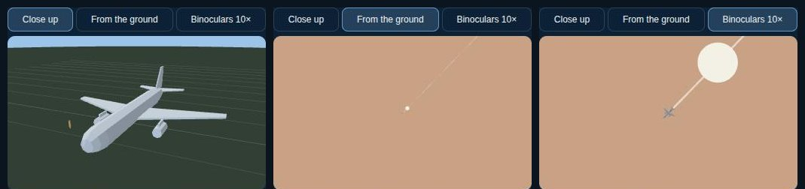

| | |
|---|---|
| **Planes by type** | Every aircraft is sorted into one of eight classes (wide-body, narrow-body, regional jet, turboprop, business jet, light aircraft, helicopter, fast jet) from its ICAO (International Civil Aviation Organization) type code, its ADS-B (Automatic Dependent Surveillance–Broadcast) emitter category or, when neither is known, its speed and height. Zoomed out, each class is a flat silhouette; below about 760 km the planes become low-poly 3D models (`planes3d.js`, about 300 triangles each, one instanced draw call per class), and close to the ground they are drawn at their real size. The live-data snapshot now records the emitter category (`?extended=1` on OpenSky). |
| **From the ground** | The flight panel has a small 3D viewer (`planeview.js`): **Close up** turns the model next to a 1.8 m person; **From the ground** puts you below, looking up at 60° to the plane's real height, with the Moon at its true size beside it; **Binoculars 10×** magnifies the same patch of sky. The caption works out the angle it spans (an A320 at 35,000 ft is about a third of the Moon's width). |
| **News that always loads** | GDELT (Global Database of Events, Language, and Tone) often refuses browsers or goes down. The live-data job now saves each news topic every 20 minutes, and when the GEO 2.0 API itself is down it builds the same map from GDELT's 15-minute event export. The site falls back to that copy automatically. |
| **Easier zooming** | The mouse wheel and trackpad pinch zoom **towards the cursor**, smoothly, from orbit to street level in about 30 notches (the old wheel needed about 60). Every card for something on the ground has **Zoom to street level** and **Show the area**; double-click dives in faster; the closest zoom is now about 570 m up. |
| **No grey haze** | Sharp satellite imagery now switches in from about 4,800 km up instead of 760 km, so the stretched 4K globe picture (a blue-grey blur at mid zoom) is gone. Pulsing rings for news and earthquakes had stopped shrinking as you zoomed in and washed over whole regions; they now keep their size on screen. Night shading follows you down to the ground instead of vanishing below 5 km. |
| **More cameras** | New daily sources: Autobahn GmbH (Germany), DGT (Spain), Vegagerðin (Iceland), the Freeway Bureau (Taiwan, live motion-JPEG streams), NZ Transport Agency (New Zealand), Live Traffic NSW (Australia), DriveBC (British Columbia) and Québec 511. Each source is optional: a failing one keeps its previous list. Mainland China's road agencies publish no open camera feeds, so Hong Kong and Taiwan cover the region. |

---

## 🧭 History — Terra Atlas v1.11: a layout where nothing overlaps

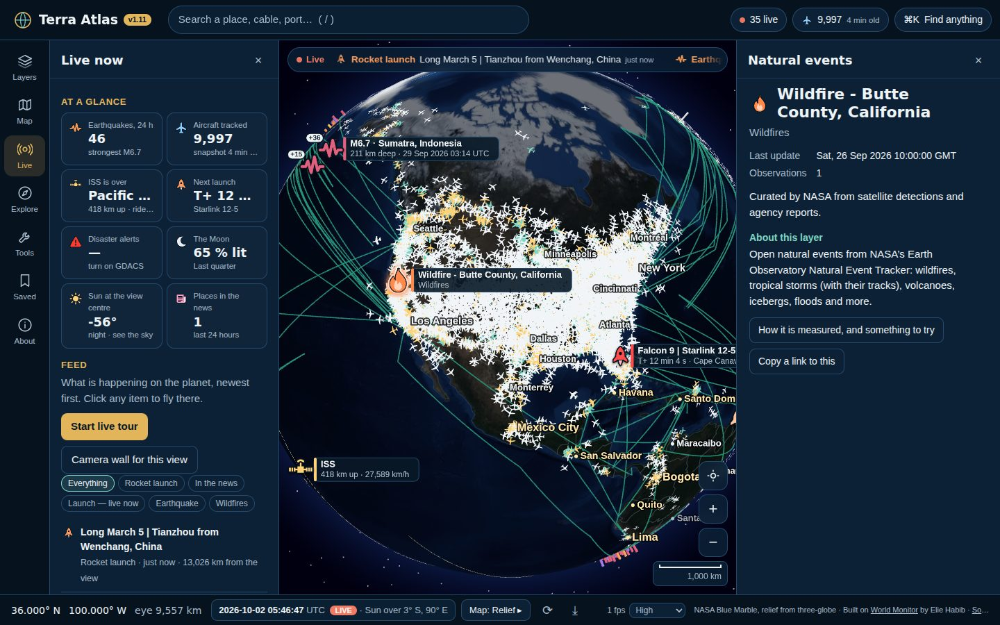

| | |
|---|---|
| **Fixed regions** | The window is now a fixed layout: a top bar (search, live count, flights count and snapshot age, Find anything), a **section rail** on the left, one section drawer, the globe, a **Details** drawer on the right and a one-line status bar. The globe is resized to the space between the drawers, so panels never cover each other, the zoom buttons or the time machine. An automated check of every chrome element at 1920, 1440, 1280, 1100, 900 and 390 px wide, with details, the time machine, a toast and the Map section open, finds no overlaps. |
| **Sections** | **Layers** (a filter box, an "On the map" strip where × hides a layer, groups that fold away, and options shown only for layers that are on) · **Map** (base map, sensor look, street-level detail, frame rate) · **Live** (an at-a-glance board, then the feed) · **Explore** (start-here cards, tours, quiz, lessons) · **Tools** (measure, trace, sky, area scan, flights board, ISS ride, flight finder, camera wall, time machine, replay, share, save, picture, spin) · **Saved** · **About**. |
| **At a glance** | Earthquakes in the last 24 hours (and the strongest), aircraft tracked, where the ISS is right now, a countdown to the next launch, red and orange disaster alerts, the Moon's phase, the Sun's height at the view centre and places in the news. Each tile opens the matching view. |
| **Easier to move around** | The Details drawer has a **Back** button. Esc closes the details first, then the section. `?` opens the keyboard list. On windows narrower than 1,280 px only one drawer is open at a time, and on phones the rail becomes a tab bar and the drawers become sheets. |
| **Faster** | Undersea cables and pipelines are drawn as one batch of GPU-widened lines (`fatlines.js`) instead of 90 separate thick-line objects, and earthquake pulses are one GPU-animated object (`pulses.js`) instead of dozens of lines rebuilt every frame. Draw calls with the default layers fell from 157 to 36. The drawing resolution also adapts to a pixel budget (about 4 million pixels on High), so big and high-DPI screens no longer render far more pixels than they need. Long tasks in the zoom-and-drag test fell to one (74 ms). |

---

## 🌌 History — Terra Atlas v1.10: smooth and steady, plus the sky above you

| | |
|---|---|
| **Fixed: blank flashes** | The idle renderer (v1.7) skipped drawing when the globe was still, but globe.gl's render pass cleared the screen first. On normal 60 fps screens that gave blank or black flicker. The whole render pass is now skipped, so the last frame simply stays on screen. |
| **Fixed: map stopped updating with real data** | Merging layers used `push(...array)`, which overflows JavaScript's call stack past ~100,000 items. The full plate-reader and camera sets hit that, so the map silently stopped refreshing. |
| **Fixed: stutter** | The hovered country was re-triangulated as a filled polygon on every change (and filled the whole screen up close); it is now a cached outline, and nothing hover-related runs while you drag. Plate-reader data is reused between camera moves, and the click index is cached per layer with numeric keys. Long tasks during a zoom-and-drag test with real data fell from 25 (2.2 s, worst 213 ms) to 4 (0.3 s, worst 104 ms). |
| **Steadier markers and names** | City names are placed so they never overlap each other or a symbol. Markers that were showing keep a head start, so they stop reshuffling every time the camera pauses, and labels fade out at the planet's edge instead of piling up there. Fewer name cards are open at once. |
| **Planes glide on the GPU** | Each plane carries its velocity into the vertex shader, so motion is perfectly smooth at any frame rate with no CPU cost (positions are re-based every 5 s). Moving 10,000 planes on the CPU now takes 3 ms instead of 18. Heights are exaggerated less from far away, so planes no longer make a fuzzy halo around the planet. Hover a plane for its callsign, height and speed. |
| **Sky above here** | Click any spot on the ground, then **Sky above here**, for a live polar chart of the Sun, the Moon, satellites and the planes in that sky, with heights and compass directions, redrawn every 2 seconds (`site/app/js/sky.js`). |
| **Fresher flights** | GitHub often delays or drops 10-minute schedules (the snapshot was found an hour old). Each workflow run now stays alive about 50 minutes and publishes every 4 minutes, and runs queue back to back. Browsers now cache the 250 KB (gzipped) snapshot properly instead of re-downloading it every minute. |
| **Smaller windows** | The side panels now make room when the bottom bar wraps onto two rows, and the top bar drops the Lessons and Home links on narrower screens. |

---

## 🛫 History — Terra Atlas v1.9: gliding planes, airport boards, flight search and shareable links

| | |
|---|---|
| **Planes glide** | Between data updates every airborne plane keeps moving along its heading at its ground speed, redrawn twice a second (once a second on the Fast setting). Planes no longer jump every few seconds, and a followed flight stays centred. |
| **Airport arrivals and departures** | Click any airport to see what is arriving (with a landing estimate), departing and on the ground right now. It is worked out from each nearby plane’s heading, height and climb rate relative to the runway. Click a flight to open its seatback view. |
| **Find any flight** | In the command palette (<kbd>Ctrl</kbd>+<kbd>K</kbd>), type a callsign (`BAW12`), an airline prefix (`UAL` lists every United flight in the air), a registration (`N123AB`) or a type (`A388`). |
| **Shareable links** | Every card has a **Copy a link to this** button. The link reopens the same camera, base map and layers with that earthquake, launch, ship, airport or flight already selected. |
| **Live data confirmed** | The `live-data` snapshot now uses an OpenSky API login and carries about 9,600 aircraft worldwide every 10 minutes, plus launches, disaster alerts and orbits. |

---

## 🔥 History — Terra Atlas v1.8: every marker is the shape of what it is

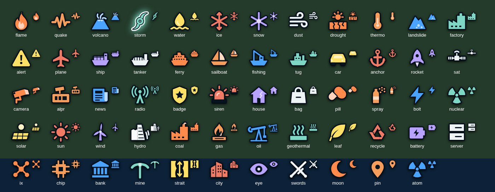

| | |
|---|---|
| **Symbols instead of bubbles** | Markers used to be identical teardrop pins with a small icon inside. Now each marker *is* its symbol, with no bubble around it: a flame for a wildfire, a seismogram for an earthquake, a hurricane spiral for a tropical storm, a cargo ship, tanker, ferry, sailing boat, fishing boat or tug for each AIS ship type, a pump jack, wind turbine, dam, solar panel, reactor trefoil or smokestack for each power-plant fuel, a car, house, bag, pill, spray can or siren for each kind of crime report, a CCTV camera, a plate reader, a rocket, a satellite for the ISS, and the Sun and Moon where they are overhead. 58 symbols in total, drawn as vector paths (`site/app/js/icons.js`) in the layer's colour with a dark halo, so they read on satellite imagery and on dark oceans alike. |
| **Size means something** | Bigger earthquakes, bigger power stations and busier internet buildings get bigger symbols (from 24 to 38 px). The one you clicked grows and gets a white halo. |
| **A key for every layer, and filters** | Each layer lists the kinds currently on the map (in the layer list and in Learn). Click a kind to hide or show it, for example only wildfires, or no thefts. |
| **Everywhere, at every zoom** | Symbols now show from the whole-globe view, where the most important items are shown first, down to street level. They also appear next to layer names, in hover cards, in field notes and in the Live feed and ticker. Click a “+N” badge to zoom into a cluster. |

<table>
<tr>
<td width="50%">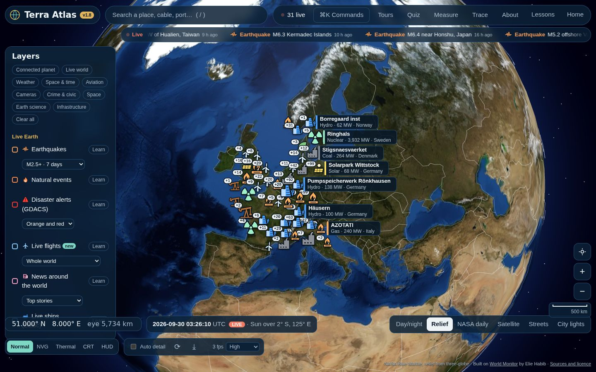 <b>Power plants by fuel</b>, sized by capacity.</td>
<td width="50%">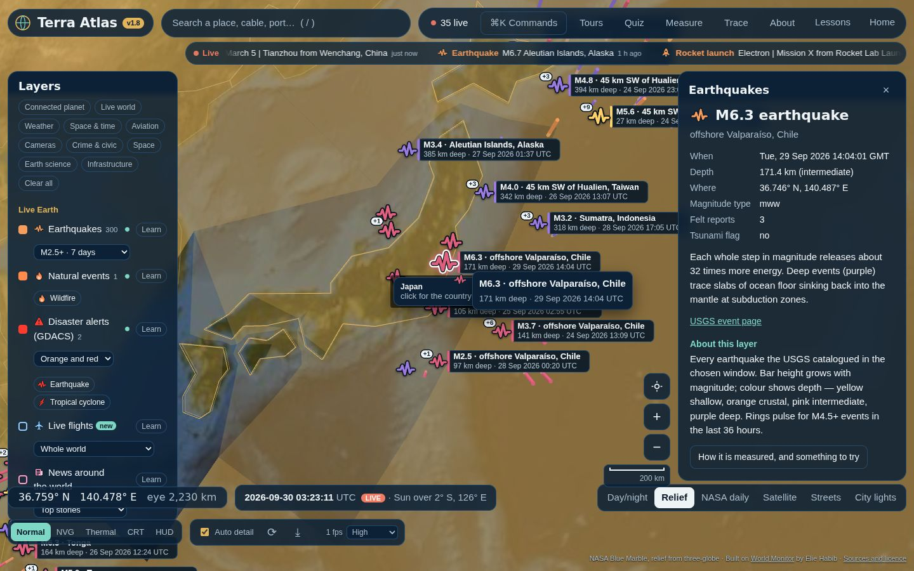 <b>Earthquakes</b> as seismograms, sized by magnitude and coloured by depth.</td>
</tr>
<tr>
<td>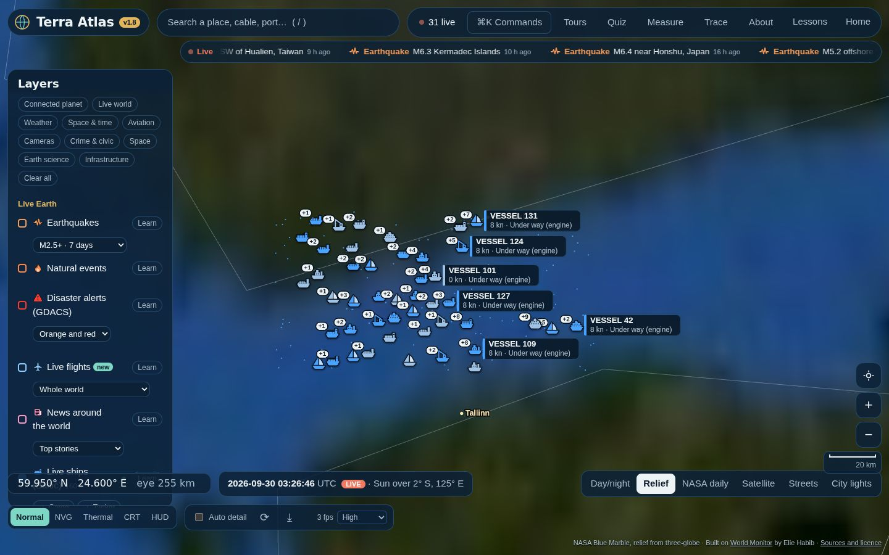 <b>Ships by type</b> from their AIS type code (test data).</td>
<td>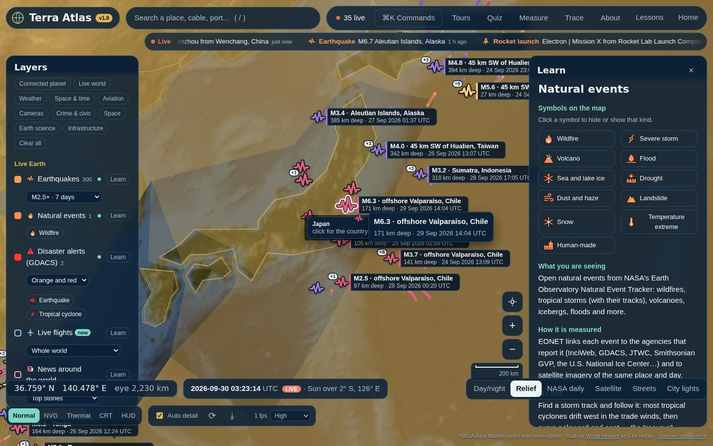 <b>Every layer has a key.</b> Click a symbol to filter.</td>
</tr>
</table>

---

## ✈ History — Terra Atlas v1.7 — live flights everywhere, a smoother globe, and the Moon

| | |
|---|---|
| **Live flights that actually load** | Flight trackers (OpenSky, airplanes.live, adsb.lol, adsb.fi) don’t send the Cross-Origin Resource Sharing (CORS) headers that browsers require, so a web page can’t read them and in v1.6 planes often never appeared. Now there are three routes. **(1) Website:** a GitHub Actions job (`.github/workflows/live.yml` + `tools/fetch-live.mjs`) fetches every aircraft worldwide every ~10 minutes and force-pushes it as one commit to an orphan `live-data` branch, which `raw.githubusercontent.com` serves with CORS headers. Your browser then moves each plane forward along its heading at its ground speed until the next snapshot (dead reckoning). **(2) Desktop app:** a native Rust command (`fetch_text`, allowlisted hosts only) reads OpenSky every 90 s and the regional exchanges every few seconds, fully live. **(3) Optional:** a 60-line Cloudflare Worker in `proxy/` gives the website real-time flights as well. |
| **Every layer says where its data came from** | Under each layer, in plain words: “4,000 aircraft from the live-data snapshot (7 min old, positions projected forward)”, or exactly what to do when a source is down. Launches, disaster alerts and satellite orbits now fall back to the same snapshot when their live source is blocked or rate-limited. |
| **Flights board** | How many aircraft are up and on the ground, height bands, the fastest (usually riding a jet stream), the highest, and any emergency squawks; click one for its seatback view. |
| **Ride along with the ISS** | The camera follows the space station, showing which country or ocean it is over, its height and speed, and whether it is day or night below. Zoom freely while riding; grab the globe to stop. |
| **Moon and tides** | Where the Moon is straight overhead right now, its phase and distance, the next new, quarter and full moons, the moonrise/moonset line, and the two tidal bulges (low-precision Astronomical Almanac formulas, about 0.3° accurate). |
| **Command palette (Ctrl+K / ⌘K)** | Type to find any of 45 layers, presets, tours, base maps, looks, 2,500 cities, actions, and your own **saved views** (camera + base map + layers, kept in your browser). |
| **Smoother and lighter** | An idle render governor draws at full speed while you interact, 30 fps when only something is animating, and 5 fps when the picture is still, so the GPU and fans rest and the main thread is free for data. Shader error checks no longer block start-up (13.5 s → 5.6 s of start-up long tasks on a software renderer), the drawing buffer is no longer preserved every frame, and the desktop app asks WebView2 for GPU rasterisation. |

<table>
<tr>
<td width="50%">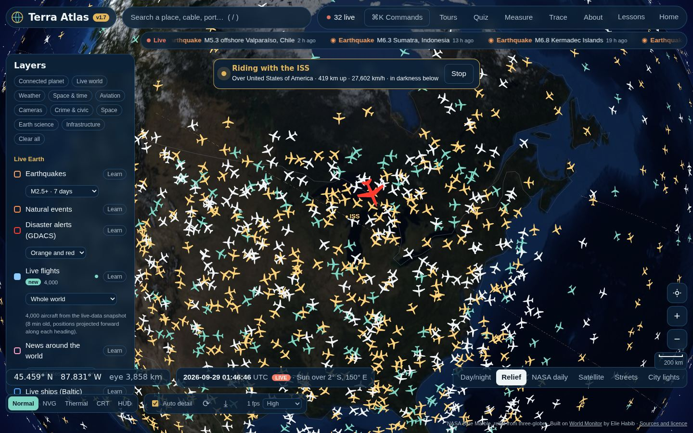 <b>Ride along with the ISS</b>, with live flights underneath.</td>
<td width="50%">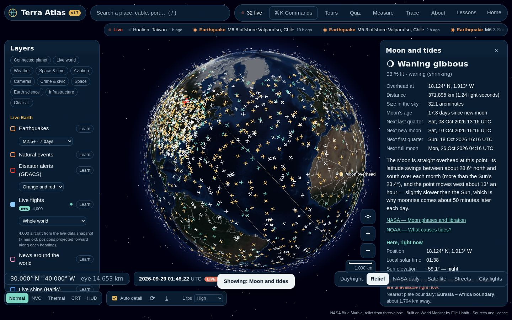 <b>Moon and tides</b> — phase, distance and the next full moon.</td>
</tr>
<tr>
<td>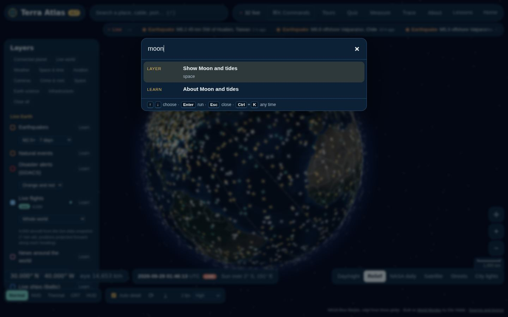 <b>Command palette</b> — Ctrl+K from anywhere.</td>
<td>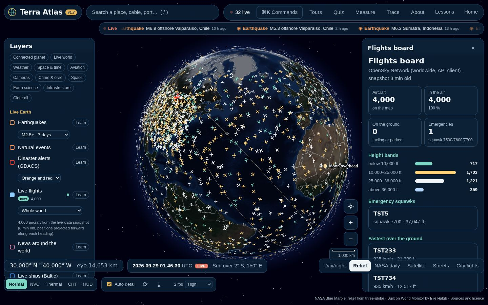 <b>Flights board</b> (screenshot uses test data).</td>
</tr>
</table>

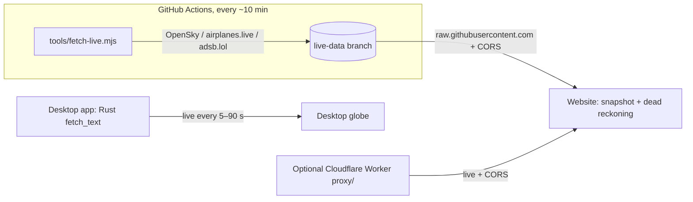

---

## ⏱ History — Terra Atlas v1.6 — time and connections

| | |
|---|---|
| **Time machine** | Click the clock (or press `[` `]`) to run the planet from −1 h/s to +6 h/s, pause it, or drag up to 7 days back. The Sun, the day/night line, satellites, space stations and the ISS ground track all follow the clock; **Replay quakes** plays the last week of earthquakes in order at one hour per second. `\` returns to live time. |
| **Trace (press C)** | Click any spot to draw how it is wired to the world: the nearest internet exchange buildings and the busiest regional hub, the undersea-cable landing and every coast those cables reach, power stations within 150 km by fuel, the nearest airport, public cameras and radio receivers, and a beam to every tracked satellite above the horizon — each with its light-speed delay. |
| **Rocket launches** | The next 25 orbital launches from The Space Devs’ Launch Library 2 at their pads, with live countdowns, mission and orbit, launch-weather odds, and webcast links; pads with a launch in the next 24 hours pulse and live webcasts show red. “Why launch from here?” works out the pad’s free speed from Earth’s spin. |
| **Wind and temperature now** | Thousands of streaks drifting with the current 10 m wind over a 2 m temperature map. The grid is fetched from Open-Meteo every 6 hours during the Pages deploy (never committed); the motion is computed in the browser every frame. |
| **Disaster alerts** | Orange and red GDACS alerts (UN OCHA and European Commission) for earthquakes, cyclones, floods, volcanoes, wildfires and droughts; red alerts pulse and join the Live ticker. |
| **Pins at every zoom** | Pins now stand on the ground and are re-seated as you zoom, so they stay under the cursor and clickable all the way down to street level (previously they floated ~30 km up and vanished behind the camera). Columns shrink with zoom, the item you clicked stays pinned, and cluster badges replace hidden columns up close. |

<table>
<tr>
<td width="50%">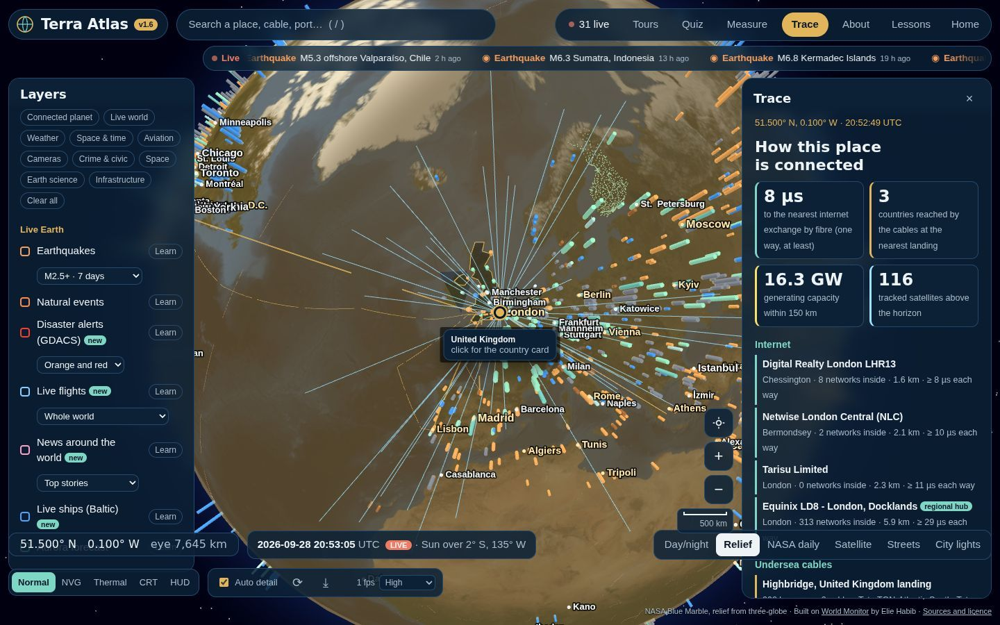 <b>Trace</b> — how London is wired to the world.</td>
<td width="50%">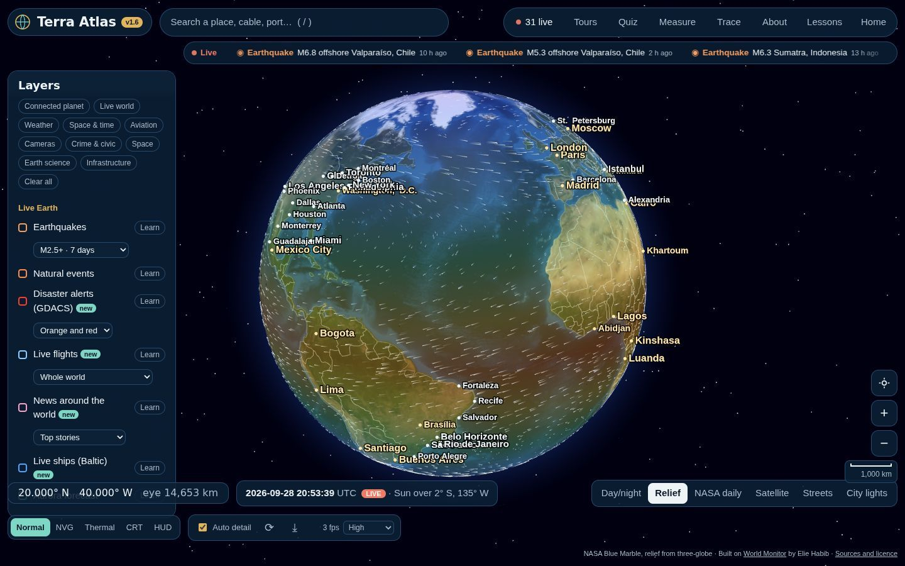 <b>Wind and temperature now</b>.</td>
</tr>
<tr>
<td>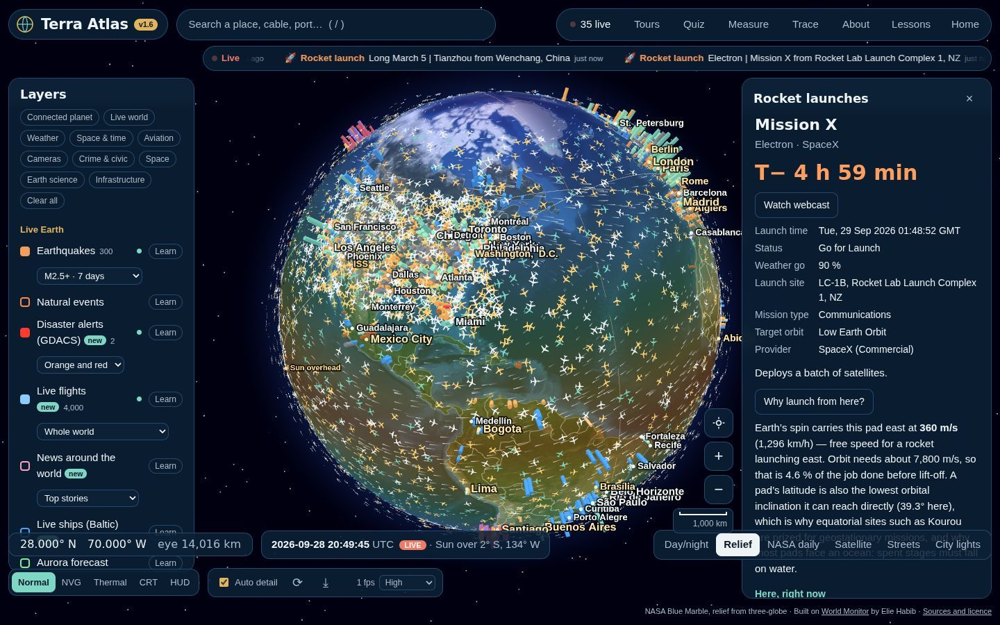 <b>Rocket launches</b> with live countdowns and webcasts.</td>
<td>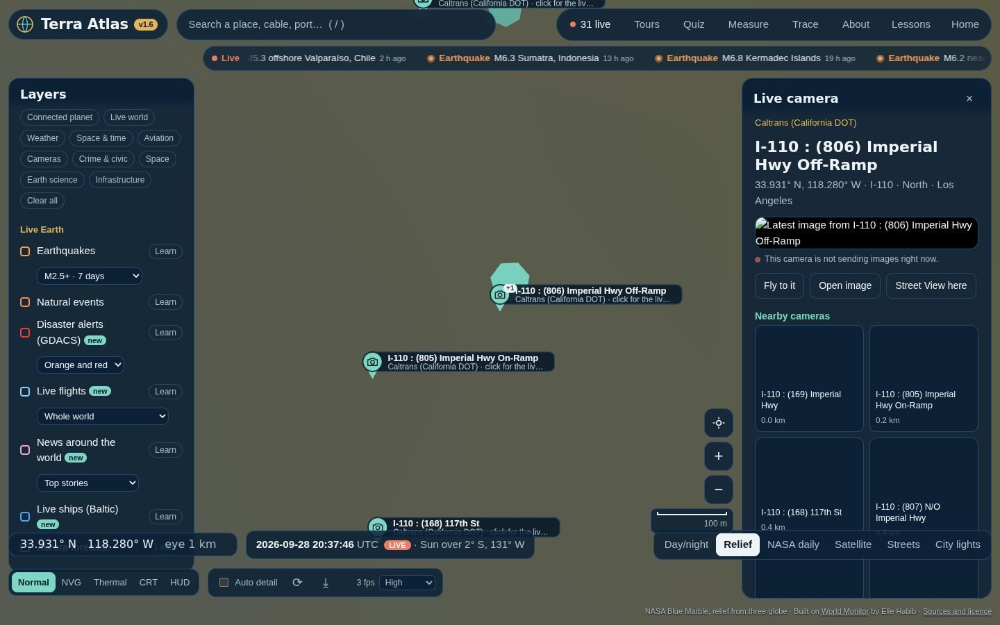 <b>Pins at maximum zoom</b> — still on the street and clickable.</td>
</tr>
</table>

---

## ⚡ History — Terra Atlas v1.5 — fast and detailed

| | |
|---|---|
| **New marker engine** | Every column from every layer is now one instanced mesh (one draw call), and pins and place names are cached canvas sprites instead of DOM elements and 3D text. In a test with 11 layers on over Los Angeles, draw calls fell from 778 to 164 and the freeze after the camera stopped fell from 11.4 s to none over 50 ms. |
| **Map-style pins** | The nearest markers become teardrop pins with icons; the closest get a label card (name and details), cards never overlap, and markers too close together fold into a “+N” cluster badge — like a web map. |
| **Hover cards everywhere** | Point at anything for its details. Hover and click use a latitude/longitude grid index, so finding the thing under the cursor takes microseconds instead of projecting every marker. |
| **No more freezing** | Work after a camera move is split into small slices that yield to the browser between layers, and a newer move cancels the older one. Marker shaders are compiled up front, particle sets are reused, and ray-casting is switched off for the big custom objects. |
| **Quality governor** | Bottom right: a live frame-rate meter and Auto / High / Balanced / Fast. Auto steps down on slow devices (fewer pins, cards and columns, lower pixel ratio, no atmosphere). |

---

## ◎ History — Terra Atlas v1.4 — the connected planet

| | |
|---|---|
| **Overwatch HUD** | Sensor look 5 (or the *HUD* button): a heads-up display over the globe with a rotating crosshair and live read-outs of what is within range — flights, cameras, power, networks, radio — and the nearest of each. |
| **Area scan (press S)** | Pulls every public layer together for the spot under the crosshair: aircraft in range, the tracked satellites that can see that spot *right now* (computed with SGP4 look angles), cameras, internet buildings, power plants, radio receivers, weather, local time and the nearest of each, one click away. |
| **NASA satellite overlays** | Wrap the globe in today’s clouds, rain and snow from the last 30 minutes (IMERG), active fires, last night’s lights, sea-surface temperature, smoke and dust, or snow cover — NASA GIBS images on a transparent shell. |
| **Power plants** | 10,700 plants ≥ 50 MW from the WRI Global Power Plant Database, coloured by fuel with a fuel filter, capacity, generation and owner. |
| **Internet exchanges & data centres** | PeeringDB colocation buildings sized by the number of networks inside — where the internet physically meets. |
| **Live radio receivers** | Public KiwiSDR shortwave receivers worldwide; click one to open it and listen live from that spot on Earth. |
| **Live ships** | Every AIS-broadcasting vessel in the Baltic from Fintraffic’s open feed, plus Finnish road weather cameras in the camera layer. |
| **Satellite footprints** | Any satellite card now shows *What can it see right now?* — the circle of Earth inside its horizon. |

---

## 🔴 History — Terra Atlas v1.3

| | |
|---|---|
| **Live ticker + Live feed** | A red ticker under the search bar streams what is happening now — earthquakes, storms and wildfires, news, and aircraft squawking emergency codes. The **Live** button opens the full feed with filters; **Start live tour** flies from event to event hands-free. |
| **News pins** | Places in the news in the last 24 hours (GDELT), by topic — top stories, disasters, conflict, protests, science, climate — each with its headlines and links to the original articles. |
| **Crime maps** | Official incident reports for Chicago, San Francisco, New York City, Los Angeles and all of England, Wales and Northern Ireland, as 3D hexagon density columns plus pins, with dates, categories and a lesson on reading the numbers fairly. |
| **Camera wall** | Twelve live cameras nearest the centre of your view in one grid, refreshing every 20 s. Plus London JamCams and Hong Kong cameras. |
| **Apply button and presets** | Tick and untick layers, then press **Apply** — nothing changes until you do. One-click presets: Live world, Aviation, Cameras, Crime & civic, Space, Earth science, Infrastructure. Every layer shows a live count. |
| **Flight emergencies** | Aircraft squawking 7500 / 7600 / 7700 are drawn large in red with a pulsing ring and pushed to the Live feed. |
| **Fixes** | Shared objects no longer vanish when layers are toggled (the cause of flights or pins disappearing), and the first visit after an update resets old layer lists saved in the address bar so new layers actually appear. A **What’s new** card and a version badge show which build you are on. |

---

## ✨ History — Terra Atlas v1.1

| | What you get |
|---|---|
| ✈️ **Every flight in the sky** | Live aircraft worldwide (OpenSky) or in detail around your view (adsb.lol), drawn as plane pointers turned to their real heading and coloured by altitude — tens of thousands in a single draw call. |
| 🪟 **Seatback flight view** | Click a plane for an airline-screen style panel: origin → destination with progress, altitude, ground speed, heading, climb rate, outside air temperature, distance and time to go, weather and local time at the destination, and a photo of the actual aircraft. *Follow* keeps the camera on it; *Window view* drops you to satellite imagery beneath it. |
| 📹 **Live traffic cameras** | About 6,000 public road cameras: Caltrans (all 12 California districts), NYC DOT, Transport for London JamCams and Hong Kong’s Transport Department (511 Ontario and Alberta when their feeds respond). Stills refresh every 15 s; Caltrans streams play live and London cameras play a recent video clip. Every camera shows the nearest others as a camera wall. |
| 🚨 **Licence-plate readers** | Flock Safety and other ALPR cameras mapped in OpenStreetMap (largely via DeFlock), with maker, operator and facing direction, a neutral Learn card on the privacy debate, and a live refresh from OpenStreetMap for the area you are viewing. |
| 🛰 **Clickable satellites and the ISS** | Click any satellite for its orbit class, perigee and apogee, inclination and period, draw its full orbit, and get the next times it passes over you. |
| 📍 **Map-style pins and names** | 2,500 city names and 3,300 airports appear as you zoom, like a web map. Close up, markers turn into icon pins with labels. Named places get a Wikipedia summary and photo. |
| 👀 **Look around** | Any point: Street View, Google Earth 3D, Mapillary, open Panoramax street photos and the nearest live cameras. |
| 🧭 **Navigation that behaves like Google Maps** | Dragging covers about one screen of ground at any zoom, each scroll notch changes height by about 15 %, double-click zooms in, arrows pan, `+`/`−` zoom, a locate-me button and a scale bar. Lines and markers keep the same on-screen size at every zoom. |
| ⚡ **Faster start** | 2K textures first and 4K when idle, a procedural star field instead of a 900 kB image, a 30 % smaller 3D engine bundle, and capped pixel ratio on high-density screens. |

> Camera lists and the licence-plate-reader snapshot are collected once a day by [`data.yml`](.github/workflows/data.yml) (run it once by hand after installing: `gh workflow run data.yml`). Flights, satellites and camera pictures are always live.
