<div align="center">

<a href="https://normansrule.github.io/global-intelligence-atlas/app/">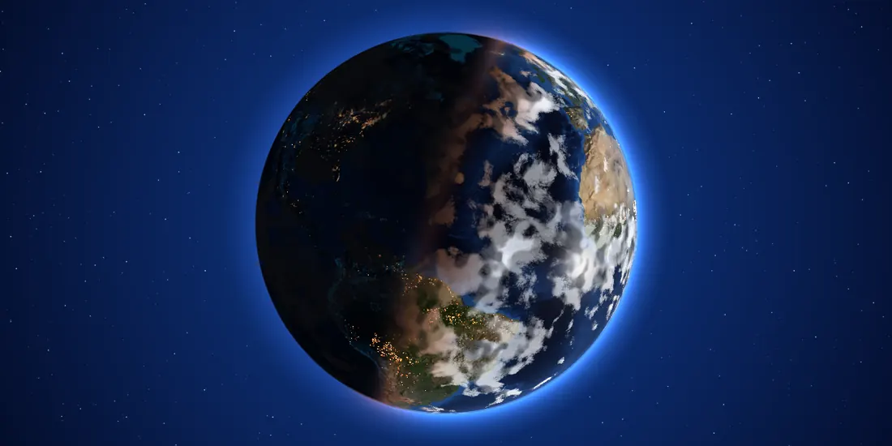</a>

<h1>Global Intelligence Atlas</h1>

<h3>The world right now, counted.</h3>

<p>A live 3D Earth you can spin, click and learn from.<br/>Storms, earthquakes, flights, ships, satellites, launches, cables and ports: click any of them for the whole story.<br/><b>In your browser or as a desktop app. No account, no key, no server, and it keeps working offline.</b></p>

<p align="center">
<a href="https://normansrule.github.io/global-intelligence-atlas/app/"><picture><source media="(prefers-color-scheme: light)" srcset="site/docs-media/btn-web-light.svg" /></picture></a>
<a href="https://github.com/Normansrule/global-intelligence-atlas/releases/latest"><picture><source media="(prefers-color-scheme: light)" srcset="site/docs-media/btn-windows-light.svg" /></picture></a>
<a href="https://github.com/Normansrule/global-intelligence-atlas/releases/latest"><picture><source media="(prefers-color-scheme: light)" srcset="site/docs-media/btn-macos-light.svg" /></picture></a>
<a href="https://github.com/Normansrule/global-intelligence-atlas/releases/latest"><picture><source media="(prefers-color-scheme: light)" srcset="site/docs-media/btn-linux-light.svg" /></picture></a>
</p>

<sub><a href="https://normansrule.github.io/global-intelligence-atlas/">Website</a> · <a href="#-get-the-app">Install it from the browser, or which download to pick</a></sub>

[](CHANGELOG.md)
[](LICENSE)
[](https://github.com/Normansrule/global-intelligence-atlas/actions/workflows/pages.yml)
[](https://github.com/Normansrule/global-intelligence-atlas/actions/workflows/tests.yml)
[](https://github.com/Normansrule/global-intelligence-atlas/actions/workflows/desktop.yml)
[](#-progress)


<table>
<tr>
<td align="center" width="20%"><h2>71</h2>layers in 11 groups</td>
<td align="center" width="20%"><h2>160+</h2>live and open sources</td>
<td align="center" width="20%"><h2>17</h2>kinds of thing to click for the whole story</td>
<td align="center" width="20%"><h2>15</h2>lessons, 6 tours, 1 quiz</td>
<td align="center" width="20%"><h2>0</h2>accounts, keys or servers</td>
</tr>
</table>

<picture>
  <source media="(prefers-color-scheme: light)" srcset="site/docs-media/layers-light.svg" />
  
</picture>

[What's new](#-new-in-v220-the-whole-solar-system) · [Get the app](#-get-the-app) · [Click anything](#-click-anything) · [At a glance](#-at-a-glance) · [Web or desktop](#-web-app-and-desktop-app) · [Gallery](#-gallery) · [Features](#-features) · [Design](#-design) · [Progress](#-progress) · [How it works](#-how-it-works) · [Run it](#-run-it-yourself) · [References](#-data-and-references) · [Credits](#-credits) · [Changelog](CHANGELOG.md)

<sub>Global Intelligence Atlas (GIA) is built on the basis of <a href="https://github.com/koala73/worldmonitor">World Monitor</a> by Elie Habib.</sub>

</div>

---

## ✨ New in v2.20: the whole solar system

<p align="center">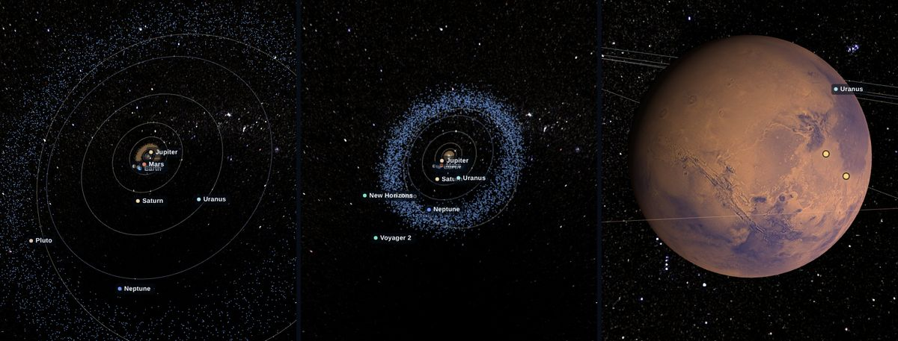</p>
<p align="center"><sub>Press the planet button: space now opens on the whole solar system. Click any planet to fly there.</sub></p>

<table>
<tr>
<td width="33%" valign="top">

### 🪐 Everything where it is today
Space opens on **every planet on its orbit**, placed for the atlas clock by Astronomy Engine. **Drag** to turn, **right-drag** (or two fingers) to slide, **scroll** to zoom, and **click a planet** to fly there. The card lists each one's distance from the Sun and how long its sunlight takes.

</td>
<td width="33%" valign="top">

### ☄️ Belts and the farthest spacecraft
The **asteroid belt** (with the gaps Jupiter's pull clears) and the **Kuiper belt** beyond Neptune, each rock turning at its own speed with the time machine. Zoom out to find **Voyager 1 and 2** and **New Horizons**, with how far they are and how long a radio signal takes.

</td>
<td width="33%" valign="top">

### 🔭 Fly much closer
On the **Moon, Mars and Mercury**, a patch of sharper **NASA Treks** map tiles loads under you as you go down, to the finest level NASA publishes (about 80 m per pixel on the Moon). You can fly in until one map pixel covers about a quarter of a screen pixel.

</td>
</tr>
</table>

## ✨ Also new in v2.19: a whole city up close

<p align="center">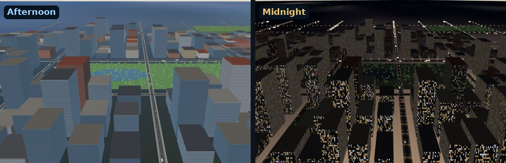</p>
<p align="center"><sub>A made-up test town (the real one comes from OpenStreetMap wherever you zoom in). Press the tilt button or <kbd>V</kbd> to look across the city; <kbd>Shift</kbd> + drag tilts by hand.</sub></p>

<table>
<tr>
<td width="33%" valign="top">

### 🏙️ Tilt and buildings with windows
Zoomed in, the **tilt** swings the view down so you look across the city, with the sky above the horizon. Every building has **rows of windows** a storey apart, glass curtain walls on towers and shop windows at street level, and its walls are **lit from where the Sun really is** right now.

</td>
<td width="33%" valign="top">

### 🌳 Parks, woods, rivers and lakes
Parks, grass, woods, beaches, rivers, canals, lakes and ponds come from **OpenStreetMap** around you, with the mapped trees and more scattered through parks and woods. Water **ripples and glints** in the Sun and reflects the sky.

</td>
<td width="33%" valign="top">

### 🌃 Streets and city lights
Roads get **pavements, lane lines** (yellow in the Americas, white elsewhere), edge lines and **zebra crossings**, with **street lamps** every 30 m or so. After dark the lamps pool warm light on the road and about a third of the windows light up, more in the evening and fewer after midnight.

</td>
</tr>
</table>

## ✨ And in v2.18: close-ups that behave like the real thing

<p align="center"><picture><source media="(prefers-color-scheme: light)" srcset="site/docs-media/closeups-v218-light.svg" />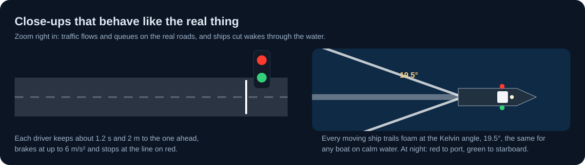</picture></p>

<table>
<tr>
<td width="33%" valign="top">

### 🚦 Traffic that drives like traffic
At street level every simulated car, van, lorry and bus now keeps a safe gap to the one ahead (about 1.2 seconds and 2 m), pulls away and brakes like a car, slows for junctions and **queues at red lights** on town roads. The roads are real OpenStreetMap roads; the traffic is still simulated, and the map says so.

</td>
<td width="33%" valign="top">

### 🌊 Ships with wakes
Every moving ship drags a **foam wake** behind it, spreading at the Kelvin angle (19.5°), the angle every boat's wake makes on calm water whatever its size or speed. It grows longer and brighter the faster the ship goes.

</td>
<td width="33%" valign="top">

### 🌙 Lights after dark
Where the Sun has set, ships show their **navigation lights** (white masthead and stern, red to port, green to starboard), vehicles their **headlights and red tail lights** (brighter when they brake), and planes keep their wingtip lights and strobes from v2.17.

</td>
</tr>
</table>

## ✨ Also in v2.17: the Earth sooner, never a black globe

<p align="center">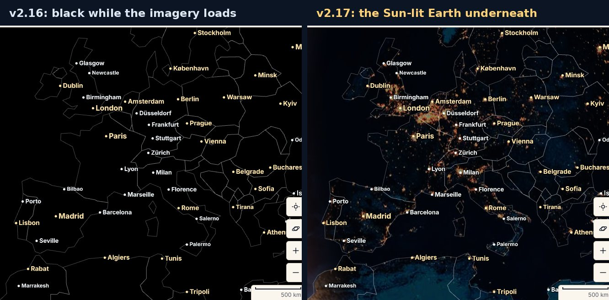</p>

<table>
<tr>
<td width="50%" valign="top">

### ⚡ The whole Earth sooner
The first view now waits only for what it shows. The relief and ocean-glint maps (600 kB, the water mask now stored in one channel at half the size) arrive just after the Earth is on screen, and the sharper 4K Earth (2.2 MB) waits until the live layers have had time to come in, and is skipped on slow or data-saver connections.

</td>
<td width="50%" valign="top">

### 🌍 Never a black globe
Zoom in close and the satellite photos load tile by tile. Until now the globe went black while they did, or for good when they could not load (offline, or blocked by a network). The Sun-lit Earth now lies underneath, so there is always land, sea and city lights to look at.

</td>
</tr>
<tr>
<td valign="top">

### 🧭 A calmer whole-globe view
Every undersea cable on Earth at once is a green web over the land. Cables now fade back when you see the whole planet and come back in full as you zoom in, so the continents and the live pins read first.

</td>
<td valign="top">

### ✈️ Planes that look like planes
Zoomed right in, live planes lose their map colours and are painted white like real aircraft, shrink smoothly to their **true size** near the ground (to scale with the roads, cars and buildings of the close-ups), and carry their **real lights**: red on the left wingtip, green on the right, white strobes that double-flash and a blinking red beacon. They glide on the graphics card between reports, so motion stays smooth at any frame rate.

</td>
</tr>
<tr>
<td valign="top">

### 📏 Speed you can check
`tests/perf/startup.py` times a first visit the way a visitor meets it: HTTP/2 with gzip like GitHub Pages, a throttled network and processor, and every live feed mocked so runs compare fairly. The numbers below come from it.

</td>
<td valign="top">

### 🚢 Ships and traffic, still live
From v2.16: below about 41 km every live ship is its 3D model at its broadcast size, moving at its reported speed and heading, and below about 6 km simulated cars, vans, lorries and buses drive the real roads (the map says they are simulated).

</td>
</tr>
</table>

<p align="center"><picture><source media="(prefers-color-scheme: light)" srcset="site/docs-media/speed-v217-light.svg" /></picture></p>

<sub>The finished Earth is the later of two moments: the globe is up, and its day picture has arrived. Measured with software WebGL in a cloud container, so absolute times are slower than on a real phone or laptop; the comparison is what counts.</sub>

## ✨ Also new in v2.16: closer, faster, truer to life

<p align="center"><a href="https://normansrule.github.io/global-intelligence-atlas/app/#@28,20,1.9&l=borders,cities&s=1">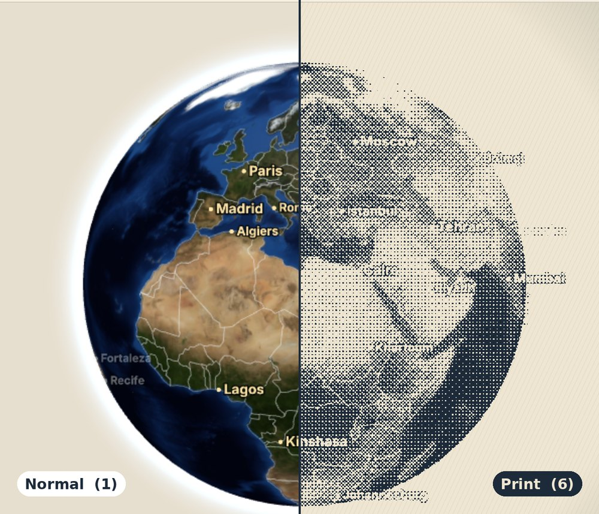</a></p>

<table>
<tr>
<td width="50%" valign="top">

### 🔭 Lifelike close-ups
Zoom right in and the map fills with things at their real size. Every live ship becomes a **3D model at its broadcast length and beam**, turned to its heading and gliding at its reported speed. Below about 6 km, **cars, vans, lorries and buses drive the real OpenStreetMap roads**, on the correct side for the country, faster on motorways, fewer at night, among buildings raised to their mapped height. The icons stay on top. The traffic is simulated and the map says so.

</td>
<td width="50%" valign="top">

### ⚡ Faster first view
Every one of the 83 start-up scripts is now requested at once instead of one level of imports at a time, and the heavy files wait until the globe is on screen: the 5.5 MB traffic-camera list, the 600 kB airline and aircraft tables and the 900 kB star map. The page now downloads **less than half as much before it is ready** (4.5 MB instead of 11 MB). The close-up code loads only when you first zoom in that far.

</td>
</tr>
<tr>
<td valign="top">

### 🦌 Animals you can see
Every animal's page now opens with a **strip of real photos** people took of it in the wild, each with an open licence (Creative Commons or public domain) and its photographer's name; press one to see it large. Underneath: its family tree (mammals › deer › moose), a short Wikipedia summary, how often it has been seen and its conservation status, all from iNaturalist.

</td>
<td valign="top">

### 🖨 Print, and 📷 1,700 more cameras
Press <kbd>6</kbd> for **Print**: the live globe as halftone dots in ink on paper, an ordered dither (Bayer, 1973) done by the browser's own image filters. And about **1,700 more public cameras** from the checked [Open Eagle Eye](https://github.com/stuchapin909/Open-Eagle-Eye) registry (Colorado, Pennsylvania, Wisconsin, Virginia, Singapore, GeoNet and USGS volcanoes, BC Ferries), each through the same publisher rules as every other webcam.

</td>
</tr>
</table>

| Start-up, same machine, local server, average of two runs | v2.15 | v2.16 |
|---|---:|---:|
| Data downloaded before the page has loaded | 11.0 MB | **4.5 MB** |
| Page ready (DOMContentLoaded) | 555 ms | **496 ms** |
| Page loaded (load event) | 1,002 ms | **926 ms** |

<sub>A local server has no network delay, so it cannot show what the parallel script requests save on a real connection: several round trips before the globe appears.</sub>

<p align="center"><sub>Click the picture to open the globe, then press 6. Close-ups: zoom into any port or city with Live ships on.</sub></p>

---

## 🌫 New in v2.15: the air you breathe, and storm warnings

<table>
<tr>
<td width="50%" valign="top"><a href="https://normansrule.github.io/global-intelligence-atlas/app/#@24,84,1.6&l=borders,air,cities&s=1">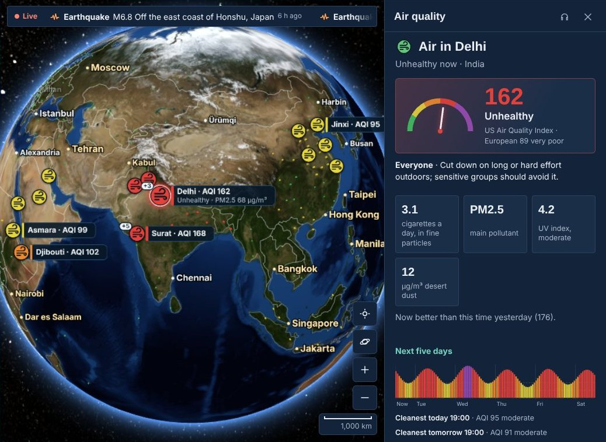</a></td>
<td width="50%" valign="top"><a href="https://normansrule.github.io/global-intelligence-atlas/app/#@37,-98,1&l=borders,warnings,cities&s=1">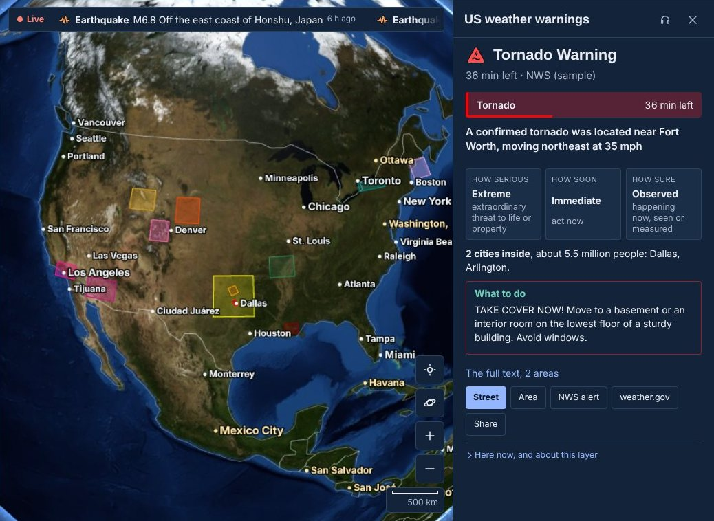</a></td>
</tr>
<tr>
<td valign="top"><b>🫁 Air quality, everywhere.</b> About 400 places coloured by the US Air Quality Index now; the bad ones pulse. Click one: who should take care and what to do, the main pollutant and <i>why</i>, every pollutant against the World Health Organization (WHO) guideline, the fine-particle dose as cigarettes, and five days hour by hour with the cleanest hours to go out. Click <b>any spot on Earth</b> for its air too.</td>
<td valign="top"><b>⛈ US weather warnings.</b> Every live tornado, thunderstorm, flood, winter storm, heat and fire-weather alert from the National Weather Service (NWS), drawn as the exact area it covers. Its page says how serious, how soon and how sure in plain words, counts down the time left, counts the cities and people inside and puts <i>what to do</i> first.</td>
</tr>
</table>

<p align="center">🎧 <b>Listen</b> reads any page aloud in your system's own voice &nbsp;·&nbsp; 🔈 switch on <b>sound</b> for soft cues when something big happens &nbsp;·&nbsp; both made in the browser, nothing to download</p>

<p align="center"><sub>Pictures from the app with sample data (the warnings are made up for the picture). Click either one to open the live layer.</sub></p>

---

## 👆 Click anything

Every dot on the globe opens into a page of its own: one line first, the full detail when you ask for it, and a link to where the numbers come from. Each link below opens that layer on the live globe.

<table>
<tr>
<td width="33%" valign="top">✈ <b><a href="https://normansrule.github.io/global-intelligence-atlas/app/#@51.5,-0.5,0.9&l=borders,aircraft,airports,cities&s=1">Planes and airports</a></b><br/><sub>Airline, flight number, aircraft model in 3D, its route and how much is flown. Airports draw every nonstop route.</sub></td>
<td width="33%" valign="top">🛳 <b><a href="https://normansrule.github.io/global-intelligence-atlas/app/#@1.3,103.8,0.5&l=borders,ports,ships,cities&s=1">Ships and ports</a></b><br/><sub>Flag, type, size and destination, and a 3D model of the ship with its cargo. Ports give the tide now and which ships can get in.</sub></td>
<td width="33%" valign="top">〰 <b><a href="https://normansrule.github.io/global-intelligence-atlas/app/#@20,150,2.4&l=borders,quakes,plates&s=1">Earthquakes</a></b><br/><sub>Fault beachball, shaking map, P and S waves sweeping the globe, aftershocks.</sub></td>
</tr>
<tr>
<td valign="top">🌀 <b><a href="https://normansrule.github.io/global-intelligence-atlas/app/#@15,-40,2.6&b=weather&l=events,borders&s=1">Storms, volcanoes and wildfires</a></b><br/><sub>Wind on the Saffir-Simpson scale, the track coloured by strength, ash drift, fire weather, people nearby.</sub></td>
<td valign="top">⚑ <b><a href="https://normansrule.github.io/global-intelligence-atlas/app/#@46,8,1.6&l=borders,cities&s=1">Countries</a></b><br/><sub>Its people as Isotype figures, how it compares with the world, its neighbours, what is happening inside it now.</sub></td>
<td valign="top">◉ <b><a href="https://normansrule.github.io/global-intelligence-atlas/app/#@35.7,139.7,0.6&l=borders,cities,airports&s=1">Cities</a></b><br/><sub>Weather and daylight, airports, everything within 100 km and the spot on the other side of the Earth.</sub></td>
</tr>
<tr>
<td valign="top">🛰 <b><a href="https://normansrule.github.io/global-intelligence-atlas/app/#@20,0,3.2&l=borders,stations,satellites&s=1">Satellites and space stations</a></b><br/><sub>What it is for, its orbit to scale, sunlight or shadow, where it flies next and what it can see.</sub></td>
<td valign="top">🚀 <b><a href="https://normansrule.github.io/global-intelligence-atlas/app/#@25,-60,2.6&l=borders,launches,cities&s=1">Rocket launches</a></b><br/><sub>Live countdown, pad weather, the flight plan ticked off live, the rocket drawn to scale.</sub></td>
<td valign="top">🔌 <b><a href="https://normansrule.github.io/global-intelligence-atlas/app/#@10,45,2.2&l=borders,cables,ships&s=1">Undersea cables</a></b><br/><sub>Light-time end to end, its landings, the countries that depend on it, ships stopped over it.</sub></td>
</tr>
<tr>
<td valign="top">☢ <b><a href="https://normansrule.github.io/global-intelligence-atlas/app/#@50,5,1.4&l=borders,nuclear,cities&s=1">Nuclear plants</a></b><br/><sub>Output, the people inside its 16, 30 and 80 km planning zones, the wind there now.</sub></td>
<td valign="top">🏛 <b><a href="https://normansrule.github.io/global-intelligence-atlas/app/#@41.9,12.5,0.8&l=borders,landmarks&s=1">Landmarks</a></b><br/><sub>Nearly 200 on every continent, with a credited photo, key figures and what else is nearby.</sub></td>
<td valign="top">🪐 <b><a href="https://normansrule.github.io/global-intelligence-atlas/app/#@15,0,3&b=daynight&l=sun,planets&s=1">The Moon, the planets and eclipses</a></b><br/><sub>Fly to any of them where they really are now, watch an eclipse's shadow cross the globe.</sub></td>
</tr>
<tr>
<td valign="top">⚠ <b><a href="https://normansrule.github.io/global-intelligence-atlas/app/#@10,100,2.6&l=borders,alerts,cities&s=1">Disaster alerts</a></b><br/><sub>The Global Disaster Alert and Coordination System (GDACS) level in words, the people inside each ring, the quake or storm behind it.</sub></td>
<td valign="top">⚡ <b><a href="https://normansrule.github.io/global-intelligence-atlas/app/#@48,10,1.4&l=borders,power,cities&s=1">Power plants</a></b><br/><sub>Capacity and how much of it is used, carbon per unit of power, the country's mix, the wind and sun there now.</sub></td>
<td valign="top">🦌 <b><a href="https://normansrule.github.io/global-intelligence-atlas/app/#@60,-100,2.4&l=borders,wildlife&s=1">Wildlife</a></b><br/><sub>Search any animal for the best places to see it, ranked by the chance of a sighting, plus 36 hotspots of unique animals.</sub></td>
</tr>
<tr>
<td valign="top">🫁 <b><a href="https://normansrule.github.io/global-intelligence-atlas/app/#@24,84,1.6&l=borders,air,cities&s=1">Air quality</a></b><br/><sub>The index in words, who should take care, the main pollutant and why, the dose as cigarettes, the cleanest hours this week.</sub></td>
<td valign="top">⛈ <b><a href="https://normansrule.github.io/global-intelligence-atlas/app/#@37,-98,1&l=borders,warnings,cities&s=1">US weather warnings</a></b><br/><sub>The exact area, how serious, soon and sure, the time left, the people inside and what to do.</sub></td>
<td valign="top">📍 <b><a href="https://normansrule.github.io/global-intelligence-atlas/app/#@20,0,2.4&l=borders,cities&s=1">Any spot on Earth</a></b><br/><sub>Click the ground: the weather, height, air, Sun, nearest plate boundary, street photos and cameras right there.</sub></td>
</tr>
</table>

<p align="center"><sub>The picture at the top is the app itself, rendered with a sample weather grid and real NASA fire detections: the globe lit by the real Sun, city lights coming on along the line between day and night as the Earth turns, clouds, rain and lightning drawn as things in the scene.</sub></p>

---

## 🌍 At a glance


| | |
|---|---|
| **71 layers in 11 groups** | Live Earth, air quality, US weather warnings, wildlife, economy and property, chemicals and environment, cameras, civic data, sky and space, Earth science, places, infrastructure, geopolitics and Intel |
| **Data sources and references** | Every source is listed in the app (About) and in [`docs/REFERENCES.md`](docs/REFERENCES.md) in American Psychological Association (APA) 7th edition style |
| **No server, no account, no key** | No application programming interface (API) keys needed. A static site on GitHub Pages; scheduled GitHub Actions jobs collect what browsers cannot fetch directly |
| **Weather you can see** | Real clouds from the forecast, rain and snow where they are falling, lightning in thunderstorms, and the glow and smoke of large fires, drawn on the globe rather than as symbols. Pick the Weather map style to switch it all on over a muted Earth, and any other style to switch it off |
| **Landmarks with photos** | Nearly 200 landmarks on every continent, drawn as what they are (ancient site, temple, castle, tower, bridge, natural wonder). Click one for its photo from Wikimedia Commons with the author's credit, a line from Wikipedia, its key figures from Wikidata and the landmarks nearby |
| **The Moon and the planets** | The real star sky with the Milky Way behind the globe, and the Sun, the Moon, every planet, Pluto and Jupiter's four big moons where they really are right now. Fly to any of them, turn it round on NASA-made maps, read its card and fly on; Earth brings you back |
| **Learn as you go** | Every layer has a card: what you are seeing, how it is measured, something to try, and its sources. Fifteen lessons, six guided tours and a quiz |
| **The air and the warnings** | The air people are breathing in about 400 places and at any spot you click, against the World Health Organization guidelines, with five days ahead; every live US weather warning drawn as its real area, with what to do |
| **Listen** | Any page read aloud in your system's own voice, and soft optional sound cues when something big happens, all made in the browser |
| **Works offline** | The app keeps a copy of every feed it has loaded on your device. When the connection drops it says so, shows the last copy with its age, and catches up when you are back. The Offline kit saves the whole atlas for a trip and answers "where am I" with the nearest city, the Sun, the Moon, the planets and the next space station pass |
| **Locked down** | A strict Content Security Policy (CSP) on every page (no inline scripts), every outside name and title escaped and fuzz-tested with hostile data, a desktop app that only fetches from listed hosts over HTTPS, and GitHub Actions workflows pinned to exact versions. Report a problem privately from the repository's Security tab |
| **Two ways to run it, one codebase** | The web app and the desktop app run the same `site/` folder, so they have the same features |

---

## 📲 Get the app

<table>
<tr>
<td width="33%" valign="top" align="center">

### 🌐 In your browser
<a href="https://normansrule.github.io/global-intelligence-atlas/app/"><picture><source media="(prefers-color-scheme: light)" srcset="site/docs-media/btn-web-light.svg" /></picture></a>

Nothing to install. Works in any recent Chrome, Edge, Firefox or Safari, on a laptop, tablet or phone.

</td>
<td width="33%" valign="top" align="center">

### 📌 As an installed web app
Open the atlas, then choose **Install** in the address bar (Chrome, Edge) or **Share → Add to Home Screen** (iPhone, iPad). It opens in its own window and keeps working offline.

</td>
<td width="33%" valign="top" align="center">

### 💻 As a desktop app
<a href="https://github.com/Normansrule/global-intelligence-atlas/releases/latest"><picture><source media="(prefers-color-scheme: light)" srcset="site/docs-media/btn-windows-light.svg" /></picture></a>
<a href="https://github.com/Normansrule/global-intelligence-atlas/releases/latest"><picture><source media="(prefers-color-scheme: light)" srcset="site/docs-media/btn-macos-light.svg" /></picture></a>
<a href="https://github.com/Normansrule/global-intelligence-atlas/releases/latest"><picture><source media="(prefers-color-scheme: light)" srcset="site/docs-media/btn-linux-light.svg" /></picture></a>

Flights and ships in real time, system notifications for your watch areas.

</td>
</tr>
</table>

<p align="center"><picture><source media="(prefers-color-scheme: light)" srcset="site/docs-media/flow-light.svg" />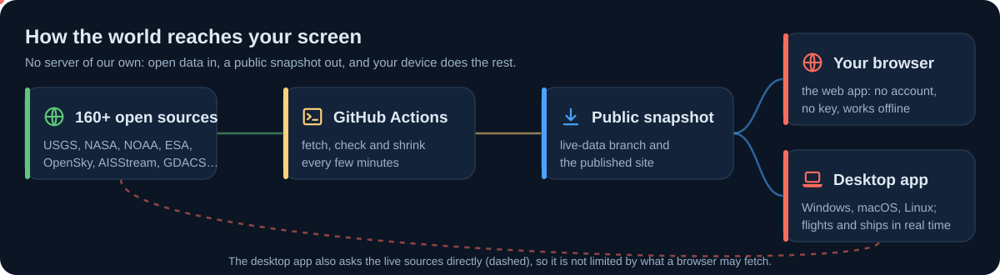</picture></p>

---

## 🖥 Web app and desktop app

Both are built from the same files, so every layer, tool and lesson is in both. The web app is tuned for the browser; the desktop app adds what a browser is not allowed to do.

| | 🌐 **Web app** (GitHub Pages) | 💻 **Desktop app** (Tauri) |
|---|---|---|
| **Open it** | [normansrule.github.io/global-intelligence-atlas/app](https://normansrule.github.io/global-intelligence-atlas/app/) | [Releases](https://github.com/Normansrule/global-intelligence-atlas/releases/latest): `.msi` / `.exe`, `.dmg` (Apple silicon and Intel), `.AppImage` / `.deb` / `.rpm` |
| **Code** | `site/` | the same `site/`, wrapped by [`desktop/`](desktop/) (`"frontendDist": "../../site"`) |
| **Layers, tools, lessons** | All | All |
| **Live data the browser cannot fetch** | Read from snapshots the GitHub Actions jobs publish every few minutes | Fetched directly (no cross-origin limits), so flights and ships are real time |
| **Ships worldwide** | Snapshot from the `live-data` branch | Live AISStream collector (with a free key) |
| **Notifications for watch areas** | Browser notifications | System notifications |
| **Offline** | Installable web app; a service worker keeps the app, textures and datasets | Everything bundled in the app |
| **Updates** | Every push to `main` | Every version tag builds a new release |

**Browser tuning:** draw calls are batched (one mesh per colour band, merged country outlines, a fast marker renderer), the pixel ratio is capped on high-density screens, an automatic quality setting steps down when the frame rate drops and rests when the tab is hidden, layers that depend on the view load only what is on screen, the page fetches the globe engine and its first modules in parallel (`modulepreload`), and on repeat visits the service worker answers the 1.4 MB engine, the Earth textures and images from its cache at once while refreshing them in the background.

---

## 🖼 Gallery

<p align="center">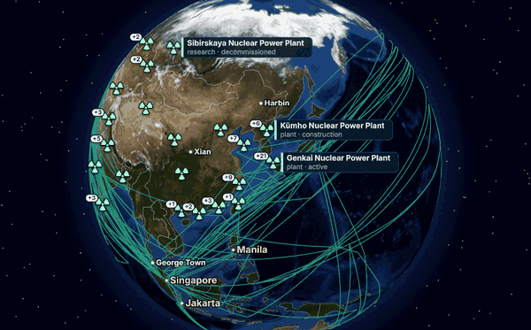</p>

<table>
<tr>
<td width="50%">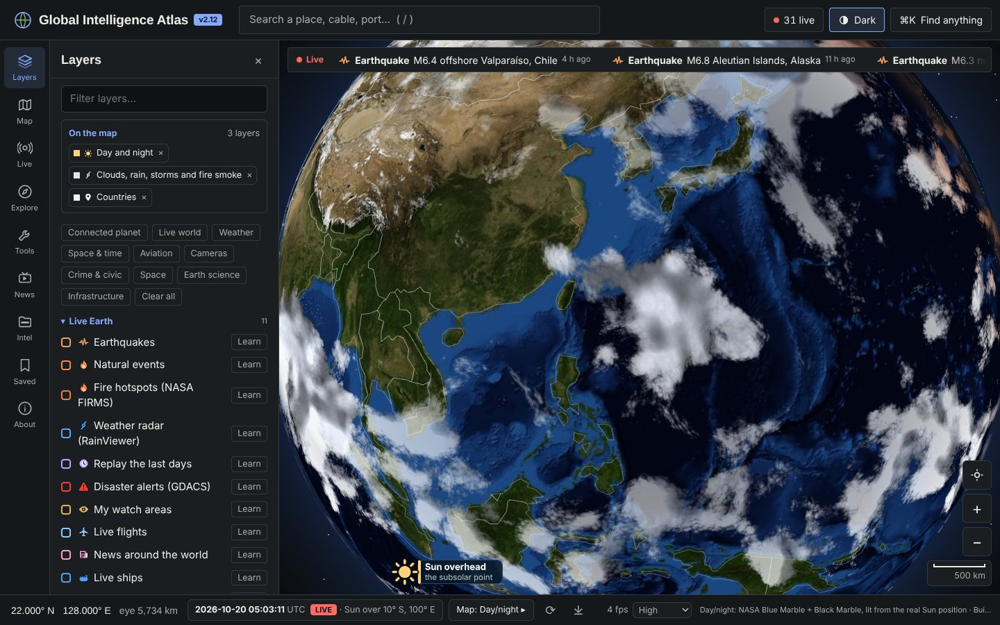<br/><b>Weather you can see.</b> Clouds, rain, lightning and fire smoke drawn physically on the globe from today's data.</td>
<td width="50%">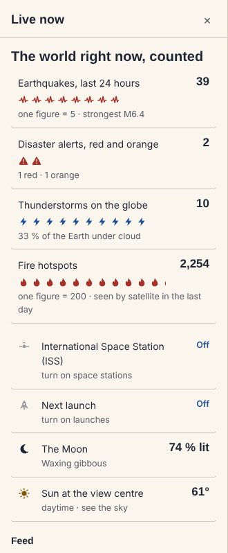<br/><b>The world right now, counted.</b> Each row is a chart: one figure stands for a stated number of things. Click a row to see them.</td>
</tr>
<tr>
<td>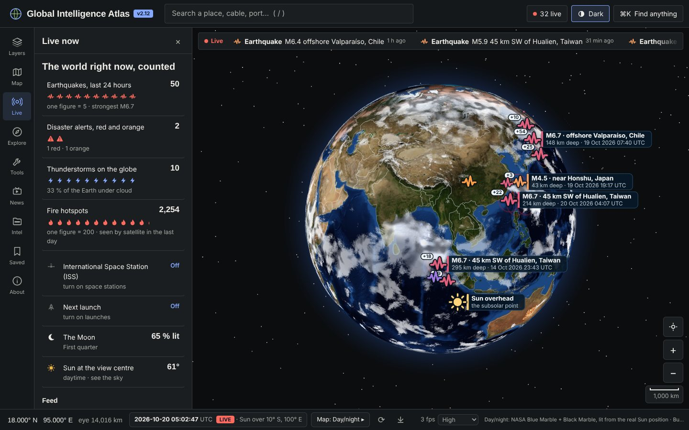<br/><b>Dark theme.</b> The same chart on ink, with stars behind the globe. It follows your system setting until you pick one.</td>
<td>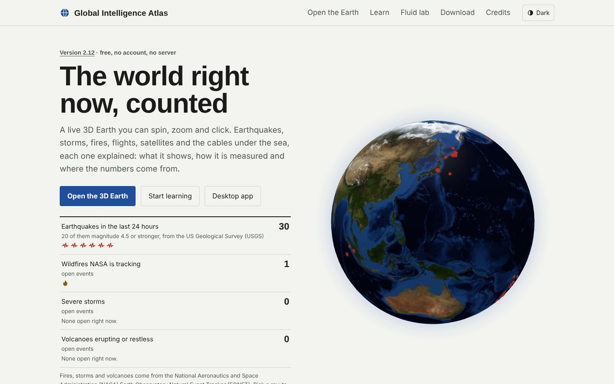<br/><b>Home page.</b> Live counts from the US Geological Survey (USGS) and the National Aeronautics and Space Administration (NASA), tied to a globe that shows where they are.</td>
</tr>
<tr>
<td><a href="https://normansrule.github.io/global-intelligence-atlas/learn/">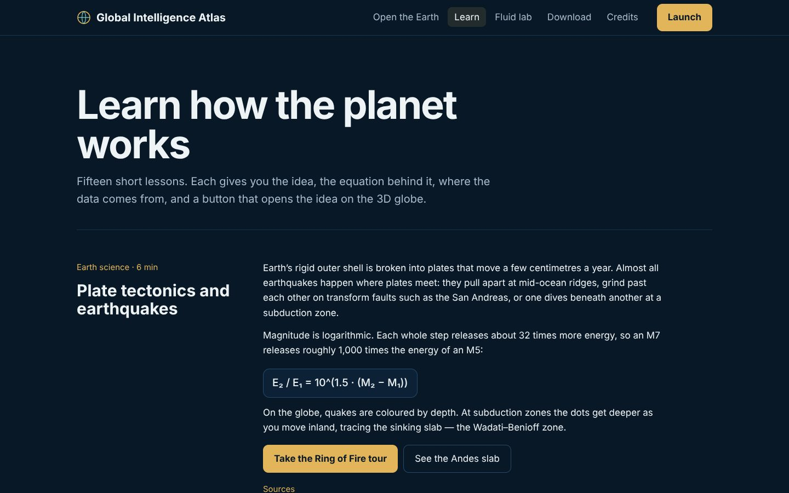</a><br/><b>Fifteen lessons</b>, each with its equation, sources and a button that opens it on the globe.</td>
<td>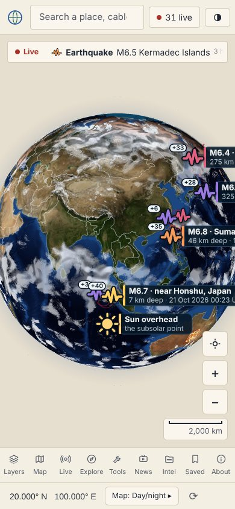<br/><b>On a phone.</b> Every section works down to phone width.</td>
</tr>
</table>

> The pictures were taken from the app itself with recorded sample data (`tools/screenshots.py` retakes the older ones). After the site is live, **Actions → Refresh README screenshots** retakes them from GitHub Pages with live data.

---

## ✨ Features

Each line opens into the full story.

<details>
<summary><b>🌋 Live Earth</b></summary>

Earthquakes (U.S. Geological Survey (USGS)), natural events and storm tracks (NASA Earth Observatory Natural Event Tracker (EONET)), fire hotspots (NASA Fire Information for Resource Management System (FIRMS)), weather radar (RainViewer), physical clouds, rain, snow and lightning from the Open-Meteo forecast with fire glow and smoke from NASA FIRMS, disaster alerts (Global Disaster Alert and Coordination System (GDACS)), aurora (National Oceanic and Atmospheric Administration (NOAA) Space Weather Prediction Center (SWPC)), wind and temperature (Open-Meteo), rocket launches (Launch Library 2) and news pins (GDELT). Live flights worldwide with a flights board, 3D planes and a seat-back view; ships worldwide from the Automatic Identification System (AIS).
</details>

<details>
<summary><b>✈ Every plane and ship, in detail</b></summary>

Click a plane and its flight view reads like an airline's own tracker: the flight number and airline (BAW117 is British Airways BA 117), the aircraft model with its typical seats, range, length and wingspan, the country it is registered in (and whether it is military), what it is doing (climbing out of London, cruising at flight level 380, descending into New York), its scheduled route from airport to airport with the local time at each end, and how much of it is flown, with a 3D model of that exact aircraft type (real length, wingspan and engines, in the airline's tail colours). The globe draws the flight's path: the track flown in coral and the rest of the route dashed ahead to a ringed destination. Search a flight number (BA117) or an airline to find it in the air, and show only one airline's planes. Ships give their flag (from the first three digits of their radio identity), their type, size, destination and whether they fit the Panama Canal, and can be filtered to cargo ships, tankers or any other kind. Airports show every scheduled nonstop route out of them as gold arcs, with their busiest routes and main airlines. The airline, model, route and registration tables come from Virtual Radar Server's public-domain standing data and are kept in the site, so none of this needs a paid flight-tracking service.
</details>

<details>
<summary><b>🚀 Every rocket launch, in depth</b></summary>

Click a launch pad and its card becomes a launch page. A live countdown leads, with the status, how sure the time is, the launch window and the chance of good weather. It says when that is for you and at the pad, and whether it flies in daylight, at twilight (when the climbing plume can glow like a jellyfish over a dark coast) or at night. **Weather at lift-off** is the Open-Meteo forecast at the pad for the launch hour (wind and gusts, cloud, rain chance and the jet stream 10 km up) with what in it usually holds a launch. **Flight plan** lists every published step, from propellant loading to satellite deployment, with T− and T+ times, the abbreviations written out (Main engine cut-off (MECO)), ticked off live as the flight goes. **Where it goes** gives the target orbit, the heading it leaves on, worked out from the pad latitude and the orbit tilt, the seas and countries under its climb (and a warning when an inland pad drops spent stages on land), the free speed Earth's spin gives it, and where the booster lands. **Crew** shows who is aboard with their role, agency, age and days already spent in space. **The rocket** is drawn to scale beside the Statue of Liberty and the Saturn V, with its payload in cars, its weight in jumbo jets, its thrust against its weight and every launch it has flown as a square (red for failures). **Booster**, **Mission** and **The pad** give the serial and flight count, the customer and latest note, and how many launches the pad, the site, the provider and the world have seen. On the globe it draws the climb in orange, the first orbit in lilac, the booster landing spot and a 300 km circle; during the flight a red ring marks where the rocket should be by now. From The Space Devs' Launch Library 2.
</details>

<details>
<summary><b>🛰 Every satellite and space station, in depth</b></summary>

Click a space station or any satellite dot and its card becomes a satellite page. It opens with what the satellite is for in plain words (a crewed station, internet from space, navigation, weather, Earth imaging, phones, a spent rocket stage or debris) and, from the CelesTrak satellite catalogue (SATCAT), who owns it, when and where it was launched and how long it has been up. A live box ticks every two seconds with its speed (Paris to New York in so many minutes), height, the country or sea under it and whether it is in sunlight or in Earth's shadow. Its orbit is drawn to scale around the Earth, with its lowest and highest points and where it is now, and its height sits on a ladder from an airliner to the geostationary ring; the page says how much of each orbit is sunlit and how many sunrises it sees a day. **Where next** lists the countries and seas it will fly over in its next orbit with the minutes until each (a geostationary satellite says where it hangs instead). **What it can see** gives the radius of its horizon and the people in the cities inside it right now, and **its record** gives its catalogue numbers, kind, status, radar size against things you know, and the orbits flown and distance travelled since launch. On the globe it draws the footprint, a line down to the ground and the next orbit. Well-known ones get their Wikipedia photo. Orbits from CelesTrak with SGP4 in your browser.
</details>

<details>
<summary><b>🜂 Every storm, volcano and wildfire, in depth</b></summary>

Click a natural event and its card becomes an event page. It says where it is (the country as a button, or open water, and the nearest city), how long it has been going and when it was last reported, the weather there now, and the people living in the cities on the map near it as Isotype figures. A **storm** gives its sustained wind and its step on the Saffir-Simpson scale, called a hurricane, typhoon or cyclone depending on the ocean, with its wind over its life drawn over the coloured steps, how fast and which way it is moving and how far it has come; on the globe its track is coloured by strength. A **volcano** gets its photo and story from Wikipedia, counts the people within 10, 30 and 100 km (the distances volcanologists use), and says which way its ash would drift on the wind 5.5 km up, with the rings and an arrow on the globe. A **wildfire** gives its size against places you know, the fire weather (wind, humidity, rain chance), which way it would spread and how many satellite hotspots are burning near it. Icebergs give their size. Events from NASA's Earth Observatory Natural Event Tracker (EONET); weather from Open-Meteo.
</details>

<details>
<summary><b>◉ Every city, in depth</b></summary>

Click a city and its page gives the weather there now (temperature, what it feels like, today's range, wind and gusts, humidity, the Ultraviolet (UV) index) with the next 24 hours as a temperature line and the hours rain is likely. A daylight ribbon marks sunrise, sunset and now, says how much longer or shorter tomorrow is and gives the city's longest and shortest days of the year. Its people are drawn as Isotype figures with its rank in the world and in its country, and the top line names its country as a button and the local time. **Getting there** lists the nearest airports and how many places the main one flies to nonstop, with its farthest flight; **Within 100 km** counts the earthquakes, planes and cameras your layers show and gives the landmarks nearby as buttons; and **The other side of the Earth** finds the spot exactly opposite, the country or ocean there and the nearest city, with a button to fly to it. On the globe a gold circle marks 100 km round the city. Weather live from Open-Meteo; day length from the Sun's position; airports and routes from OurAirports and Virtual Radar Server's standing data.
</details>

<details>
<summary><b>⚑ Every country, in depth</b></summary>

Click a country and its page draws its people as rows of Isotype figures (one figure is always the same round number of people; blue figures live in towns and cities, ochre in the countryside), gives its population, area and density with its rank among all countries, and sets it against the world on income per person, life expectancy, life in towns and cities, internet use, electricity, renewable energy and forest, each with its trend since 1990. It says the time and whether it is day or night in the capital, lists languages, money, driving side, phone code and web suffix, counts what the layers you have on show inside its borders right now (earthquakes this week, planes in its sky, open natural events, live cameras, its landmarks), and gives its neighbours as buttons that fly you there. On the globe the country is outlined in gold, its neighbours are traced and its capital is pinned. Live from REST Countries, the World Bank and Wikipedia.
</details>

<details>
<summary><b>〰 Every earthquake, in depth</b></summary>

Click an earthquake and its card becomes an event page. It opens with the magnitude, the depth, the strongest shaking on the Modified Mercalli scale and how many people reported feeling it, the alert from the U.S. Geological Survey's Prompt Assessment of Global Earthquakes for Response (PAGER) in words, and the tsunami flag with what it really means. The energy is given in tonnes of TNT and Hiroshima bombs on a magnitude scale, and a cut-away drawing shows how far down it started, through the crust and mantle. The fault solution is drawn as a beachball and named (thrust, normal, or left- or right-lateral strike-slip) with the nearest plate boundary. The shaking contours from ShakeMap are drawn on the globe in their standard colours, with the nearby cities and the shaking each one felt. A table gives when the first (P) and second (S) waves reached nearby and distant cities, and both wavefronts sweep out across the globe 60 times faster than real, leaving the shadow the Earth's core casts. The foreshocks and aftershocks are counted, plotted and ringed on the globe, and the card says how well the quake is located. All of it comes live from the USGS; the travel times, energy and aftershock window come from published formulas (IASP91, Gutenberg and Richter, Gardner and Knopoff).
</details>

<details>
<summary><b>🪐 The Moon, the planets, eclipses and a cinematic Earth</b></summary>

The globe is lit by the real Sun: mountains cast shading from the Sun's direction, the oceans glint where sunlight reflects toward you, the air glows blue on the day side and red-orange along the line of sunset, and city lights come on only where it is dark. Behind it is NASA's Tycho star map with the Milky Way, and the Sun, the Moon, the eight planets, Pluto and Jupiter's four big moons at their true positions, sizes and distances, worked out in the browser by [Astronomy Engine](https://github.com/cosinekitty/astronomy) and turned the way the International Astronomical Union (IAU) says each one faces, so the Moon shows its real phase and wobble (libration) and Saturn's rings their real tilt. The planet button by the zoom buttons (or Explore → The solar system) opens the whole solar system from above, with the asteroid and Kuiper belts and the farthest spacecraft (Voyager 1 and 2, New Horizons); click a name and the camera flies there and you can turn it and zoom in, on the Moon, Mars and Mercury down to the finest map NASA publishes; the space bar flies on to the next one, Orbits draws their paths, and Earth flies back to the globe. Maps come from Solar System Scope (Creative Commons Attribution 4.0, made from NASA mission imagery) and NASA 3D Resources (public domain); close to the Moon, Mars or Mercury the atlas also loads NASA's own full global mosaic from Solar System Treks. Links can open in space (`#…&sp=saturn`).

**Eclipses and landing sites.** Explore → Eclipses lists the coming eclipses of the Sun and the Moon; Watch runs the time machine through one while the real shadows are drawn: the Moon's shadow sweeping across the globe (its centre within 20 km of NASA's greatest-eclipse point) and the Earth's copper-red shadow on the Moon. Gold pins mark 17 landings on the Moon and 10 on Mars, each with its story.
</details>

<details>
<summary><b>🦌 Wildlife: where to see any animal</b></summary>

Search for an animal (a moose, a snow leopard, a puffin) and the atlas ranks the places you are most likely to see it, as a percentage: of all sightings of that kind of animal reported in a region in the last ten years, the share that were this one, from the Global Biodiversity Information Facility (GBIF) and iNaturalist. Each place gives the best months, where it was last seen and photos under Creative Commons licences. Thirty-six hotspots of unique animals, from Madagascar to the Galápagos, list what lives only there.
</details>

<details>
<summary><b>🫁 Air quality, everywhere and at any spot</b></summary>

About 400 places (every capital, then the biggest cities at least 160 km apart) are coloured by the US Air Quality Index now, from green (good) to maroon (hazardous); taller badges are worse air and red or worse ones pulse. Click one and its page opens with a gauge and the index in words, then **who should take care and what to do** (the US Environmental Protection Agency's advice for that band), the **main pollutant and why** (ozone on sunny afternoons, fine particles from traffic, heating and burning, desert dust on the wind, smoke when fire hotspots burn within 300 km), the fine-particle dose as **cigarettes a day** (Berkeley Earth: 22 µg/m³ for a day is about one), the ultraviolet (UV) index, desert dust and whether the air is better or worse than this time yesterday. **Next five days** draws every hour as a bar in its band colour and names the cleanest hours today and tomorrow. Folded underneath: each of six pollutants against the World Health Organization (WHO) 2021 guideline, and pollen in Europe. Click any spot on the ground and **Here now** gives its air in one line, with a button for the full page. Values come from the Copernicus Atmosphere Monitoring Service (CAMS) models through Open-Meteo, about 40 km worldwide and 10 km in Europe, so they describe the area rather than one street; an hourly snapshot keeps the layer working when the service cannot be reached.
</details>

<details>
<summary><b>⛈ US weather warnings, in depth</b></summary>

Every live warning, watch and advisory from the US National Weather Service (NWS) is drawn as the exact area it covers, in the NWS map colours: red tornado warnings, orange severe thunderstorms, dark red flash floods, pink winter storms, coral heat, deep pink fire weather. Storm-based warnings carry their own outline; alerts issued by forecast zone get theirs from the zones they name. Choose warnings only, warnings and watches, or every alert. An alert's page opens with its kind and a bar counting down the time left, the headline, and the three Common Alerting Protocol (CAP) words (how serious, how soon, how sure) in plain English; then the cities inside the area and about how many people live in them, **what to do** in a box of its own, other alerts over the same zones as buttons, and the full text folded away. A snapshot made every few minutes on GitHub keeps it working when the browser cannot reach the NWS. The atlas is not a warning system: always follow local officials.
</details>

<details>
<summary><b>🎧 Listen and sound</b></summary>

The headphones button in the header of every page reads it aloud with the voice your system already has (the Web Speech API): the title, the line under it and the main text, never the folded sections, and it stops when the page changes. The speaker button in the top bar switches on quiet sound cues, made on the spot with the Web Audio API so there are no audio files: a soft tick when a page opens, a two-note chime when something big appears in Just in (lower for bigger events) and a low double pulse for a tornado or extreme warning. Sound starts off and remembers your choice.
</details>

<details>
<summary><b>⚠ Every disaster alert and power plant, in depth</b></summary>

A disaster alert from the Global Disaster Alert and Coordination System (GDACS) opens into its level in plain words, the people living inside the rings its hazard uses, the earthquake or storm behind it and the alerts nearby. A power plant gives its capacity, how much of it is really used against the typical figure from the U.S. Energy Information Administration (EIA), the carbon dioxide per unit of power over its life from the Intergovernmental Panel on Climate Change (IPCC), the country's power mix and, for wind and solar, the wind and sunshine there now.
</details>

<details>
<summary><b>☁ Chemicals and environment</b></summary>

Pesticide use by county and by square mile, the U.S. Environmental Protection Agency (EPA) Toxics Release Inventory (TRI), CalEnviroScreen pollution burden by census tract, environmental violations from EPA Enforcement and Compliance History Online (ECHO), and pesticides measured in rivers, lakes and wells from the Water Quality Portal, compared with EPA drinking-water limits.
</details>

<details>
<summary><b>🛳 Infrastructure and open data</b></summary>

Undersea cables, pipelines, trade routes, chokepoints, ports, artificial intelligence (AI) data centres, nuclear sites, spaceports, financial centres and critical minerals. Seven of these layers can draw independently sourced open data (Wikidata, the National Geospatial-Intelligence Agency (NGA) World Port Index, TeleGeography and the U.S. Energy Information Administration (EIA)), refreshed monthly; About → Datasets switches between open data and World Monitor’s curated lists.
</details>

<details>
<summary><b>📰 News: world headlines and live news channels</b></summary>

The News tab lists the latest stories from 16 publishers' own feeds around the world (filter by region or word; each opens on the publisher's site, with the picture the publisher attached to it in its feed) and plays 22 free live news channels from the broadcasters' official streams: their YouTube live stream, or their own HTTP Live Streaming (HLS) stream. Every headline and channel says who owns it (public, state or commercial), as World Monitor does. `news.yml` refreshes both every 30 minutes.
</details>

<details>
<summary><b>🕵 Intel and the Intelligence toolkit</b></summary>

Declassified documents on a map and timeline, a redaction inspector for Portable Document Format (PDF) files, photo location from its metadata, a shadow clock and web-archive lookups. The toolkit, adapted from [Osiris](https://github.com/simplifaisoul/osiris), looks up domains, networks, software flaws (Common Vulnerabilities and Exposures (CVE)), sanctions lists and crypto wallets straight from public registries, and ranks conflict zones by live reports.
</details>

<details>
<summary><b>⏪ Replay, terrain and the view from the ground</b></summary>

Replay the last two weeks of flights, ships, alerts and fires; real terrain and 3D buildings at street level; the sky above any place; a time machine for day, night and the seasons; trace how a place is connected (power, internet, cameras).
</details>

<details>
<summary><b>🧩 Editions and plug-ins</b></summary>

Every layer describes itself (sources, licence, refresh, capabilities). Choose an edition (Full, Classroom without surveillance or conflict layers, or Lite) and add plug-in layers from a web address (URL).
</details>

<details>
<summary><b>🎓 Learning</b></summary>

Fifteen lessons on the [Learn page](https://normansrule.github.io/global-intelligence-atlas/learn/), six narrated tours (the Ring of Fire, arteries of the internet, chokepoints of world trade, orbits, the seasons, energy and minerals), the “Where on Earth?” quiz scored by great-circle distance, and a measuring tool that gives distance, bearing and the light time through fibre.
</details>

**Keyboard:** `/` search · `Ctrl+K` find anything · `C` trace · `[` `]` time speed · `\` live time · `S` area scan · `1`–`4` sensor looks · `5` heads-up display (HUD) · `6` Print · `T` tours · `Q` quiz · `M` measure · `R` spin · arrows pan · `+` `−` zoom · `Esc` close. **Share a view:** the address bar always holds the camera, base map and layers, for example `app/#@26.5,56.3,0.35&b=imagery&l=waterways,routes`.

---

## 📊 Progress

**Roadmap:** `█████████████████████░░░░░░░░░` **71 %** (8 of 12 items done, 1 in progress; [`HANDOFF.md`](HANDOFF.md) section 9 has the details)

| # | Roadmap item | Status | Shipped in |
|---|---|---|---|
| 1 | Data health panel and source monitor | ✅ Done | v2.1 |
| 2 | Accurate aircraft types | ✅ Done | v2.1 |
| 3 | Fire hotspots and weather radar | ✅ Done | v2.1 |
| 4 | Watch areas and alerts | ✅ Done | v2.1 |
| 5 | Ships worldwide | ✅ Done | v2.2 |
| 6 | Terrain and buildings for the ground view | ✅ Done | v2.3 |
| 7 | History and replay | ✅ Done | v2.4 |
| 8 | Layer plug-in system and editions | ✅ Done | v2.5 |
| 9 | Open data in place of World Monitor’s lists | 🟡 In progress: 7 of 12 layers `███████░░░░░` | v2.9 |
| 10 | Desktop polish: code signing, signed auto-updates, offline snapshot | ⬜ Planned | |
| 11 | Accessibility and languages | ⬜ Planned | |
| 12 | Code health: type checks, linting, splitting `main.js` | ⬜ Planned | |

**Still to move to open data (item 9):** pipelines (Global Energy Monitor), AI data centres (Epoch AI), trade routes, conflict zones and watch regions.

| Milestone | What it brought |
|---|---|
| v1.1 – v1.12 | Released as Terra Atlas: the globe, live layers, flights, cameras, tours, the quiz and the desktop app |
| v2.0 | Its own project, with references, a handoff guide and its own data jobs |
| v2.1 – v2.5 | Roadmap items 1 to 8 |
| v2.6 – v2.8 | Chemicals and environment |
| v2.9 | Open data for seven infrastructure layers |
| v2.10 | The Global Intelligence Atlas (GIA) repository launch: this README, browser tuning, release branding |
| v2.11 | Cameras from 22 more agencies and Osiris's worldwide webcam list, the rest of World Monitor's map datasets, markers that share a spot, economy, property and industry |
| v2.12 | A News tab: headlines from 16 publishers' own feeds around the world and free live news channels from broadcasters' official streams |
| **v2.20** | **The whole solar system: space opens on every planet where it is today, with the asteroid and Kuiper belts and the farthest spacecraft; click a planet to fly there; sharper NASA maps as you fly in close to the Moon, Mars and Mercury** |
| v2.19 | **A whole city up close: tilt to look across it, buildings with windows lit by the real Sun and after dark, parks, woods, rivers and lakes with trees and rippling water, pavements, lane lines and street lamps** |
| v2.18 | **Close-ups that behave like the real thing: traffic that keeps its distance and queues at red lights, ship wakes at the Kelvin angle, and navigation, head and tail lights after dark** |
| v2.17 | **The finished Earth 14 to 17 % sooner with 0.8 MB less before it, lifelike planes up close with their real lights, a redesigned README, the Sun-lit Earth under close-up imagery instead of black, cables that fade at the whole-globe view, and a repeatable first-visit timer** |
| v2.16 | **Lifelike close-ups (3D ships at real size, simulated traffic on real roads, buildings), a faster first view, animal photo galleries, the Print look and about 1,700 more cameras** |
| **v2.15** | **Air quality everywhere, US weather warnings drawn as their real areas, Listen and sound** |
| **v2.14** | **Ships in 3D with their cargo, and in-depth pages for every disaster alert and power plant** |
| **v2.13** | **Click anything for the whole story: in-depth pages for every plane, ship, airport, port, undersea cable, nuclear plant, earthquake, natural event, country, city, satellite and launch; the Counted world redesign** |

Full release notes: [`CHANGELOG.md`](CHANGELOG.md).

---

## 🎨 Design

The look is called **Counted world**. It borrows from Isotype, the picture-statistics language Otto Neurath and Gerd Arntz made in 1920s Vienna so that anyone could read public numbers, which is exactly what this project is for.

- **Quantities are counted, not decorated.** Where the app tells you how many of something there are, it draws a row of identical little figures, and the row says what one figure stands for ("one figure = 5"). Single facts get a single figure.
- **Colour names a category.** A small flat palette: red for hazards and anything live, ultramarine for actions, selection and focus, ochre for warnings and time, green for links and things that are switched on. No gradients, no glow, no frosted glass.
- **Two typefaces with jobs.** Jost, a geometric face in the spirit of the Isotype charts, for headings and numbers; Atkinson Hyperlegible, designed by the Braille Institute for low-vision readers, for everything you read.
- **Day is a map on paper, night is the same map at sea.** Day is warm, slightly yellowed paper (#ece5d6) with ultramarine ink; night is deep navy (#0b1524) with pale blue, sea green and amber. Every colour is a token with a day and a night value, checked for contrast in both (every text pair is at least 4.6 to 1). A faint graticule sits behind the website's hero, the globe rests on paper by day and among stars at night, and switching spreads the new theme out from the button as a circle.
- **Motion arrives, then holds still.** Things move when they appear or when you act: the website's hero settles in line by line, sections rise in as you scroll, numbers count up, links and rows answer the pointer, buttons press in by 3 %, and pages cross-fade. Nothing loops or moves on a timer, and only position and opacity are animated so it stays smooth. With reduced motion switched on in your system, nothing travels; colour changes still show what happened.
- **One object, one story.** The home page pins a single live globe and lets the story scroll past it; every chapter steers the globe rather than showing a picture of it.
- **Fewest words, most information.** Each item shows one line; click it for the full detail, the sources and a button into the globe. Long explanations fold to a single line until you open them.
- **One spacing and type scale.** Five text sizes and a 4-point spacing scale, shared by the app and the website, so panels line up and nothing overlaps (checked at six window sizes by `tests/e2e/overlap.py`).
- **The weather is physical.** Clouds, rain, lightning and smoke are drawn as things in the scene, lit by the real Sun, rather than as icons, in a handful of draw calls so ordinary laptops keep up.

The full design profile is in [`PRODUCT.md`](PRODUCT.md); the tokens are at the top of [`site/app/css/atlas.css`](site/app/css/atlas.css) and [`site/assets/site.css`](site/assets/site.css).

---

## 🔧 How it works

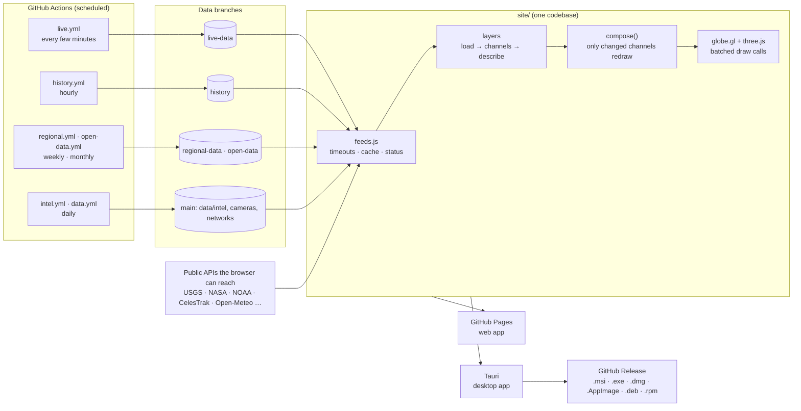

- **Every layer is one object** with `load()`, `channels()`, `describe()` and `learn`. Adding a layer means adding one object to the registry ([`site/app/js/registry.js`](site/app/js/registry.js)).
- **Honest failure:** each layer shows a status dot; when a source is down or blocked, its card says what failed.
- **Data jobs** write orphan branches that the app reads through raw GitHub URLs, so the site itself stays static.

```
site/                 everything GitHub Pages serves (and the desktop app packages)
├── index.html        home page (live counts and a globe)
├── assets/           website styles and scripts (site.css, site.js, home.js)
├── app/              the globe: js/ (one module per feature), css/, data/, textures/, vendor/ (globe.gl + three.js)
│   ├── css/atlas.css     every colour, size and motion token, light and dark
│   ├── js/theme.js       light and dark themes for the page and the 3D scene
│   └── js/skyfx.js       clouds, rain, lightning and fire drawn on the globe
├── learn/ fluid/ download/ credits/
└── sw.js             offline cache
desktop/              Tauri 2 shell around site/
tools/                data jobs, screenshots, references
tests/                headless-browser and Node tests
.github/workflows/    pages · desktop · tests · live · history · regional · open-data · intel · data · health · aircraft-db · screenshots · video
```

---

## 🚀 Run it yourself

**Use it:** open the [web app](https://normansrule.github.io/global-intelligence-atlas/app/), drag to spin the globe and scroll to zoom. The bar on the left opens the sections: **Layers** to switch things on, **Live** for what is happening right now (counted), **Explore** for tours, the quiz and lessons, **Tools** for measuring and tracing. Click anything on the globe for its card. The half-filled circle at the top right switches between light and dark.

**Preview locally** (any static server):

```bash
git clone https://github.com/Normansrule/global-intelligence-atlas.git && cd global-intelligence-atlas
cd site && python3 -m http.server 8080          # open http://localhost:8080/app/
```

**Publish your own copy:** Settings → Pages → Source: GitHub Actions. [`pages.yml`](.github/workflows/pages.yml) publishes `site/` on every push. Start the data jobs once by hand (`gh workflow run live.yml`, `intel.yml`, `data.yml`, `regional.yml`, `open-data.yml`, `economy.yml`, `news.yml`, `aircraft-db.yml`, then `history.yml`); after that they run on their schedules.

**Desktop release:** push a version tag and [`desktop.yml`](.github/workflows/desktop.yml) builds every platform and attaches the files to a GitHub Release:

```bash
git tag v2.14.0 && git push origin v2.14.0
```

The builds are not code-signed, so Windows SmartScreen and macOS Gatekeeper ask you to confirm the first launch (the Download page explains how).

**Optional keys** (repository secrets): `OPENSKY_CLIENT_ID` and `OPENSKY_CLIENT_SECRET` for a better flight feed, `FIRMS_MAP_KEY` for fire hotspots, `AISSTREAM_KEY` for ships worldwide, `WSDOT_ACCESS_CODE` for Washington's official camera list (the public list is used without it), `CENSUS_API_KEY` (free) for the U.S. county home values. A small Cloudflare Worker in [`proxy/`](proxy/) gives the web app real-time flights too.

**Tests** (headless Chromium with software WebGL; the same tests run in GitHub Actions):

```bash
pip install playwright && python -m playwright install chromium
MOCK_REAL=1 bash tests/e2e/run.sh test_v2.py     # expect "SUMMARY 15 / 15"
bash tests/e2e/run.sh overlap.py                  # expect "no overlaps" at six window sizes
bash tests/e2e/run.sh test_pins_zoom.py            # pins stay on screen down to the closest zoom
python3 tests/docs/check_readme.py                # README pictures, links and progress tracker
```

**Rebuild the references, screenshots and animations:** `python3 tools/build-references.py` · `python3 tools/screenshots.py` · `python3 tools/make_gif.py` · `python3 tools/make_gif.py --looks`. Developer guide: [`HANDOFF.md`](HANDOFF.md).

---

## 📚 Data and references

Every library, data set and paper is cited in APA 7th edition style in [`docs/REFERENCES.md`](docs/REFERENCES.md) (over 300 references), with a second table showing where each is used and under which licence. The app’s About panel lists the same sources.

Key references:

- Habib, E. (2026). *World Monitor* [Computer software]. GitHub. https://github.com/koala73/worldmonitor
- simplifaisoul. (2026). *Osiris: Open source intelligence & reconnaissance integrated system* [Computer software]. GitHub. https://github.com/simplifaisoul/osiris
- Asturiano, V. (2026a). *globe.gl* [Computer software]. GitHub. https://github.com/vasturiano/globe.gl
- Bird, P. (2003). An updated digital model of plate boundaries. *Geochemistry, Geophysics, Geosystems, 4*(3), Article 1027. https://doi.org/10.1029/2001GC000252
- U.S. Geological Survey. (n.d.-a). *Earthquake Hazards Program: GeoJSON summary feeds* [Data set]. Retrieved October 14, 2026, from https://earthquake.usgs.gov/earthquakes/feed/v1.0/geojson.php

The full list, with retrieval dates for live feeds, is in [`docs/REFERENCES.md`](docs/REFERENCES.md). How to cite this project: [`CITATION.cff`](CITATION.cff).

---

## 🙏 Credits

**Global Intelligence Atlas (GIA) is built on the basis of [World Monitor](https://github.com/koala73/worldmonitor) by [Elie Habib](https://github.com/koala73)**, a real-time global intelligence dashboard. Its 3D-globe concept, layer catalogue, curated datasets and country outlines come from that project, and World Monitor stays credited in the app, on the Credits page and in [`NOTICE.md`](NOTICE.md), which records what was taken and what changed.

| Project | How GIA uses it |
|---|---|
| [World Monitor](https://github.com/koala73/worldmonitor) · AGPL-3.0 | The basis: concept, curated datasets, country outlines |
| [Osiris](https://github.com/simplifaisoul/osiris) · MIT | Design of the Intelligence toolkit, the conflict-zone list and its worldwide public webcam list |
| [globe.gl](https://github.com/vasturiano/globe.gl) · [three.js](https://github.com/mrdoob/three.js) · MIT | 3D globe, tile engine, shaders |
| [satellite.js](https://github.com/shashwatak/satellite-js) · MIT | Orbit propagation (Simplified General Perturbations 4, SGP4) |
| [Astronomy Engine](https://github.com/cosinekitty/astronomy) · MIT | Positions and spin of the Sun, Moon, planets, Pluto and Jupiter's moons |
| [Solar System Scope textures](https://www.solarsystemscope.com/textures/) · CC BY 4.0 · [NASA 3D Resources](https://github.com/nasa/NASA-3D-Resources) · public domain | Maps of the Sun, Moon and planets, and the star sky |
| [Tauri](https://github.com/tauri-apps/tauri) · MIT / Apache-2.0 | Desktop app |
| [WebGL Fluid Simulation](https://github.com/PavelDoGreat/WebGL-Fluid-Simulation) · MIT | Fluid lab |
| [hls.js](https://github.com/video-dev/hls.js) · Apache-2.0 | Live camera video |
| [God’s Eye View](https://github.com/bilawalsidhu/gods-eye-view) · MIT | Inspiration for the sensor looks and for simulated traffic on real roads (no code copied) |
| [Open Eagle Eye](https://github.com/stuchapin909/Open-Eagle-Eye) · MIT | Its verified camera registry, merged into Public webcams worldwide under the atlas's own publisher rules |
| [ascii-dither-shader](https://github.com/codeptor/ascii-dither-shader) | Idea for the Print look (no licence stated, so nothing copied; the dither is Bayer's 1973 method) |
| [Argus](https://github.com/MeyerThorsten/Argus) · AGPL-3.0 | Idea for the air-quality and US weather-alert layers (no code copied) |
| [free-sfx](https://github.com/arnofaure/free-sfx) · CC BY 4.0 · [ElevenLabs MCP](https://github.com/elevenlabs/elevenlabs-mcp) · MIT | Ideas for the sound cues and Listen (both are made in the browser; no audio or code copied) |
| [Skills for designers and engineers](https://github.com/emilkowalski/skills) by Emil Kowalski · MIT | Motion rules for the v2.15 pages: ease-out, under 300 ms, grow from 96 %, reduced motion respected |
| [Remotion](https://github.com/remotion-dev/remotion) | Promo video rendered from code |
| [Jost](https://github.com/indestructible-type/Jost) · [Atkinson Hyperlegible](https://www.brailleinstitute.org/freefont/) · SIL Open Font License (OFL) | Typefaces |

Satellite imagery: *we acknowledge the use of imagery provided by services from NASA’s Global Imagery Browse Services (GIBS), part of NASA’s Earth Science Data and Information System (ESDIS).* Map data © OpenStreetMap contributors (ODbL).

## 📄 License

**GNU Affero General Public License, version 3 only (AGPL-3.0-only)**, the same as World Monitor, whose datasets it ships. You may use, study, share and modify this project; if you run a modified version for others over a network, you must offer them its source. See [`LICENSE`](LICENSE).
