<div align="center">

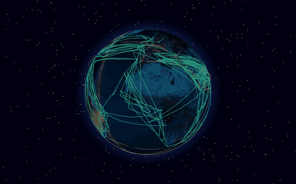

# Global Intelligence Atlas (GIA)

**A living 3D Earth to explore and learn from, in your browser or as a desktop app.**

Live earthquakes, storms, fires, flights, ships, satellites and aurora; the cables, pipelines, ports and chokepoints that connect the world; chemicals and pollution down to the square mile; and open-source intelligence (OSINT) tools, each with a lesson that explains it.
Built on the basis of [World Monitor](https://github.com/koala73/worldmonitor) by Elie Habib.

[](https://normansrule.github.io/global-intelligence-atlas/app/)
[](https://github.com/Normansrule/global-intelligence-atlas/releases/latest)
[](https://normansrule.github.io/global-intelligence-atlas/)

[](CHANGELOG.md)
[](LICENSE)
[](https://github.com/Normansrule/global-intelligence-atlas/actions/workflows/pages.yml)
[](https://github.com/Normansrule/global-intelligence-atlas/actions/workflows/tests.yml)
[](https://github.com/Normansrule/global-intelligence-atlas/actions/workflows/desktop.yml)
[](#-progress)


[Web or desktop](#-web-app-and-desktop-app) · [Gallery](#-gallery) · [Features](#-features) · [Progress](#-progress) · [How it works](#-how-it-works) · [Run it](#-run-it-yourself) · [References](#-data-and-references) · [Credits](#-credits) · [Changelog](CHANGELOG.md)

</div>

---

## 🌍 At a glance

| | |
|---|---|
| **65 layers in 11 groups** | Live Earth, economy and property, chemicals and environment, cameras, civic data, sky and space, Earth science, places, infrastructure, geopolitics and Intel |
| **210 data sources, 264 references** | Every source is listed in the app (About) and in [`docs/REFERENCES.md`](docs/REFERENCES.md) in APA 7th edition style |
| **No server, no account, no key** | A static site on GitHub Pages; scheduled GitHub Actions jobs collect what browsers cannot fetch directly |
| **Learn as you go** | Every layer has a card: what you are seeing, how it is measured, something to try, and its sources. Fifteen lessons, six guided tours and a quiz |
| **Two ways to run it, one codebase** | The web app and the desktop app run the same `site/` folder, so they have the same features |

---

## 🖥 Web app and desktop app

Both are built from the same files, so every layer, tool and lesson is in both. The web app is tuned for the browser; the desktop app adds what a browser is not allowed to do.

| | 🌐 **Web app** (GitHub Pages) | 💻 **Desktop app** (Tauri) |
|---|---|---|
| **Open it** | [normansrule.github.io/global-intelligence-atlas/app](https://normansrule.github.io/global-intelligence-atlas/app/) | [Releases](https://github.com/Normansrule/global-intelligence-atlas/releases/latest): `.msi` / `.exe`, `.dmg` (Apple silicon and Intel), `.AppImage` / `.deb` / `.rpm` |
| **Code** | `site/` | the same `site/`, wrapped by [`desktop/`](desktop/) (`"frontendDist": "../../site"`) |
| **Layers, tools, lessons** | All | All |
| **Live data the browser cannot fetch** | Read from snapshots the GitHub Actions jobs publish every few minutes | Fetched directly (no cross-origin limits), so flights and ships are real time |
| **Ships worldwide** | Snapshot from the `live-data` branch | Live AISStream collector (with a free key) |
| **Notifications for watch areas** | Browser notifications | System notifications |
| **Offline** | Installable web app; a service worker keeps the app, textures and datasets | Everything bundled in the app |
| **Updates** | Every push to `main` | Every version tag builds a new release |

**Browser tuning:** draw calls are batched (one mesh per colour band, merged country outlines, a fast marker renderer), the pixel ratio is capped on high-density screens, an automatic quality setting steps down when the frame rate drops and rests when the tab is hidden, layers that depend on the view load only what is on screen, the page fetches the globe engine and its first modules in parallel (`modulepreload`), and on repeat visits the service worker answers the 1.4 MB engine, the Earth textures and images from its cache at once while refreshing them in the background.

---

## 🖼 Gallery

<table>
<tr>
<td width="50%"><a href="https://normansrule.github.io/global-intelligence-atlas/app/#@28,55,1.5&b=night&l=cables,pipelines,routes,waterways,datacenters">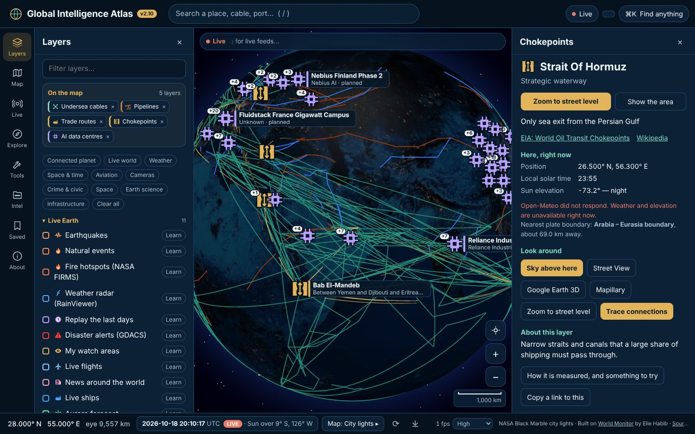</a><br/><b>The world’s plumbing.</b> Cables, pipelines, trade routes, chokepoints and data centres; click one for its card.</td>
<td width="50%"><a href="https://normansrule.github.io/global-intelligence-atlas/app/?look=flir#@36,138,1.2&b=bluemarble&l=borders,cables,quakes,nuclear">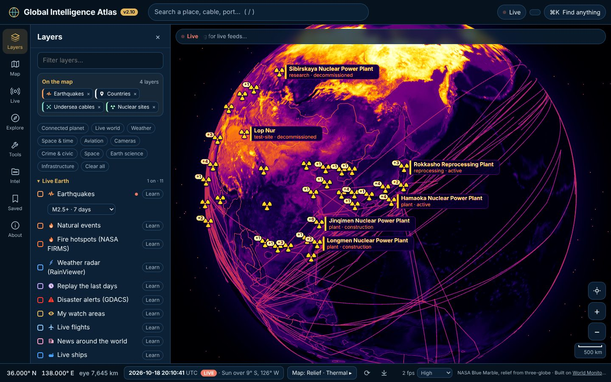</a><br/><b>Sensor looks.</b> Normal, night vision, thermal and CRT (keys 1 to 4).</td>
</tr>
<tr>
<td><a href="https://normansrule.github.io/global-intelligence-atlas/app/#@30,-20,3.6&b=daynight&l=satellites,stations,sun">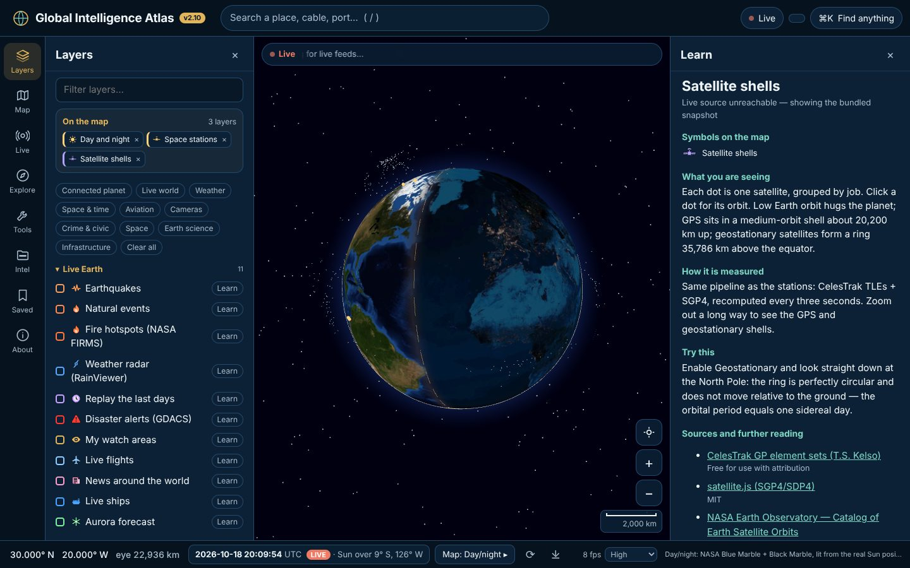</a><br/><b>Orbits computed in your browser.</b> Satellites and space stations, propagated with SGP4.</td>
<td><a href="https://normansrule.github.io/global-intelligence-atlas/app/#@-5,-120,2.1&b=bluemarble&l=plates,quakes,borders,grid">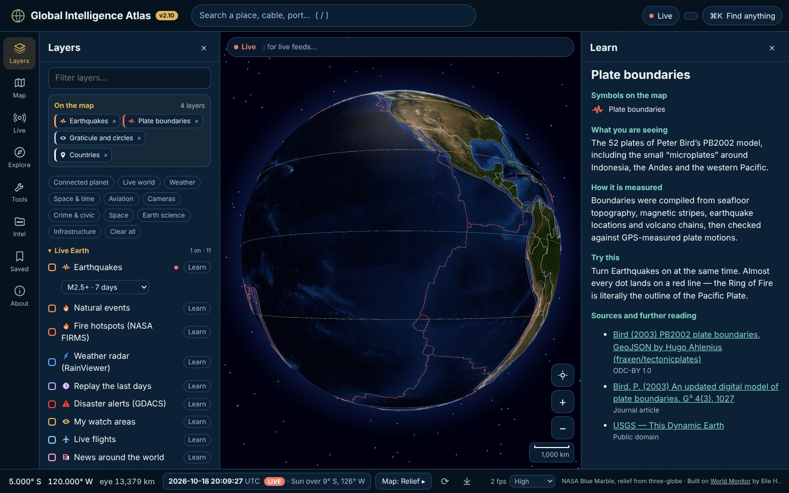</a><br/><b>A lesson on every layer.</b> What you see, how it is measured, something to try, and sources.</td>
</tr>
<tr>
<td><a href="https://normansrule.github.io/global-intelligence-atlas/">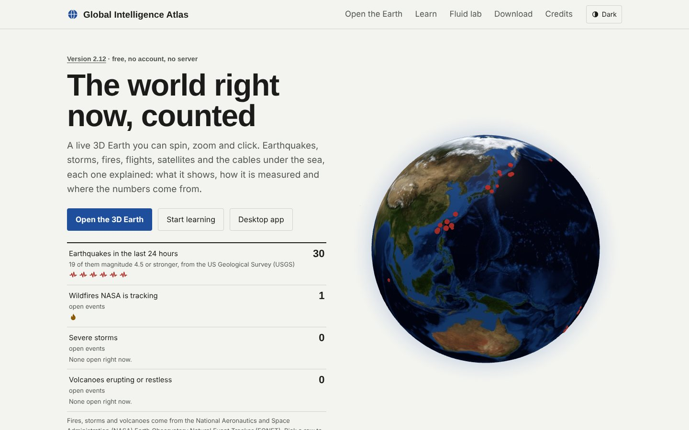</a><br/><b>Home page</b> with a live, rotating globe.</td>
<td><a href="https://normansrule.github.io/global-intelligence-atlas/learn/">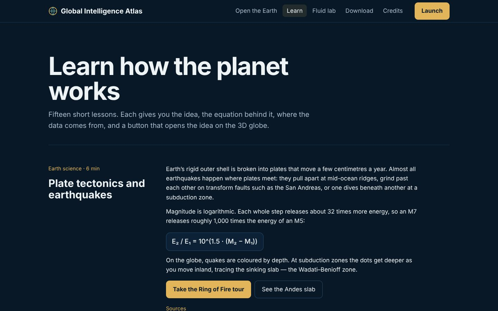</a><br/><b>Fifteen lessons</b>, each with its equation, sources and a button that opens it on the globe.</td>
</tr>
<tr>
<td><a href="https://normansrule.github.io/global-intelligence-atlas/fluid/">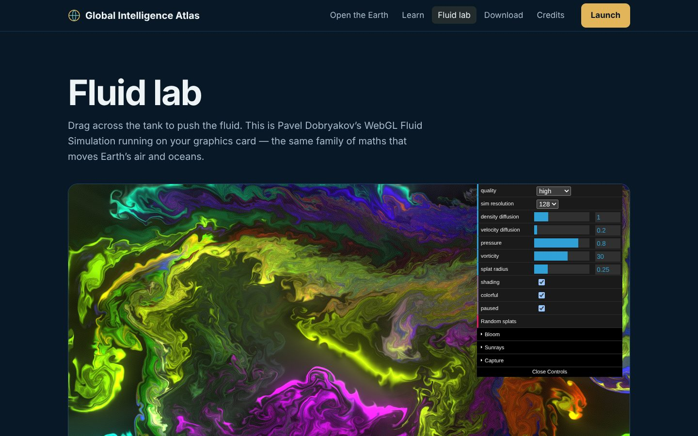</a><br/><b>Fluid lab.</b> A GPU fluid simulation with cyclone, trade-wind and jet-stream presets.</td>
<td><a href="https://normansrule.github.io/global-intelligence-atlas/download/">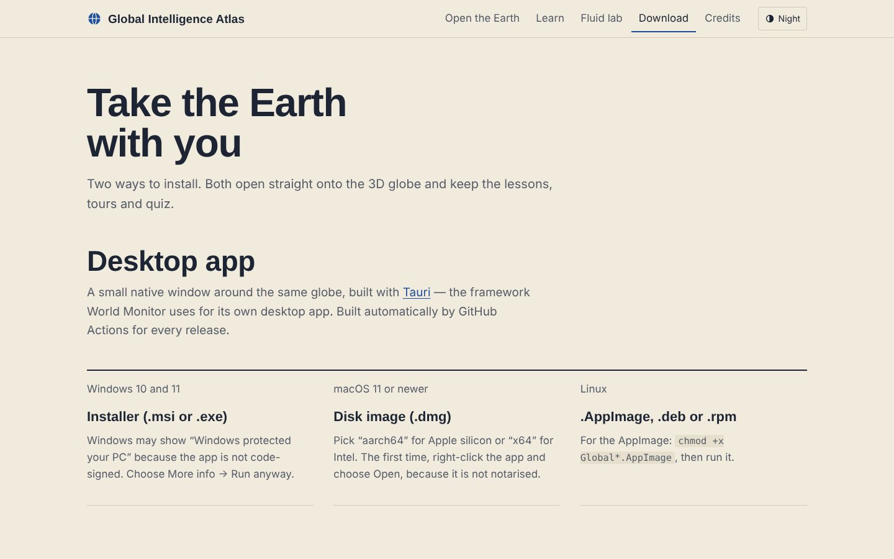</a><br/><b>Download page.</b> Desktop builds and how to install the web app.</td>
</tr>
</table>

<div align="center">
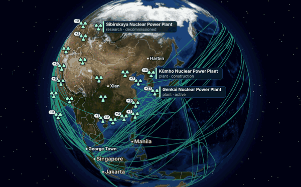
<br/><sub>The same view through the four sensor looks.</sub>
</div>

> The pictures were taken from the app itself (`tools/screenshots.py`, `tools/make_gif.py`). These show the layers that ship with the site; after the site is live, **Actions → Refresh README screenshots** retakes them from GitHub Pages with live data.

---

## ✨ Features

<details open>
<summary><b>🌋 Live Earth</b></summary>

Earthquakes (U.S. Geological Survey (USGS)), natural events and storm tracks (NASA Earth Observatory Natural Event Tracker (EONET)), fire hotspots (NASA Fire Information for Resource Management System (FIRMS)), weather radar (RainViewer), disaster alerts (Global Disaster Alert and Coordination System (GDACS)), aurora (NOAA Space Weather Prediction Center (SWPC)), wind and temperature (Open-Meteo), rocket launches (Launch Library 2) and news pins (GDELT). Live flights worldwide with a flights board, 3D planes and a seat-back view; ships worldwide from the Automatic Identification System (AIS).
</details>

<details open>
<summary><b>☁ Chemicals and environment</b></summary>

Pesticide use by county and by square mile, the EPA Toxics Release Inventory (TRI), CalEnviroScreen pollution burden by census tract, environmental violations from EPA Enforcement and Compliance History Online (ECHO), and pesticides measured in rivers, lakes and wells from the Water Quality Portal, compared with EPA drinking-water limits.
</details>

<details open>
<summary><b>🛳 Infrastructure and open data</b></summary>

Undersea cables, pipelines, trade routes, chokepoints, ports, AI data centres, nuclear sites, spaceports, financial centres and critical minerals. Seven of these layers can draw independently sourced open data (Wikidata, the National Geospatial-Intelligence Agency (NGA) World Port Index, TeleGeography and the U.S. Energy Information Administration (EIA)), refreshed monthly; About → Datasets switches between open data and World Monitor’s curated lists.
</details>

<details open>
<summary><b>📰 News: world headlines and live news channels</b></summary>

The News tab lists the latest stories from 16 publishers' own feeds around the world (filter by region or word; each opens on the publisher's site) and plays 22 free live news channels from the broadcasters' official streams: their YouTube live stream, or their own HLS stream. Every headline and channel says who owns it (public, state or commercial), as World Monitor does. `news.yml` refreshes both every 30 minutes.
</details>

<details open>
<summary><b>🕵 Intel and the Intelligence toolkit</b></summary>

Declassified documents on a map and timeline, a redaction inspector for PDF files, photo location from its metadata, a shadow clock and web-archive lookups. The toolkit, adapted from [Osiris](https://github.com/simplifaisoul/osiris), looks up domains, networks, software flaws (Common Vulnerabilities and Exposures (CVE)), sanctions lists and crypto wallets straight from public registries, and ranks conflict zones by live reports.
</details>

<details open>
<summary><b>⏪ Replay, terrain and the view from the ground</b></summary>

Replay the last two weeks of flights, ships, alerts and fires; real terrain and 3D buildings at street level; the sky above any place; a time machine for day, night and the seasons; trace how a place is connected (power, internet, cameras).
</details>

<details open>
<summary><b>🧩 Editions and plug-ins</b></summary>

Every layer describes itself (sources, licence, refresh, capabilities). Choose an edition (Full, Classroom without surveillance or conflict layers, or Lite) and add plug-in layers from a URL.
</details>

<details open>
<summary><b>🎓 Learning</b></summary>

Fifteen lessons on the [Learn page](https://normansrule.github.io/global-intelligence-atlas/learn/), six narrated tours (the Ring of Fire, arteries of the internet, chokepoints of world trade, orbits, the seasons, energy and minerals), the “Where on Earth?” quiz scored by great-circle distance, and a measuring tool that gives distance, bearing and the light time through fibre.
</details>

**Keyboard:** `/` search · `Ctrl+K` find anything · `C` trace · `[` `]` time speed · `\` live time · `S` area scan · `1`–`4` sensor looks · `5` HUD · `T` tours · `Q` quiz · `M` measure · `R` spin · arrows pan · `+` `−` zoom · `Esc` close. **Share a view:** the address bar always holds the camera, base map and layers, for example `app/#@26.5,56.3,0.35&b=imagery&l=waterways,routes`.

---

## 📊 Progress

**Roadmap:** `█████████████████████░░░░░░░░░` **71 %** (8 of 12 items done, 1 in progress; [`HANDOFF.md`](HANDOFF.md) section 9 has the details)

| # | Roadmap item | Status | Shipped in |
|---|---|---|---|
| 1 | Data health panel and source monitor | ✅ Done | v2.1 |
| 2 | Accurate aircraft types | ✅ Done | v2.1 |
| 3 | Fire hotspots and weather radar | ✅ Done | v2.1 |
| 4 | Watch areas and alerts | ✅ Done | v2.1 |
| 5 | Ships worldwide | ✅ Done | v2.2 |
| 6 | Terrain and buildings for the ground view | ✅ Done | v2.3 |
| 7 | History and replay | ✅ Done | v2.4 |
| 8 | Layer plug-in system and editions | ✅ Done | v2.5 |
| 9 | Open data in place of World Monitor’s lists | 🟡 In progress: 7 of 12 layers `███████░░░░░` | v2.9 |
| 10 | Desktop polish: code signing, signed auto-updates, offline snapshot | ⬜ Planned | |
| 11 | Accessibility and languages | ⬜ Planned | |
| 12 | Code health: type checks, linting, splitting `main.js` | ⬜ Planned | |

**Still to move to open data (item 9):** pipelines (Global Energy Monitor), AI data centres (Epoch AI), trade routes, conflict zones and watch regions.

| Milestone | What it brought |
|---|---|
| v1.1 – v1.12 | Released as Terra Atlas: the globe, live layers, flights, cameras, tours, the quiz and the desktop app |
| v2.0 | Its own project, with references, a handoff guide and its own data jobs |
| v2.1 – v2.5 | Roadmap items 1 to 8 |
| v2.6 – v2.8 | Chemicals and environment |
| v2.9 | Open data for seven infrastructure layers |
| v2.10 | The Global Intelligence Atlas (GIA) repository launch: this README, browser tuning, release branding |
| v2.11 | Cameras from 22 more agencies and Osiris's worldwide webcam list, the rest of World Monitor's map datasets, markers that share a spot, economy, property and industry |
| **v2.12** | **A News tab: headlines from 16 publishers' own feeds around the world and free live news channels from broadcasters' official streams** |

Full release notes: [`CHANGELOG.md`](CHANGELOG.md).

---

## 🔧 How it works

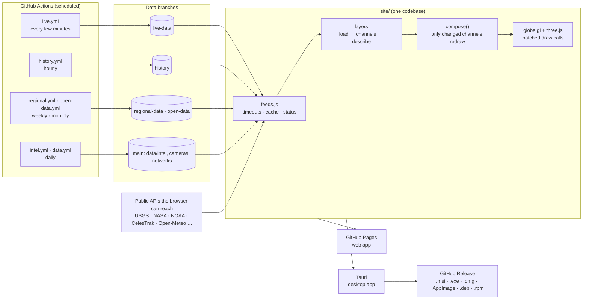

- **Every layer is one object** with `load()`, `channels()`, `describe()` and `learn`. Adding a layer means adding one object to the registry ([`site/app/js/registry.js`](site/app/js/registry.js)).
- **Honest failure:** each layer shows a status dot; when a source is down or blocked, its card says what failed.
- **Data jobs** write orphan branches that the app reads through raw GitHub URLs, so the site itself stays static.

```
site/                 everything GitHub Pages serves (and the desktop app packages)
├── index.html        home page
├── app/              the globe: js/ (one module per feature), data/, textures/, vendor/ (globe.gl + three.js)
├── learn/ fluid/ download/ credits/
└── sw.js             offline cache
desktop/              Tauri 2 shell around site/
tools/                data jobs, screenshots, references
tests/                headless-browser and Node tests
.github/workflows/    pages · desktop · tests · live · history · regional · open-data · intel · data · health · aircraft-db · screenshots · video
```

---

## 🚀 Run it yourself

**Preview locally** (any static server):

```bash
git clone https://github.com/Normansrule/global-intelligence-atlas.git && cd global-intelligence-atlas
cd site && python3 -m http.server 8080          # open http://localhost:8080/app/
```

**Publish your own copy:** Settings → Pages → Source: GitHub Actions. [`pages.yml`](.github/workflows/pages.yml) publishes `site/` on every push. Start the data jobs once by hand (`gh workflow run live.yml`, `intel.yml`, `data.yml`, `regional.yml`, `open-data.yml`, `economy.yml`, `news.yml`, `aircraft-db.yml`, then `history.yml`); after that they run on their schedules.

**Desktop release:** push a version tag and [`desktop.yml`](.github/workflows/desktop.yml) builds every platform and attaches the files to a GitHub Release:

```bash
git tag v2.12.0 && git push origin v2.12.0
```

The builds are not code-signed, so Windows SmartScreen and macOS Gatekeeper ask you to confirm the first launch (the Download page explains how).

**Optional keys** (repository secrets): `OPENSKY_CLIENT_ID` and `OPENSKY_CLIENT_SECRET` for a better flight feed, `FIRMS_MAP_KEY` for fire hotspots, `AISSTREAM_KEY` for ships worldwide, `WSDOT_ACCESS_CODE` for Washington's official camera list (the public list is used without it), `CENSUS_API_KEY` (free) for the U.S. county home values. A small Cloudflare Worker in [`proxy/`](proxy/) gives the web app real-time flights too.

**Tests** (headless Chromium with software WebGL; the same tests run in GitHub Actions):

```bash
pip install playwright && python -m playwright install chromium
MOCK_REAL=1 bash tests/e2e/run.sh test_v2.py     # expect "SUMMARY 15 / 15"
bash tests/e2e/run.sh overlap.py                  # expect "no overlaps" at six window sizes
python3 tests/docs/check_readme.py                # README pictures, links and progress tracker
```

**Rebuild the references, screenshots and animations:** `python3 tools/build-references.py` · `python3 tools/screenshots.py` · `python3 tools/make_gif.py` · `python3 tools/make_gif.py --looks`. Developer guide: [`HANDOFF.md`](HANDOFF.md).

---

## 📚 Data and references

Every library, data set and paper is cited in APA 7th edition style in [`docs/REFERENCES.md`](docs/REFERENCES.md) (225 references), with a second table showing where each is used and under which licence. The app’s About panel lists the same 157 sources.

Key references:

- Habib, E. (2026). *World Monitor* [Computer software]. GitHub. https://github.com/koala73/worldmonitor
- simplifaisoul. (2026). *Osiris: Open source intelligence & reconnaissance integrated system* [Computer software]. GitHub. https://github.com/simplifaisoul/osiris
- Asturiano, V. (2026a). *globe.gl* [Computer software]. GitHub. https://github.com/vasturiano/globe.gl
- Bird, P. (2003). An updated digital model of plate boundaries. *Geochemistry, Geophysics, Geosystems, 4*(3), Article 1027. https://doi.org/10.1029/2001GC000252
- U.S. Geological Survey. (n.d.-a). *Earthquake Hazards Program: GeoJSON summary feeds* [Data set]. Retrieved October 14, 2026, from https://earthquake.usgs.gov/earthquakes/feed/v1.0/geojson.php

The full list, with retrieval dates for live feeds, is in [`docs/REFERENCES.md`](docs/REFERENCES.md). How to cite this project: [`CITATION.cff`](CITATION.cff).

---

## 🙏 Credits

**Global Intelligence Atlas (GIA) is built on the basis of [World Monitor](https://github.com/koala73/worldmonitor) by [Elie Habib](https://github.com/koala73)**, a real-time global intelligence dashboard. Its 3D-globe concept, layer catalogue, curated datasets and country outlines come from that project, and World Monitor stays credited in the app, on the Credits page and in [`NOTICE.md`](NOTICE.md), which records what was taken and what changed.

| Project | How GIA uses it |
|---|---|
| [World Monitor](https://github.com/koala73/worldmonitor) · AGPL-3.0 | The basis: concept, curated datasets, country outlines |
| [Osiris](https://github.com/simplifaisoul/osiris) · MIT | Design of the Intelligence toolkit, the conflict-zone list and its worldwide public webcam list |
| [globe.gl](https://github.com/vasturiano/globe.gl) · [three.js](https://github.com/mrdoob/three.js) · MIT | 3D globe, tile engine, shaders |
| [satellite.js](https://github.com/shashwatak/satellite-js) · MIT | Orbit propagation (SGP4) |
| [Tauri](https://github.com/tauri-apps/tauri) · MIT / Apache-2.0 | Desktop app |
| [WebGL Fluid Simulation](https://github.com/PavelDoGreat/WebGL-Fluid-Simulation) · MIT | Fluid lab |
| [hls.js](https://github.com/video-dev/hls.js) · Apache-2.0 | Live camera video |
| [GSAP](https://github.com/greensock/GSAP) | Page animations |
| [God’s Eye View](https://github.com/bilawalsidhu/gods-eye-view) · MIT | Inspiration for the sensor looks |
| [Remotion](https://github.com/remotion-dev/remotion) | Promo video rendered from code |

Satellite imagery: *we acknowledge the use of imagery provided by services from NASA’s Global Imagery Browse Services (GIBS), part of NASA’s Earth Science Data and Information System (ESDIS).* Map data © OpenStreetMap contributors (ODbL).

## 📄 License

**AGPL-3.0-only**, the same as World Monitor, whose datasets it ships. You may use, study, share and modify this project; if you run a modified version for others over a network, you must offer them its source. See [`LICENSE`](LICENSE).
